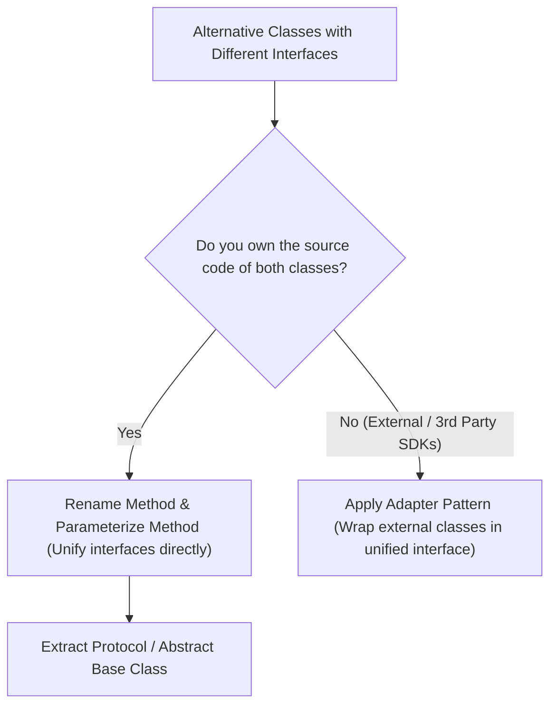

# Alternative Classes with Different Interfaces 🔄

## Source Reference
* **Book:** *Dive Into Refactoring* (Alexander Shvets), Chapter: *Code Smells / Object-Orientation Abusers / Alternative Classes with Different Interfaces*
* **Design Pattern Bridge:** [Adapter Pattern](../../../design-patterns/structural/adapter.md), [Facade Pattern](../../../design-patterns/structural/facade.md)
* **Target Language:** Modern Python 3 (Python 3.10+) with `pytest`.

---

## 1. Signs and Symptoms

Two or more classes perform identical or closely related functional tasks, but their method names, parameter orders, or return types are completely different.

### Detection Checklist:
- [ ] You have two notification clients: one calls `send_sms(to_number, text)`, while the other calls `dispatch_message(recipient, body, urgency=1)`.
- [ ] You cannot swap one implementation for another without writing custom conversion logic at every call site.
- [ ] Two different developers created duplicate utility classes without realizing a solution already existed in another package.
- [ ] Third-party SDKs perform the same operations (e.g., S3 storage vs Google Cloud Storage) under completely disjoint API signatures.

---

## 2. Reasons for the Problem

This smell almost always occurs because of **siloed development**:
1. A developer builds a class unaware that an equivalent class already exists elsewhere in the project.
2. An engineering team integrates two external third-party SDKs that solve the same problem with incompatible interfaces.

---

## 3. Why It's Bad

* **Zero Interchangeability:** Calling code cannot be written polymorphically against a single abstraction.
* **Cascading Conditional Logic:** Callers must introduce `if service_provider == "TWILIO": ... elif service_provider == "AWS_SNS": ...` everywhere notifications are dispatched.
* **Duplicated Testing Effort:** You must write separate, custom mocks and tests for each inconsistent interface.

---

## 4. Recommended Treatment



1. **Rename Method:** If you own both classes, rename their methods so they share the exact same names and parameter orders.
2. **Extract Protocol:** Define a formal Python `typing.Protocol` to enforce structural subtyping across both implementations.
3. **Adapter Pattern:** If one or both classes are third-party libraries you cannot modify, create dedicated Adapter wrappers.

---

## 5. Python Before & After Demonstration

### A. Smelly Code (Two Incompatible SMS Gateways)
```python
# notification_smelly.py
class TwilioGateway:

  def transmit_sms(self, phone: str, message: str) -> bool:
    # Twilio-specific method signature
    return len(phone) > 8 and len(message) > 0


class AwsSnsGateway:

  def publish_text_message(
      self, destination_number: str, text: str, sender_id: str = "DEFAULT"
  ) -> dict:
    # AWS-specific signature with different parameter name and return type
    return {
        "MessageId": "aws-12345",
        "Success": len(destination_number) > 8 and len(text) > 0,
    }


class AlertService:
  """Caller forced to write branching logic due to incompatible interfaces."""

  def __init__(self, provider: str) -> None:
    self.provider = provider
    self.twilio = TwilioGateway()
    self.aws = AwsSnsGateway()

  def alert(self, phone: str, text: str) -> bool:
    if self.provider == "TWILIO":
      return self.twilio.transmit_sms(phone, text)
    elif self.provider == "AWS":
      res = self.aws.publish_text_message(phone, text)
      return res.get("Success", False)
    raise ValueError(f"Unknown provider: {self.provider}")
```

### B. The Pytest Baseline Contract
```python
# test_notification.py
from notification_smelly import AlertService


def test_twilio_alert():
  service = AlertService(provider="TWILIO")
  assert service.alert("+1555019999", "System alert!") is True


def test_aws_alert():
  service = AlertService(provider="AWS")
  assert service.alert("+1555019999", "System alert!") is True
```

### C. Refactored Clean Code (Adapter Pattern + Unified Protocol)
```python
# notification_clean.py
from typing import Protocol


class SmsProvider(Protocol):
  """Unified protocol ensuring 100% polymorphic interchangeability."""

  def send(self, phone_number: str, message_text: str) -> bool:
    ...


class TwilioAdapter:
  """Adapts TwilioGateway to the SmsProvider protocol."""

  def __init__(self, gateway: "TwilioGateway") -> None:
    self._gateway = gateway

  def send(self, phone_number: str, message_text: str) -> bool:
    return self._gateway.transmit_sms(phone_number, message_text)


class AwsSnsAdapter:
  """Adapts AwsSnsGateway to the SmsProvider protocol."""

  def __init__(self, gateway: "AwsSnsGateway") -> None:
    self._gateway = gateway

  def send(self, phone_number: str, message_text: str) -> bool:
    res = self._gateway.publish_text_message(phone_number, message_text)
    return bool(res.get("Success", False))


class AlertService:
  """Clean service: completely decoupled from concrete vendor SDK implementations."""

  def __init__(self, provider: SmsProvider) -> None:
    self._provider = provider

  def alert(self, phone: str, text: str) -> bool:
    return self._provider.send(phone, text)
```

---

## 6. Payoff and Performance

| Dimension | Before Refactoring | After Refactoring |
| :--- | :--- | :--- |
| **Coupling** | `AlertService` is tightly coupled to every concrete vendor SDK | `AlertService` depends only on the clean `SmsProvider` Protocol |
| **Adding New Vendors** | Adds another `elif` branch to the core alerting logic | Wrap the new vendor in an Adapter; zero changes to existing services |
| **Testability** | Unit tests must mock out diverse proprietary vendor signatures | Tests can supply a simple in-memory `MockSmsProvider` |

---

## 7. When to Ignore

* **Classes with Incidental Similarity:** Two classes share a similar-sounding method (e.g., `Car.drive()` vs `HardDrive.drive()`), but represent completely different problem domains with no shared purpose.
