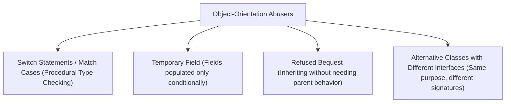

# Object-Orientation Abusers 🎭

## Source Reference
* **Book:** *Dive Into Refactoring* (Alexander Shvets), Chapter: *Code Smells / Object-Orientation Abusers*
* **Design Pattern Links:** [Strategy Pattern](../../../design-patterns/behavioral/strategy.md), [State Pattern](../../../design-patterns/behavioral/state.md), [Adapter Pattern](../../../design-patterns/structural/adapter.md), [Null Object](../../techniques/simplifying-conditionals/introduce-null-object.md)

---

## Overview

**Object-Orientation Abusers** occur when code fails to take full advantage of object-oriented capabilities (polymorphism, encapsulation, inheritance, interfaces/protocols) or applies them incorrectly. Instead of letting objects manage their own state and behavior polymorphically, code relies on procedural conditional dispatch, partial initialization, or inappropriate inheritance hierarchies.

---

## The 4 Code Smells in this Group

| Code Smell | Core Symptom | Primary Refactoring Technique | Pattern Solution |
| :--- | :--- | :--- | :--- |
| [**Switch Statements**](switch-statements.md) | Large `match` / `if-elif-else` branches switching on object types or codes | Replace Conditional with Polymorphism | [Strategy](../../../design-patterns/behavioral/strategy.md) / [State](../../../design-patterns/behavioral/state.md) |
| [**Temporary Field**](temporary-field.md) | Instance variables only used during specific method invocations, leaving them `None` the rest of the time | Extract Class, Introduce Null Object | [Null Object](../../techniques/simplifying-conditionals/introduce-null-object.md) |
| [**Refused Bequest**](refused-bequest.md) | A subclass overrides parent methods just to raise `NotImplementedError` or ignore them | Replace Inheritance with Delegation | [Decorator](../../../design-patterns/structural/decorator.md) / Composition |
| [**Alternative Classes with Different Interfaces**](alternative-classes.md) | Two classes do the exact same conceptual work but expose different method names and parameter signatures | Rename Method, Extract Protocol | [Adapter](../../../design-patterns/structural/adapter.md) |

---

## Architectural Impact

When OO principles are abused, the architecture degenerates into procedural code disguised as classes:
* **Fragile Open-Closed Principle:** Adding a new type requires hunting down every `if/elif` or `match/case` statement across the codebase.
* **Leaky Invariants:** When classes hold temporary fields, object validity depends on call order rather than initialization contracts.
* **Liskov Substitution Principle Violations:** Subclasses that reject inherited methods break polymorphic substitute guarantees, leading to runtime type errors.
