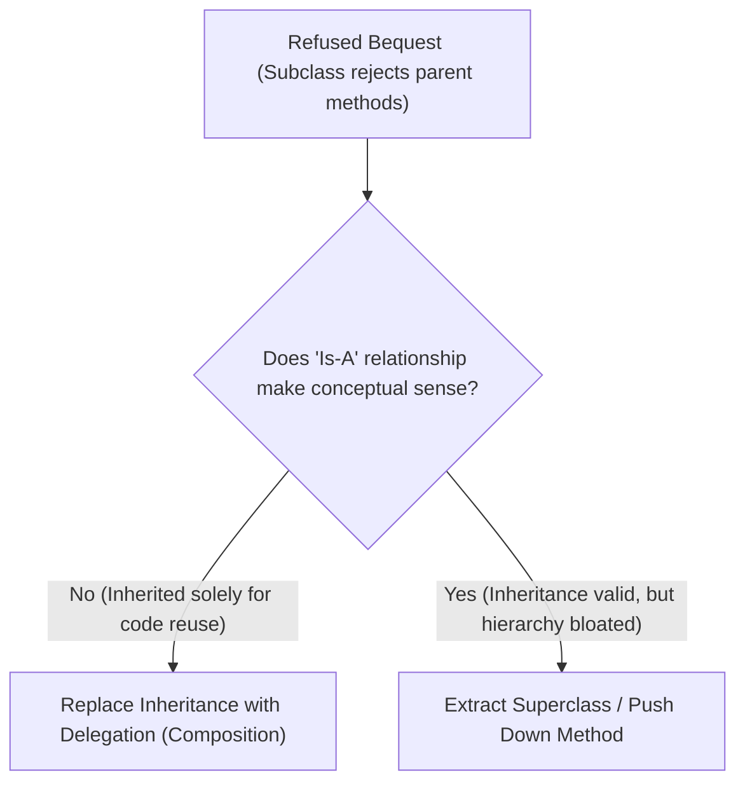

# Refused Bequest 🙅‍♂️

## Source Reference
* **Book:** *Dive Into Refactoring* (Alexander Shvets), Chapter: *Code Smells / Object-Orientation Abusers / Refused Bequest*
* **Design Pattern Bridge:** [Decorator Pattern](../../../design-patterns/structural/decorator.md), [Strategy Pattern](../../../design-patterns/behavioral/strategy.md)
* **Target Language:** Modern Python 3 (Python 3.10+) with `pytest`.

---

## 1. Signs and Symptoms

A subclass inherits methods and attributes from a parent class, but either **does not use them**, overrides them to do nothing (`pass`), or raises exceptions (e.g., `raise NotImplementedError("Not supported on this type")`).

### Detection Checklist:
- [ ] A subclass overrides a parent method solely to raise an error: `def fly(self): raise NotImplementedError("Penguins can't fly")`.
- [ ] A subclass overrides parent methods with empty `pass` statements to suppress unwanted side effects.
- [ ] Clients must inspect `isinstance(obj, SpecificSubclass)` before calling inherited methods to avoid runtime explosions.
- [ ] The relationship between the subclass and superclass fails the conceptual "Is-A" test.

---

## 2. Reasons for the Problem

Developers frequently abuse class inheritance as a quick shortcut for **code reuse** rather than modeling genuine subtyping relationships. A developer sees useful helper methods in an existing class `Stack` and decides to subclass `list` (or inherit from `Employee` for a `Contractor`), inheriting dozen of methods that break the semantics of the new entity.

---

## 3. Why It's Bad

* **Violation of Liskov Substitution Principle (LSP):** Any function written to accept the parent class cannot safely execute without crashing when passed the subclass.
* **Polluted Autocomplete & API:** Users of the subclass are presented with public methods that either do nothing or crash when invoked.
* **Hidden Coupling:** Changes to internal details of the superclass unpredictably break the subclass.

---

## 4. Recommended Treatment



1. **Replace Inheritance with Delegation:** Instead of subclassing, give the class a private reference to the collaborator object (`self._delegate`) and forward only the necessary method calls.
2. **Push Down Method / Extract Superclass:** If the inheritance hierarchy makes sense conceptually, create a higher abstract base containing only shared behavior, leaving specialized methods in subclasses that actually support them.

---

## 5. Python Before & After Demonstration

### A. Smelly Code (Inheritance for Code Reuse Violating LSP)
```python
# collection_smelly.py
class CustomStack(list):
  """Smelly: Inheriting from list just to reuse .append() and .pop().

  Clients can now invoke .insert(0, ...), .sort(), and .reverse(), violating
  LIFO invariants!
  """

  def push(self, item: object) -> None:
    self.append(item)

  def insert(self, index: int, item: object) -> None:
    raise NotImplementedError(
        "Cannot insert at arbitrary index in a LIFO stack!"
    )

  def sort(self, *args, **kwargs) -> None:
    raise NotImplementedError("Cannot sort a LIFO stack directly!")
```

### B. The Pytest Baseline Contract
```python
# test_collection.py
import pytest
from collection_smelly import CustomStack


def test_stack_operations():
  stack = CustomStack()
  stack.push("Alpha")
  stack.push("Beta")
  assert stack.pop() == "Beta"


def test_refused_bequest_raises_errors():
  stack = CustomStack()
  stack.push("Alpha")
  with pytest.raises(NotImplementedError):
    stack.insert(0, "Illegal")
```

### C. Refactored Clean Code (Composition & Delegation)
```python
# collection_clean.py
from typing import Generic, TypeVar

T = TypeVar("T")


class SafeStack(Generic[T]):
  """Clean implementation using Delegation instead of Inheritance.

  Only genuine Stack operations are exposed; list invariants cannot be violated.
  """

  def __init__(self) -> None:
    self._storage: list[T] = []

  def push(self, item: T) -> None:
    self._storage.append(item)

  def pop(self) -> T:
    if not self._storage:
      raise IndexError("pop from empty stack")
    return self._storage.pop()

  def peek(self) -> T:
    if not self._storage:
      raise IndexError("peek at empty stack")
    return self._storage[-1]

  @property
  def is_empty(self) -> bool:
    return len(self._storage) == 0

  def __len__(self) -> int:
    return len(self._storage)
```

---

## 6. Payoff and Performance

| Dimension | Before Refactoring | After Refactoring |
| :--- | :--- | :--- |
| **API Contract** | Exposes 40+ methods from `list`, half of which crash | Exposes only 5 cohesive, guaranteed stack operations |
| **LSP Compliance** | Fails LSP completely; passing `CustomStack` where `list` is expected causes crashes | Complies with standard composition semantics |
| **Refactoring Freedom** | Cannot change internal storage without breaking list inheritance | Can swap internal storage to `collections.deque` with zero external impact |

---

## 7. When to Ignore

* **Framework Adapters:** Some GUI or ORM frameworks (e.g., Django models, Qt widgets) force base classes with hundreds of default virtual methods where subclasses intentionally override only the subset they care about.
