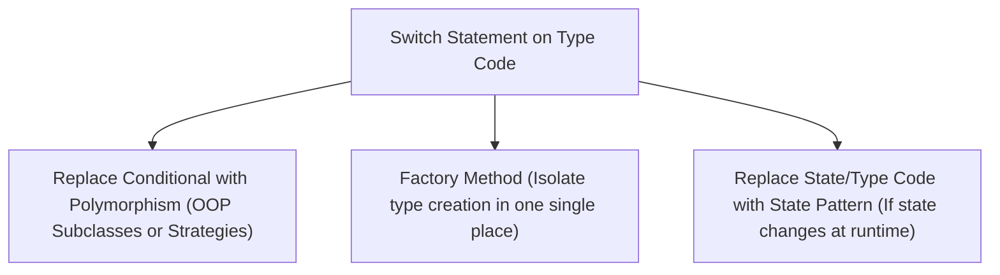

# Switch Statements 🔀

## Source Reference
* **Book:** *Dive Into Refactoring* (Alexander Shvets), Chapter: *Code Smells / Object-Orientation Abusers / Switch Statements*
* **Design Pattern Bridge:** [Strategy Pattern](../../../design-patterns/behavioral/strategy.md), [State Pattern](../../../design-patterns/behavioral/state.md), [Factory Method](../../../design-patterns/creational/factory-method.md)
* **Target Language:** Modern Python 3 (Python 3.10+) with `pytest`.

---

## 1. Signs and Symptoms

You have a complex `if-elif-else` chain or Python 3.10+ `match-case` statement that performs different actions depending on the value of a type code, string tag, or class attribute.

### Detection Checklist:
- [ ] The same condition or type check appears in multiple places across the codebase (e.g., in pricing, in taxes, in shipping, in rendering).
- [ ] Every time a new variant is introduced (e.g., adding a `PREMIUM_PLUS` customer tier), you must edit 5 or 6 different `match/case` blocks.
- [ ] The conditional block spans dozens of lines and mixes unrelated business rules.
- [ ] Linting flags high cyclomatic complexity on functions with dispatching logic.

---

## 2. Reasons for the Problem

Switch statements are the natural procedural habit of programmers before adopting object-oriented or polymorphic designs. When a new case is needed, it is trivially easy to add `elif status == "EXPRESS": ...` right inside the existing method. Over months and years, these statements proliferate in multiple methods.

---

## 3. Why It's Bad

* **Violation of Open-Closed Principle (OCP):** Modifying existing code to add new behavior increases regression risks for all existing cases.
* **Duplication Across the Codebase:** If you switch on `employee.type` in `calculate_pay()`, you will inevitably switch on `employee.type` in `calculate_bonus()`, `calculate_vacation()`, and `generate_badge()`.
* **Merge Conflicts:** Multiple developers adding support for different features in the same central switch statement constantly create git merge conflicts.

---

## 4. Recommended Treatment



1. **Replace Conditional with Polymorphism:** Extract each branch into a separate class conforming to a shared `Protocol` or abstract base class.
2. **Strategy Pattern:** If the behavior varies independently of the object identity, inject a strategy callable or class.
3. **Factory Method:** If a switch statement is unavoidable, restrict it strictly to the factory responsible for instantiating the correct subclass.

---

## 5. Python Before & After Demonstration

### A. Smelly Code (Procedural `match-case` Dispatch)
```python
# payment_processor_smelly.py
class PaymentProcessor:

  def process(self, payment_type: str, amount: float, details: dict) -> dict:
    match payment_type:
      case "CREDIT_CARD":
        fee = amount * 0.029 + 0.30
        card_num = details.get("card_number", "")
        masked = f"****{card_num[-4:]}"
        return {
            "status": "APPROVED",
            "fee": round(fee, 2),
            "reference": f"CC-{masked}",
        }
      case "PAYPAL":
        fee = amount * 0.034
        email = details.get("paypal_email", "")
        return {
            "status": "APPROVED",
            "fee": round(fee, 2),
            "reference": f"PP-{email}",
        }
      case "CRYPTO":
        fee = 5.00  # Flat network fee
        wallet = details.get("wallet_address", "")
        return {
            "status": "APPROVED",
            "fee": fee,
            "reference": f"ETH-{wallet[:6]}",
        }
      case _:
        raise ValueError(f"Unsupported payment type: {payment_type}")
```

### B. The Pytest Baseline Contract
```python
# test_payment_processor.py
import pytest
from payment_processor_smelly import PaymentProcessor


def test_credit_card_payment():
  proc = PaymentProcessor()
  res = proc.process(
      "CREDIT_CARD", 100.0, {"card_number": "4111111111111234"}
  )
  assert res["status"] == "APPROVED"
  assert res["fee"] == 3.20  # 100 * 0.029 + 0.30
  assert res["reference"] == "CC-1234"


def test_unsupported_payment():
  proc = PaymentProcessor()
  with pytest.raises(ValueError, match="Unsupported payment type"):
    proc.process("APPLE_PAY", 50.0, {})
```

### C. Refactored Clean Code (Polymorphic Strategies + Registry)
```python
# payment_processor_clean.py
from typing import Protocol, Type


class PaymentStrategy(Protocol):
  """Polymorphic protocol defining payment calculation and execution."""

  def process(self, amount: float, details: dict) -> dict:
    ...


class CreditCardPayment:

  def process(self, amount: float, details: dict) -> dict:
    fee = round(amount * 0.029 + 0.30, 2)
    card_num = details.get("card_number", "")
    return {
        "status": "APPROVED",
        "fee": fee,
        "reference": f"CC-****{card_num[-4:]}",
    }


class PayPalPayment:

  def process(self, amount: float, details: dict) -> dict:
    fee = round(amount * 0.034, 2)
    email = details.get("paypal_email", "")
    return {"status": "APPROVED", "fee": fee, "reference": f"PP-{email}"}


class CryptoPayment:

  def process(self, amount: float, details: dict) -> dict:
    wallet = details.get("wallet_address", "")
    return {
        "status": "APPROVED",
        "fee": 5.00,
        "reference": f"ETH-{wallet[:6]}",
    }


class PaymentProcessor:
  """Clean processor relying entirely on polymorphic dispatch and dynamic registration."""

  def __init__(self) -> None:
    self._strategies: dict[str, Type[PaymentStrategy]] = {
        "CREDIT_CARD": CreditCardPayment,
        "PAYPAL": PayPalPayment,
        "CRYPTO": CryptoPayment,
    }

  def register_strategy(
      self, payment_type: str, strategy: Type[PaymentStrategy]
  ) -> None:
    """Allows runtime extension (Open-Closed Principle) without editing this class."""
    self._strategies[payment_type] = strategy

  def process(self, payment_type: str, amount: float, details: dict) -> dict:
    strategy_cls = self._strategies.get(payment_type)
    if not strategy_cls:
      raise ValueError(f"Unsupported payment type: {payment_type}")
    return strategy_cls().process(amount, details)
```

---

## 6. Payoff and Performance

| Dimension | Before Refactoring | After Refactoring |
| :--- | :--- | :--- |
| **Adding a New Payment Type** | Modifies existing conditional code; risk of regression | Register a new class; zero changes to existing code |
| **Cyclomatic Complexity** | $O(N)$ branch complexity in a single function | $O(1)$ complexity via dictionary/polymorphic lookup |
| **Testability** | Must test all branches through one monolithic runner | Each strategy is tested in total isolation |

---

## 7. When to Ignore

* **Simple Guard Clauses:** A simple `if user is None: return` or single 2-way toggle (`if is_active: ... else: ...`) does not justify creating classes.
* **Pure Factories:** Creating the correct object requires looking up a type string or enum at least once. Restricting the switch strictly to a dedicated Factory class is an accepted clean design.
