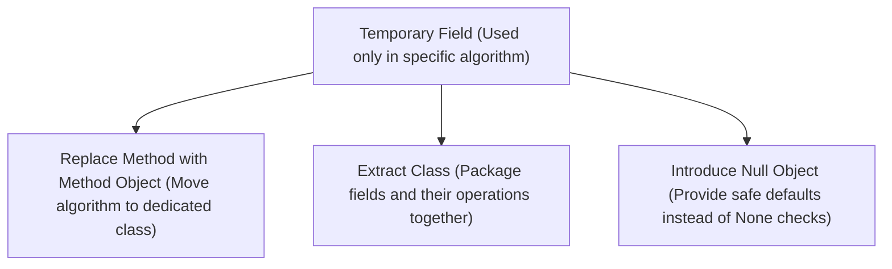

# Temporary Field ⏱️

## Source Reference
* **Book:** *Dive Into Refactoring* (Alexander Shvets), Chapter: *Code Smells / Object-Orientation Abusers / Temporary Field*
* **Design Pattern Bridge:** [Null Object Pattern](../../techniques/simplifying-conditionals/introduce-null-object.md), [State Pattern](../../../design-patterns/behavioral/state.md)
* **Target Language:** Modern Python 3 (Python 3.10+) with `pytest`.

---

## 1. Signs and Symptoms

An object contains instance variables (`self.foo`) that are only populated and used under specific circumstances or during a specific complex calculation. Outside of those moments, the fields remain `None` or hold meaningless default values.

### Detection Checklist:
- [ ] Multiple instance attributes in `__init__` are initialized to `None` (`self.cached_score = None`, `self.temp_matrix = None`).
- [ ] Methods begin with defensive checks asserting that a previous method was called first: `if self._temp_context is None: raise RuntimeError("Call prepare() first!")`.
- [ ] Attributes are used only inside one or two private helper methods and never touched by the rest of the class.
- [ ] An algorithm uses instance attributes like global scratchpad variables to avoid passing them as function arguments.

---

## 2. Reasons for the Problem

Temporary fields frequently arise when a developer refactors a very large method and wants to break it into smaller helper methods. Rather than passing 5 intermediate values between the helpers, the developer creates instance variables (`self.subtotal`, `self.tax_bracket`) on the main class. The object's state becomes polluted by scratchpad variables of a single transient calculation.

---

## 3. Why It's Bad

* **Violated Invariants:** An object should always be in a valid, cohesive state once instantiated. Having fields that are valid only 5% of the time makes reasoning about state treacherous.
* **Concurrency & Reentrancy Hazards:** If two threads or recursive calls invoke the calculation simultaneously, they will overwrite each other's temporary instance fields.
* **Memory Bloat:** The object retains memory references to transient data long after the calculation finishes.

---

## 4. Recommended Treatment



1. **Replace Method with Method Object:** Move the entire calculation into its own dedicated class. The temporary fields become the standard instance attributes of this single-purpose calculator object.
2. **Extract Class:** If the temporary fields are populated when an optional feature is enabled, extract them into a separate configuration or metadata object.
3. **Introduce Null Object:** If the field is `None` to represent an absent collaborator, supply a Null Object that implements the same interface harmlessly.

---

## 5. Python Before & After Demonstration

### A. Smelly Code (Instance Attributes as Scratchpad Variables)
```python
# tax_calculator_smelly.py
class TaxFilingService:

  def __init__(self, taxpayer_name: str, annual_income: float) -> None:
    self.taxpayer_name = taxpayer_name
    self.annual_income = annual_income
    # Temporary fields used ONLY during compute_tax()!
    self.effective_bracket: float | None = None
    self.deductions_applied: float | None = None
    self.audit_flag: bool | None = None

  def compute_tax(self, deductions: list[float]) -> float:
    # State mutation creates a temporal coupling trap:
    self.deductions_applied = sum(deductions)
    taxable = max(0.0, self.annual_income - self.deductions_applied)

    if taxable > 100_000:
      self.effective_bracket = 0.30
      self.audit_flag = True
    else:
      self.effective_bracket = 0.15
      self.audit_flag = False

    return taxable * self.effective_bracket

  def get_audit_status(self) -> bool:
    if self.audit_flag is None:
      raise RuntimeError(
          "Must invoke compute_tax() before checking audit status!"
      )
    return self.audit_flag
```

### B. The Pytest Baseline Contract
```python
# test_tax_calculator.py
import pytest
from tax_calculator_smelly import TaxFilingService


def test_tax_computation_lifecycle():
  service = TaxFilingService("Bob", 120_000)

  # Invariant check: cannot query before computing
  with pytest.raises(RuntimeError):
    service.get_audit_status()

  tax = service.compute_tax([10_000, 5_000])  # Taxable: 105,000 -> 30%
  assert tax == 31_500.0
  assert service.get_audit_status() is True
```

### C. Refactored Clean Code (Method Object Pattern)
```python
# tax_calculator_clean.py
from dataclasses import dataclass


@dataclass(frozen=True)
class TaxAssessmentResult:
  """Immutable result containing calculation details without polluting the service."""

  tax_due: float
  effective_bracket: float
  deductions_applied: float
  requires_audit: bool


class TaxCalculationOperation:
  """Method Object: encapsulates transient calculation state safely."""

  def __init__(
      self, annual_income: float, deductions: list[float]
  ) -> None:
    self.annual_income = annual_income
    self.deductions = deductions

  def execute(self) -> TaxAssessmentResult:
    deductions_total = sum(self.deductions)
    taxable = max(0.0, self.annual_income - deductions_total)

    if taxable > 100_000:
      bracket = 0.30
      audit = True
    else:
      bracket = 0.15
      audit = False

    tax_due = taxable * bracket
    return TaxAssessmentResult(
        tax_due=tax_due,
        effective_bracket=bracket,
        deductions_applied=deductions_total,
        requires_audit=audit,
    )


class TaxFilingService:
  """Clean entity: strictly maintains domain identity without transient scratchpad fields."""

  def __init__(self, taxpayer_name: str, annual_income: float) -> None:
    self.taxpayer_name = taxpayer_name
    self.annual_income = annual_income

  def assess_taxes(
      self, deductions: list[float]
  ) -> TaxAssessmentResult:
    operation = TaxCalculationOperation(self.annual_income, deductions)
    return operation.execute()
```

---

## 6. Payoff and Performance

| Dimension | Before Refactoring | After Refactoring |
| :--- | :--- | :--- |
| **Object Lifecycle** | Partially valid; calling methods out of order causes crashes | Always valid; calculation returns an atomic, immutable result |
| **Thread Safety** | Non-reentrant; concurrent calculations corrupt each other's fields | 100% thread-safe and reentrant |
| **Cognitive Load** | High; reading `__init__` does not explain which fields are permanent | Clear separation of permanent domain entity vs transient calculation |

---

## 7. When to Ignore

* **Strictly Cached Properties:** A property cached via `@functools.cached_property` starts uncomputed, but once evaluated, it remains permanent and immutable for the lifetime of the object.
