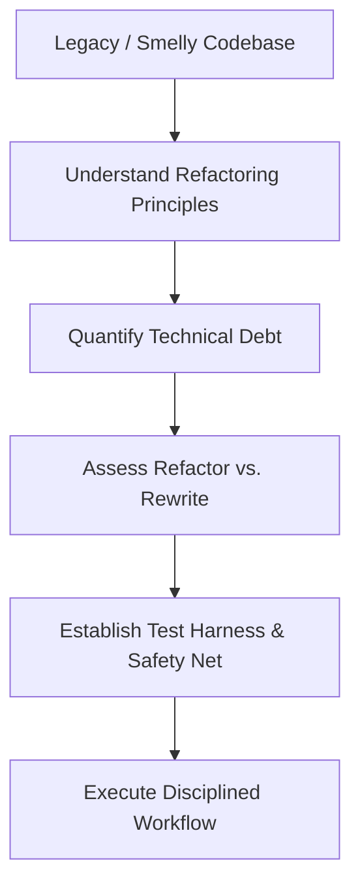

# Foundations of Refactoring 🏛️

> *"Before you begin refactoring, you must understand the rules of the road. Refactoring is not code cleanup done on a whim; it is an engineering discipline governed by rigorous principles and automated verification."*

Welcome to the **Foundations Hub**. This section lays down the theoretical, economic, and practical rules required to navigate legacy codebases safely and profitably.

---

## 🧭 Core Architectural Foundations

### 1. [What is Refactoring?](what-is-refactoring.md)
* The formal definition: *altering internal structure without changing external behavior*.
* The **Two Hats** metaphor: separating feature development from architectural restructuring.
* Why automated tests form the absolute prerequisite for refactoring.

### 2. [Principles of Refactoring](principles-of-refactoring.md)
* Characteristics of Clean Code: readability, testability, and maintainability.
* Core guiding heuristics: **DRY** (Don't Repeat Yourself), **YAGNI** (You Aren't Gonna Need It), and the **Boy Scout Rule** (*leave the code cleaner than you found it*).
* Cognitive load theory vs. micro-performance concerns in Python.

### 3. [Refactoring vs. Rewriting](refactoring-vs-rewriting.md)
* The myth of the "Clean Greenfield Rewrite".
* The **Second-System Effect** and why complete rewrites frequently end in project cancellation.
* The **Strangler Fig Pattern**: incrementally strangling legacy systems with zero downtime.

### 4. [Technical Debt](technical-debt.md)
* Martin Fowler's **Technical Debt Quadrant**: Deliberate vs. Inadvertent, Prudent vs. Reckless.
* How code rot compounds interest over time and collapses development velocity.
* Sustainable strategies for debt repayment during active feature delivery.

### 5. [Safe Refactoring & Testing Preconditions](safe-refactoring-and-testing.md)
* The non-negotiable safety net: pre-conditions required before editing production code.
* The role of **Characterization Tests** and Approval Testing in pinning down legacy behavior.
* Atomic version control: committing micro-steps and instant rollback mechanics (`git checkout .`).

### 6. [The Refactoring Workflow](refactoring-workflow.md)
* The **Red-Green-Refactor** development loop.
* The micro-step rhythm: 2-to-5 minute refactoring cycles.
* Developer ergonomics: IDE refactoring tools, static analyzers (`mypy`, `ruff`), and automated test runners.

### 7. [When NOT to Refactor](when-not-to-refactor.md)
* The **Rule of Three**: why premature abstraction is worse than slight duplication.
* Imminent production deadlines and release freezes.
* Disposable prototypes and throwaway exploratory scripts.
* Deprecated legacy components scheduled for decommissioning.
