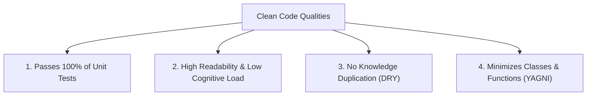
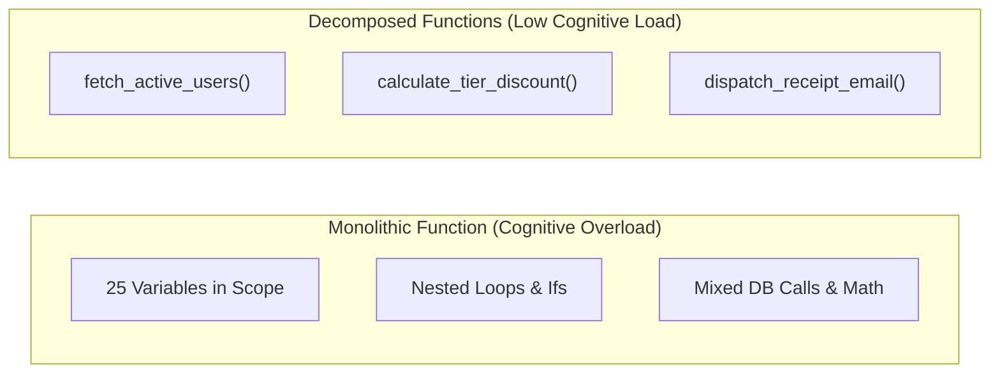
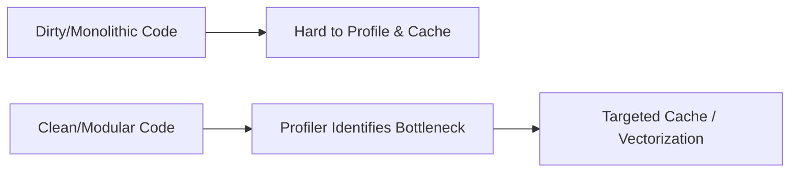

# Principles of Refactoring 📐

## Source Reference
* **Authors:** Martin Fowler (*Refactoring*), Alexander Shvets (*Dive Into Refactoring*), Kent Beck (*Extreme Programming Explained*)
* **Core Philosophy:** Software design is not a one-time architectural phase; it is an ongoing, continuous discipline.

---

## 1. What Makes Code "Clean"?

Alexander Shvets defines clean code as code that is **readable, maintainable, and free of architectural surprises**.

### Hallmarks of Clean Code:
1. **Clear to Other Engineers:** A new teammate can read a module and immediately understand what it does without opening documentation or asking the original author.
2. **Contains No Surprises:** Methods do what their names say they do, without unexpected side effects, silent mutations of global state, or unhandled exceptions.
3. **Economical:** Contains zero dead code, zero speculative abstractions, and zero boilerplate.

---

## 2. Core Heuristics and Guidelines

### A. The DRY Principle (Don't Repeat Yourself)
> *"Every piece of knowledge must have a single, unambiguous, authoritative representation within a system."* — Andy Hunt & Dave Thomas

Duplication is the root cause of maintenance nightmares. When business requirements shift, an engineer updates the logic in one location but forgets the other three occurrences, creating silent production bugs.

### B. The YAGNI Principle (You Aren't Gonna Need It)
Do not build abstractions, interfaces, or generic frameworks based on speculative future requirements. Implement only what is required to satisfy current tests today. Refactor to introduce abstractions only when actual requirements demand them.

### C. The Boy Scout Rule
> *"Leave the campground cleaner than you found it."* — Robert C. Martin

Never attempt a monolithic, multi-month "refactoring project." Instead, whenever you open a Python file to implement a feature or fix a bug, make one small improvement:
* Rename an ambiguous variable.
* Break a 40-line function into two cohesive functions.
* Add type hints to a confusing function signature.

Over time, this continuous micro-hygiene cures code rot across the entire repository.

---

## 3. Cognitive Load and "Chunking"

Human working memory can hold approximately **$4 \pm 1$ items** simultaneously (Cowan’s cognitive load model).

When a method is 100 lines long with 15 local variables, an engineer reading the code must hold all 15 variables in their head to verify correctness. By extracting smaller helper functions, you replace 15 low-level variables with a single meaningful function name, drastically reducing cognitive strain.

---

## 4. The Performance Myth: Does Refactoring Hurt Speed?

A frequent objection to refactoring is: *"Won't splitting this function into five small functions slow down execution?"*

### The Reality of Modern Execution:
1. **The 90/10 Rule:** In virtually every software system, **90% of execution time is spent inside 10% of the code** (typically tight loops, database I/O, network latency, and disk operations).
2. **Premature Optimization is Destructive:** Attempting to write "fast" code upfront results in unreadable, tightly coupled spaghetti that is almost impossible to optimize later.
3. **Clean Code is Easier to Optimize:** When a profiler reveals a true bottleneck, clean modular code allows you to isolate and optimize the slow 10% without risking regressions in the other 90%.

