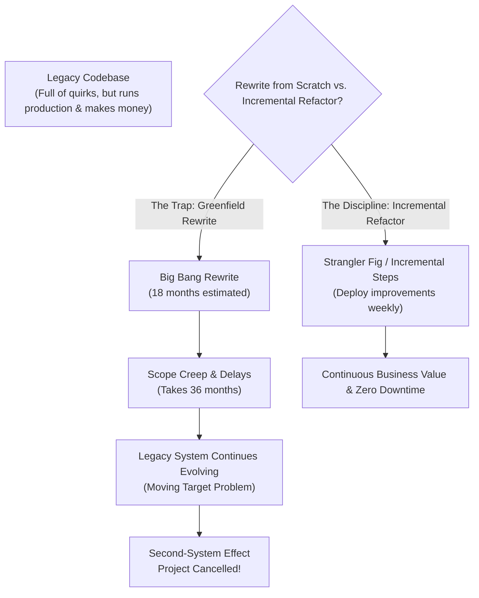
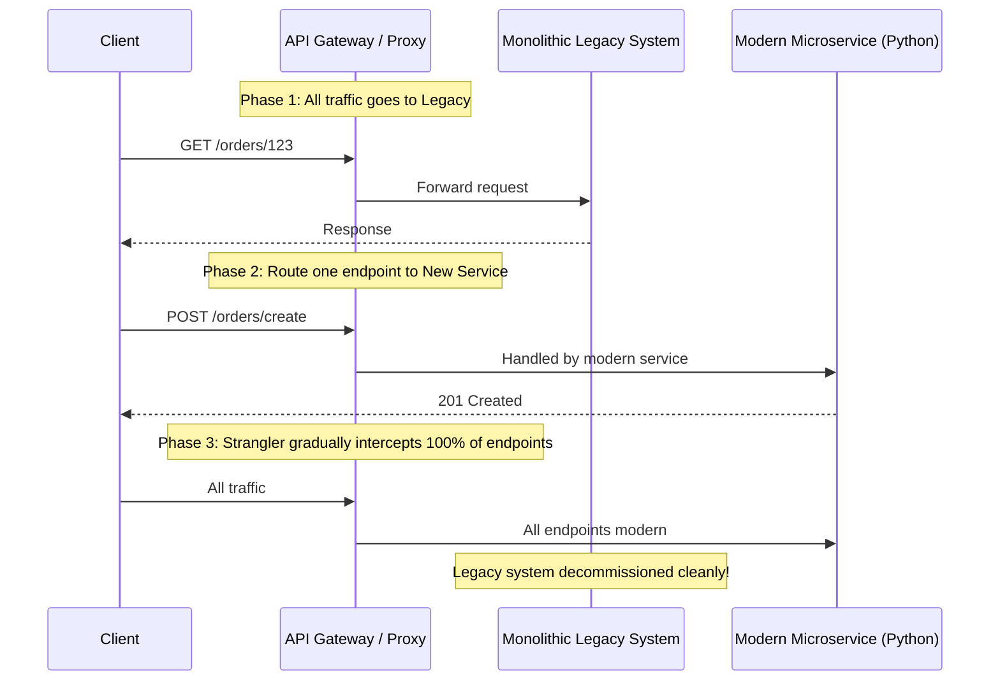

# Refactoring vs. Rewriting ⚖️

## Source Reference
* **Author:** Joel Spolsky (*Things You Should Never Do, Part I*), Martin Fowler (*Refactoring*)
* **Core Philosophy:** Incremental, behavior-preserving refactoring is almost always safer and more cost-effective than starting from scratch.

---

## 1. The Siren Song of the Greenfield Rewrite

When engineers inherit a complicated legacy codebase, the universal reaction is: *"This code is a disaster. It is impossible to maintain. We should throw it away and rewrite it from scratch using modern technology."*

---

## 2. Why Greenfield Rewrites Usually Fail

### A. The "Old Code is Ugly Because of Hard-Won Bug Fixes" Rule
Legacy code looks messy not because earlier developers were incompetent, but because it contains hundreds of obscure edge-case fixes discovered in production over years:
* Handling malformed third-party API payloads.
* Workarounds for quirky browser cookies.
* Compensating transactions for dropped network packets.

When a team rewrites a system from scratch, they inevitably discard those hard-won lessons, re-introducing dozens of old bugs back into production.

### B. The Moving Target Dilemma
While the "rewrite team" spends 18 months building the new platform, the business cannot freeze product development. Competitors launch features, customers demand patches, and the original legacy system continues to evolve. The rewrite team is constantly chasing a moving target they can never catch.

---

## 3. Comparison Matrix

| Factor | Incremental Refactoring | Greenfield Rewrite |
| :--- | :--- | :--- |
| **Business Risk** | **Very Low:** Changes are deployed in small, continuous micro-releases. | **Catastrophic:** Big-bang cutover risks immediate system collapse. |
| **Time to First Value** | **Immediate:** Code improves on day 1 of the current sprint. | **Delayed:** Months or years before users see any benefit. |
| **Preservation of Domain Knowledge**| **High:** Edge cases and legacy bug fixes are preserved. | **Low:** Historical domain knowledge is inadvertently lost. |
| **Cost** | Budgeted as a normal 15-20% engineering hygiene tax. | Massive upfront capital expenditure with uncertain ROI. |
| **Rollback Capability** | Trivial: `git revert` on a single pull request. | Extremely difficult: Data migrations are irreversible. |

---

## 4. The Strangler Fig Pattern: The Alternative to a Rewrite

When a legacy system is truly too brittle to refactor in-place, Martin Fowler recommends the **Strangler Fig Pattern**:

---

## 5. When a Complete Rewrite IS Justified

A greenfield rewrite is rational only under strict, exceptional circumstances:
1. **The underlying runtime/technology is obsolete** (e.g., COBOL, Flash, or unsupported Python 2.6 where modern libraries cannot run).
2. **The code was a throwaway spike or proof-of-concept** explicitly built to be discarded.
3. **The domain model has fundamentally changed** (e.g., transitioning from an on-premise single-tenant desktop app to a multi-tenant cloud SaaS).
