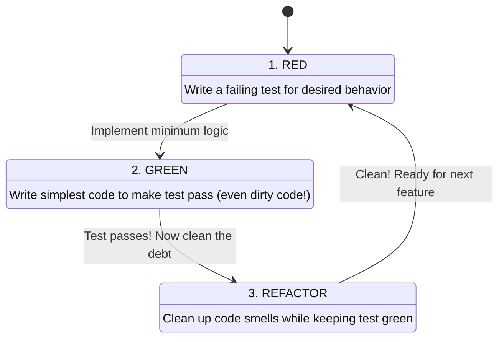
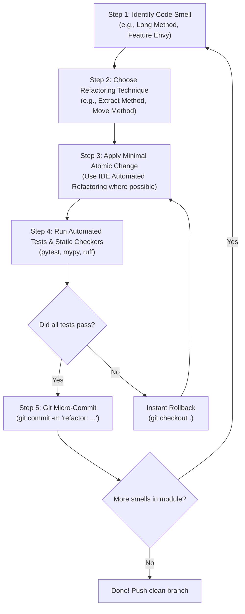

# The Refactoring Workflow 🔄

## Source Reference
* **Authors:** Martin Fowler (*Refactoring*), Kent Beck (*Test-Driven Development by Example*)
* **Core Philosophy:** Small, continuous atomic micro-steps beat massive, disruptive rewrites.

---

## 1. The Red-Green-Refactor Loop

In modern software development, refactoring is not a distinct project milestone scheduled once a year; it is the **third step in the fundamental TDD cycle**:

### The Three Phases:
1. **Red:** Write a unit test representing a new requirement. Run the test suite and verify that it fails for the expected reason.
2. **Green:** Write just enough code to make the test pass as quickly as possible. Don't worry about design elegance yet; your goal is purely to achieve working behavior.
3. **Refactor:** Now that the test suite is green and protecting you, inspect the code for smells (duplication, poor naming, long methods). Clean the code incrementally, running tests after every single change.

---

## 2. Step-by-Step Developer Ergonomics

When tackling an existing module that has accumulated significant code smells, follow this 5-step operational protocol:

---

## 3. Developer Tooling Stack for Python Refactoring

Modern refactoring speed depends heavily on proper tooling ergonomics:

### A. Automated IDE Refactorings (VS Code / PyCharm)
* **Rename Symbol (`F2` / `Shift+F6`):** Renames a variable, function, or class across all modules, updating imports automatically without relying on dangerous text find-and-replace.
* **Extract Method / Variable:** Automatically inspects selected statements, creates a new function, identifies inputs, and handles `return` values.

### B. Static Type Checking (`mypy`)
Running `mypy` catches subtle type mismatches during signature refactorings (e.g. changing an argument from `str` to a domain `UUID` object) before executing tests.

### C. Fast Linting & Formatting (`ruff`)
* Instantly formats code to Black style.
* Detects unused imports, dead variables, and legacy Python 2 idioms in milliseconds.

### D. Automated Test Watchers (`pytest-watch`)
Runs unit tests automatically in the background every time a file is saved, providing instantaneous red/green feedback within 1 second.
