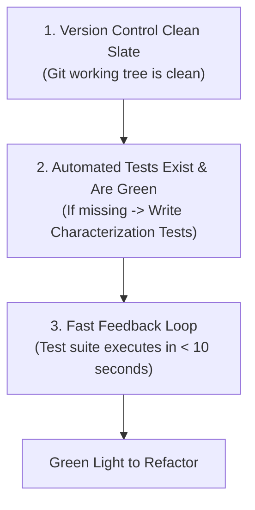
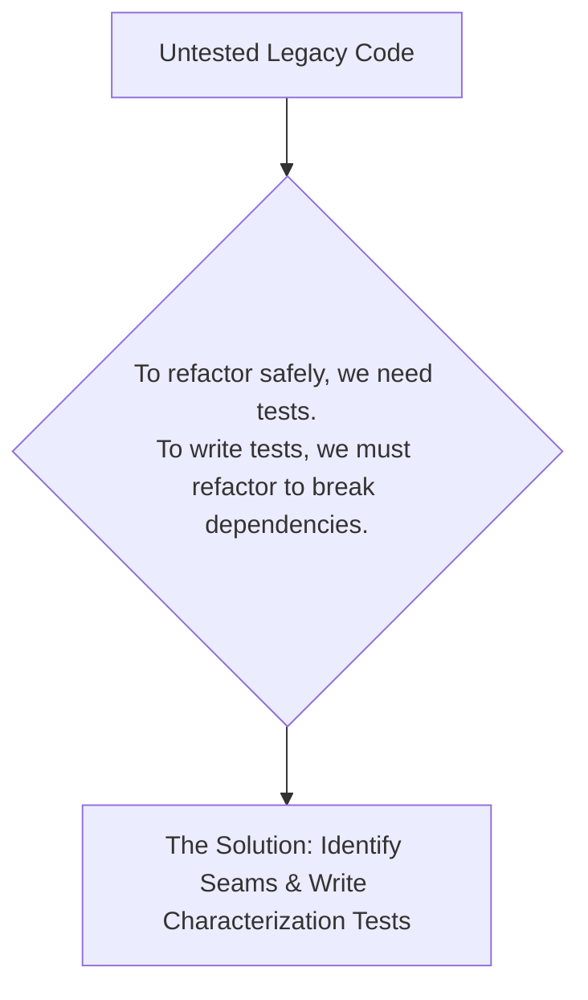
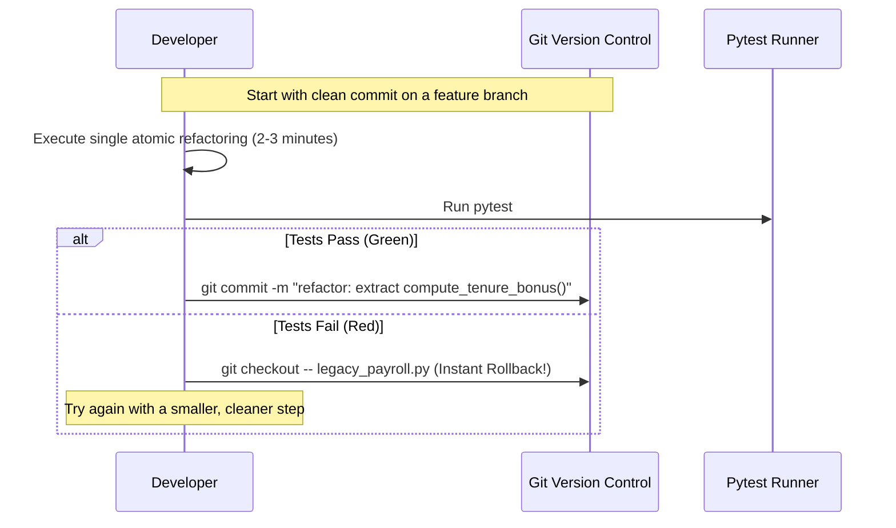

# Safe Refactoring and Testing Preconditions 🛡️

## Source Reference
* **Author:** Michael Feathers (*Working Effectively with Legacy Code*), Martin Fowler (*Refactoring*)
* **Core Philosophy:** Refactoring without automated tests is merely changing code with hope.

---

## 1. The Preconditions for Safe Refactoring

Before modifying a single line of production code in a legacy module, three preconditions must be verified:



---

## 2. Dealing with Untested Legacy Code: The Dilemma

Michael Feathers defines legacy code simply as: **code without automated tests**.



### What is a "Seam"?
A **Seam** is a place where you can alter program behavior without editing source code directly (e.g., passing a mock dependency into a constructor, monkeypatching an environment variable, or injecting an interface).

---

## 3. Characterization Testing: Pinning Down Behavior

When writing tests for code you did not write, **do not write tests for what you *think* the code should do**. Instead, write tests that document what the code **actually does right now**, warts and quirks included.

### Python Example: Characterizing Legacy Payroll

Suppose you inherit an untested legacy payroll calculation with obscure conditional rules:

```python
# legacy_payroll.py (Smelly & Untested)
def compute_bonus(salary: float, years: int, rating: str) -> float:
  # Legacy logic with hidden side effects
  base = salary * 0.05
  if years > 5:
    base += 500
  if rating == "A":
    base *= 1.5
  elif rating == "B":
    base *= 1.2
  return round(base, 2)
```

### Writing the Characterization Test Suite (`pytest`):
We write tests for known sample inputs to lock down the exact mathematical outputs before touching the code:

```python
# test_legacy_payroll_characterization.py
from legacy_payroll import compute_bonus
import pytest


@pytest.mark.parametrize(
    "salary, years, rating, expected_bonus",
    [
        (50000.0, 2, "C", 2500.0),  # Standard baseline
        (50000.0, 6, "C", 3000.0),  # Senior bonus (+500)
        (60000.0, 2, "A", 4500.0),  # Rating A (3000 * 1.5)
        (60000.0, 7, "A", 5250.0),  # Rating A + Senior ((3000+500)*1.5)
        (80000.0, 10, "B", 5400.0),  # Rating B + Senior ((4000+500)*1.2)
    ],
)
def test_characterize_bonus_calculations(salary, years, rating, expected_bonus):
  # This pins down the legacy contract!
  assert compute_bonus(salary, years, rating) == expected_bonus
```

Now that the characterization test passes 100%, you have an unbreakable safety net. You can refactor `legacy_payroll.py` as aggressively as you want; any deviation in calculations will trigger an immediate red test.

---

## 4. Version Control Mechanics: Micro-Commits and Rollbacks

Refactoring requires a disciplined Git rhythm:



### The Rule of Atomic Micro-Commits:
* Every commit message should name the exact refactoring technique applied:
  * `refactor: extract function _calculate_vat()`
  * `refactor: rename variable usr -> active_customer`
  * `refactor: introduce parameter object ShippingAddress`
* If a step takes more than 10 minutes or introduces 5 broken tests, **do not attempt to debug the mess**. Discard the changes with `git reset --hard` and break the transformation down into two smaller steps.
