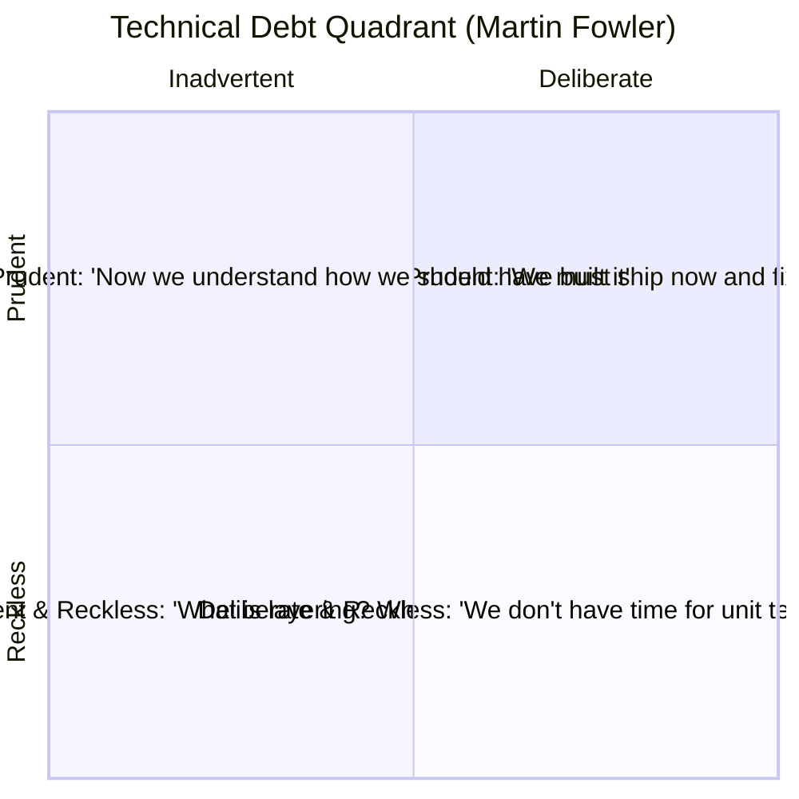
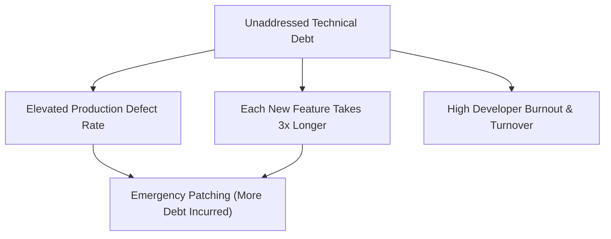

# Technical Debt 💸

> *"Shipping first-time code is like going into debt. A little debt speeds development so long as it is paid back promptly with a rewrite... The danger occurs when the debt is not repaid."* — Ward Cunningham

**Technical Debt** represents the implied cost of additional future rework caused by choosing an easy, expedience-driven solution now instead of using a better approach that would take longer.

---

## 1. The Technical Debt Quadrant

Martin Fowler categorized technical debt along two axes: **Intent** (Deliberate vs. Inadvertent) and **Execution** (Prudent vs. Reckless):

### Explaining the Four Quadrants

1. **Deliberate & Prudent (Strategic Debt):**
   * *Scenario:* A startup must launch an MVP before a conference to secure funding. The team consciously decides to skip caching and complex abstractions.
   * *Mitigation:* The debt is tracked in the issue tracker and repaid once the funding milestone is achieved.
2. **Inadvertent & Prudent (Learning Debt):**
   * *Scenario:* Skilled engineers design a service. After 6 months of production usage, the domain is much clearer, revealing architectural flaws that could not have been anticipated upfront.
3. **Deliberate & Reckless (Sloppiness):**
   * *Scenario:* Developers rush features, deliberately skipping tests, documentation, and separation of concerns because "management wants velocity."
   * *Consequence:* Development velocity grinds to a halt within months.
4. **Inadvertent & Reckless (Incompetence):**
   * *Scenario:* Junior developers or untrained teams build software without knowing design patterns, SOLID principles, or modular decomposition.

---

## 2. The Interest Rate of Code Rot

Like financial debt, technical debt incurs **interest payments**:

$$\text{Total Cost of Feature} = \text{Development Time} + \text{Interest on Existing Debt}$$

### Symptoms That Interest Is Overwhelming Velocity:
* Modifying one module triggers unexpected regressions in seemingly unrelated components (**Shotgun Surgery**).
* Developers fear modifying core classes because "no one knows how it works."
* Onboarding a new engineer takes months because code lacks self-documenting structure.

---

## 3. How to Pay Off Technical Debt

1. **Continuous Incremental Refactoring (Boy Scout Rule):** Never schedule a 6-month "refactoring pause" (business stakeholders will reject it). Instead, refactor the files you touch while implementing regular features.
2. **Allocate 20% Capacity per Sprint:** Dedicate one in five story points specifically to resolving code smells and updating test coverage.
3. **Isolate Legacy Modules Behind Facades:** Wrap smelly third-party or legacy components with a clean Python **Facade** or **Adapter**, preventing rot from infecting new business logic.
