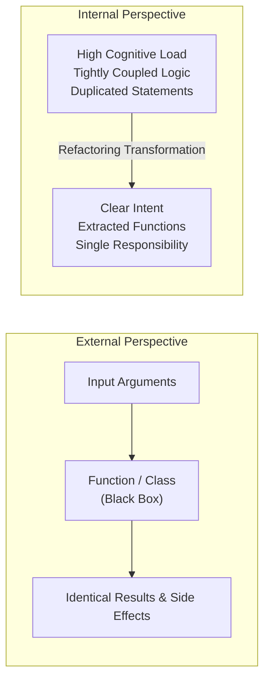
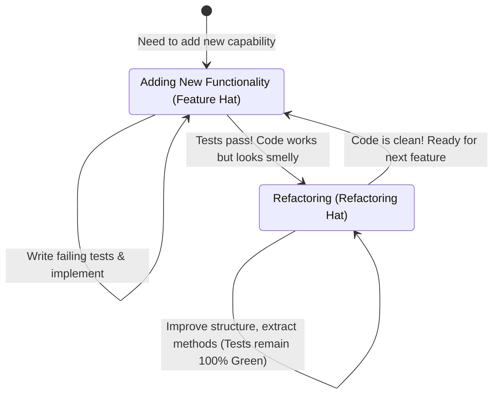

# What is Refactoring? 📖

## Source Reference
* **Book:** *Dive Into Refactoring* (Alexander Shvets) & *Refactoring: Improving the Design of Existing Code* (Martin Fowler)
* **Core Philosophy:** Improving internal structure while strictly preserving external observable behavior.
* **Target Language:** Modern Python 3 (Python 3.10+) with `pytest`.

---

## 1. The Core Definition

> *"Refactoring is a disciplined technique for restructuring an existing body of code, altering its internal structure without changing its external behavior."* — Martin Fowler

Refactoring is **not** bug fixing. It is **not** feature addition. It is **not** performance tuning.



If an external caller, HTTP client, or automated test can observe a change in output, exception type, or state side-effect, **you have not refactored—you have rewritten or altered functionality.**

---

## 2. The Two Hats Metaphor

Kent Beck formulated the metaphor of **The Two Hats**. When engineering software, you must wear only one hat at any given moment:



### The Rules of the Two Hats:
1. **Wearing the Feature Hat:** You write new tests and add new production capabilities. You do not worry about perfect architecture until the feature is functional and tests pass.
2. **Wearing the Refactoring Hat:** You do not add any new features or change API contracts. You only restructure internal logic while ensuring all existing tests remain continuously green.

---

## 3. Concrete Python Demonstration

### A. The "Smelly" Code (Before)
Consider a function that calculates an e-commerce order total with shipping and tax:

```python
# order_calculator_smelly.py
def calculate_total(order: dict) -> float:
  # Smelly: Monolithic, magic numbers, mixed levels of abstraction
  subtotal = 0.0
  for item in order.get("items", []):
    subtotal += item["price"] * item["quantity"]

  # Calculate discount
  if order.get("coupon") == "SUMMER20":
    subtotal *= 0.8
  elif order.get("coupon") == "WELCOME10":
    subtotal *= 0.9

  # Calculate shipping
  shipping = 0.0
  if subtotal < 100.0:
    if order.get("shipping_method") == "EXPRESS":
      shipping = 25.0
    else:
      shipping = 10.0
  else:
    if order.get("shipping_method") == "EXPRESS":
      shipping = 15.0
    else:
      shipping = 0.0  # Free standard shipping over $100

  # Calculate tax
  tax = subtotal * 0.0825

  return round(subtotal + shipping + tax, 2)
```

### B. The Safety Baseline (`pytest`)
Before touching a single line, we define our behavioral contract using `pytest`:

```python
# test_order_calculator.py
from order_calculator import calculate_total


def test_standard_order_with_coupon_and_shipping():
  order = {
      "items": [
          {"price": 40.0, "quantity": 2},  # 80.0
          {"price": 10.0, "quantity": 1},  # 10.0 -> Subtotal: 90.0
      ],
      "coupon": "WELCOME10",  # 90.0 * 0.9 = 81.0
      "shipping_method": "STANDARD",  # Subtotal < 100 -> shipping = 10.0
  }
  # Subtotal: 81.0, Shipping: 10.0, Tax (8.25%): 6.6825 -> Total: 97.68
  assert calculate_total(order) == 97.68


def test_free_shipping_for_orders_over_100():
  order = {
      "items": [{"price": 120.0, "quantity": 1}],
      "coupon": None,
      "shipping_method": "STANDARD",
  }
  # Subtotal: 120.0, Shipping: 0.0, Tax: 9.90 -> Total: 129.90
  assert calculate_total(order) == 129.90
```

### C. The Refactored Clean Code (After)
We extract cohesive helper functions, replace magic constants, and decompose the logic. **The exact same `pytest` assertions pass without modification**:

```python
# order_calculator_clean.py
from typing import Any

TAX_RATE = 0.0825
FREE_SHIPPING_THRESHOLD = 100.0

DISCOUNT_RATES: dict[str, float] = {
    "SUMMER20": 0.20,
    "WELCOME10": 0.10,
}


def calculate_items_subtotal(items: list[dict[str, Any]]) -> float:
  return sum(item["price"] * item["quantity"] for item in items)


def apply_coupon_discount(subtotal: float, coupon: str | None) -> float:
  discount_pct = DISCOUNT_RATES.get(coupon or "", 0.0)
  return subtotal * (1.0 - discount_pct)


def compute_shipping_cost(subtotal: float, shipping_method: str | None) -> float:
  is_express = (shipping_method or "").upper() == "EXPRESS"
  if subtotal >= FREE_SHIPPING_THRESHOLD:
    return 15.0 if is_express else 0.0
  return 25.0 if is_express else 10.0


def calculate_total(order: dict[str, Any]) -> float:
  raw_subtotal = calculate_items_subtotal(order.get("items", []))
  discounted_subtotal = apply_coupon_discount(
      raw_subtotal, order.get("coupon")
  )
  shipping_cost = compute_shipping_cost(
      discounted_subtotal, order.get("shipping_method")
  )
  sales_tax = discounted_subtotal * TAX_RATE

  return round(discounted_subtotal + shipping_cost + sales_tax, 2)
```

---

## 4. Key Takeaways

1. **Refactoring changes how code works inside, not what it delivers outside.**
2. **Wear one hat at a time:** never mix feature development with structural refactoring.
3. **If tests are missing, writing characterization tests is Step 0.** Never refactor on hope.
