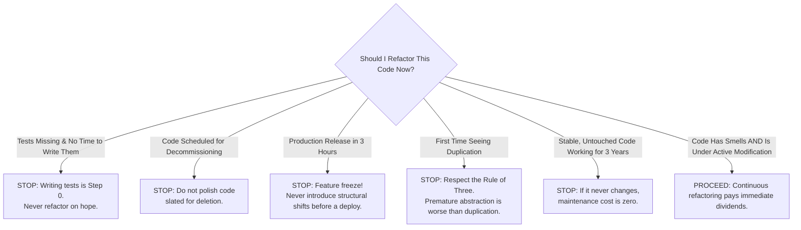

# When NOT to Refactor 🛑

## Source Reference
* **Authors:** Martin Fowler (*Refactoring*), Alexander Shvets (*Dive Into Refactoring*)
* **Core Philosophy:** Refactoring is an economic activity to increase future velocity, not an aesthetic exercise in pursuit of theoretical perfection.

---

## 1. The Pragmatic Balance

Refactoring consumes engineering time. If refactoring a piece of code does not make future development faster, reduce production risk, or eliminate critical technical debt, **it should not be done.**

---

## 2. The 5 Anti-Scenarios Where Refactoring is Prohibited

### A. The Rule of Three (Premature Abstraction)
> *"Three strikes and you refactor."* — Don Roberts

1. **First time you write something:** Just write it.
2. **Second time you do something similar:** You may wince at the duplication, but write it again anyway.
3. **Third time you write similar logic:** **Now refactor.**

Refactoring on the *second* occurrence is dangerous because you do not yet know the true axis of variation. You risk creating an over-engineered abstraction that turns out to be wrong for the third and fourth use cases.

### B. Stable, Untouched Legacy Modules
If a module is ugly, poorly formatted, and lacks unit tests, but has operated in production for four years without a single bug report **and no one plans to add features to it**, **leave it alone.**
* Code only incurs interest on technical debt when developers have to read, understand, or modify it.
* If a file is never modified, its technical debt has an effective interest rate of **zero**.

### C. Imminent Deadlines & Code Freezes
Never begin refactoring on the eve of a major product release or critical customer demonstration. 
* Refactoring changes many lines of code across modules.
* While the intent is behavior preservation, there is always a slight risk of subtle regression.
* Keep releases calm; schedule refactoring for early in the next development cycle.

### D. Throwaway Prototypes and Spikes
When writing an exploratory script, proof-of-concept, or a 48-hour hackathon demo to test feasibility with customers, **do not refactor**. 
* The goal is rapid feedback, not long-term maintainability.
* If the prototype is validated, throw it away and rebuild it properly using TDD and clean design.

### E. Code Slated for Immediate Decommissioning
Do not clean up or extract classes from a service that will be retired or replaced by a new third-party vendor integration next month. Focus engineering energy on the migration path instead.
