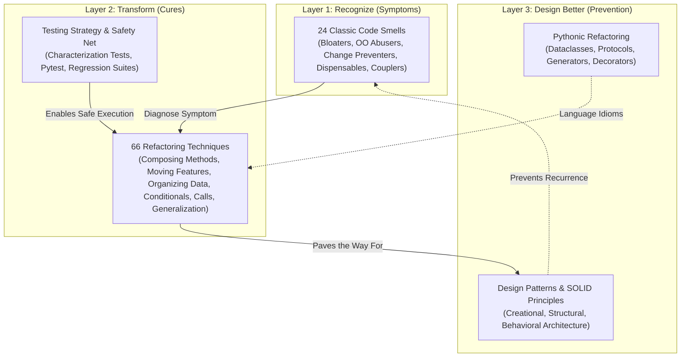
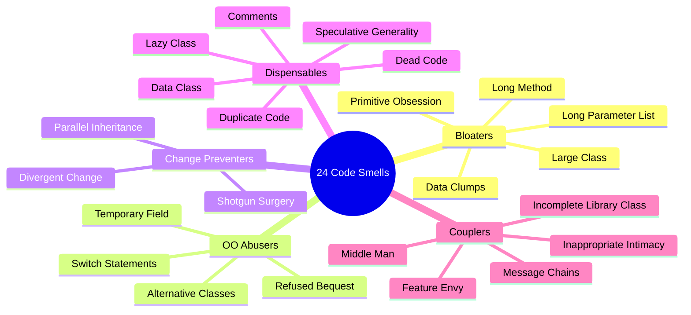

# Refactoring Knowledge System 🛠️🐍

> *"Any fool can write code that a computer can understand. Good programmers write code that humans can understand."* — Martin Fowler
>
> *"Refactoring is a controlled technique for improving the design of an existing code base. Its essence is applying a series of small behavior-preserving transformations, each of which is too small to be worth doing on its own, but the cumulative effect of each is quite significant."* — Alexander Shvets, *Dive Into Refactoring*

Welcome to the **Refactoring Knowledge System**. This comprehensive knowledge base serves as a production-grade handbook for detecting **Code Smells**, safely executing **Refactoring Techniques**, and architecting clean, maintainable systems using modern, type-hinted **Python 3**.

---

## 🏛️ The Three-Layer Engineering Model

This system connects code diagnostics, safe transformations, and long-term architectural health into an integrated feedback loop:

---

## 🧭 Master Navigation & Catalog

### 1. [Foundations of Refactoring](foundations/)
Core philosophies, economic trade-offs, and disciplined developer workflows:
* 📖 **[What is Refactoring?](foundations/what-is-refactoring.md)**: Core definition, the Two Hats metaphor, and preserving observable behavior.
* 📐 **[Principles of Refactoring](foundations/principles-of-refactoring.md)**: Clean code qualities, DRY, YAGNI, the Boy Scout Rule, and cognitive load.
* ⚖️ **[Refactoring vs. Rewriting](foundations/refactoring-vs-rewriting.md)**: Why complete rewrites usually fail (The Second-System Effect) vs. incremental strangler refactoring.
* 💸 **[Technical Debt](foundations/technical-debt.md)**: Martin Fowler's Debt Quadrant, computing interest rates on code rot, and payoff strategies.
* 🛡️ **[Safe Refactoring & Testing Preconditions](foundations/safe-refactoring-and-testing.md)**: The non-negotiable safety net, characterization tests, and atomic Git commits.
* 🔄 **[The Refactoring Workflow](foundations/refactoring-workflow.md)**: The Red-Green-Refactor cycle, micro-commit cadence, and step-by-step developer ergonomics.
* 🛑 **[When NOT to Refactor](foundations/when-not-to-refactor.md)**: The Rule of Three, deadlines, throwaway prototypes, and avoiding premature optimization.

---

### 2. [Testing Strategy for Refactoring](testing/)
How to build an unbreakable test harness before touching a single line of production code:
* 🧪 **[Characterization Tests](testing/characterization-tests.md)**: Pinning down legacy behavior (bugs included) using Golden Master and Approval testing.
* 🐍 **[Pytest for Refactoring](testing/pytest-for-refactoring.md)**: Parametrized fixtures, monkeypatching, and snapshot verification in Python.
* 🔁 **[Regression Testing](testing/regression-testing.md)**: Fast test suites, test coverage vs test quality, and mutation testing.
* 🚧 **[Refactoring Without Existing Tests](testing/refactoring-without-tests.md)**: Safe techniques to establish seams in untestable legacy Python code.

---

### 3. [The 24 Classic Code Smells](code-smells/)
Categorized diagnostics mapping visible symptoms directly to their underlying architectural ailments:

* 🐘 **[Bloaters (5)](code-smells/bloaters/)**: Methods and classes that have grown so large they become impossible to comprehend.
* ⚠️ **[Object-Orientation Abusers (4)](code-smells/oo-abusers/)**: Flawed or incomplete usage of polymorphism and object-oriented encapsulation.
* 🔒 **[Change Preventers (3)](code-smells/change-preventers/)**: Violations of the Open-Closed and Single Responsibility principles that make modifications painful.
* 🗑️ **[Dispensables (6)](code-smells/dispensables/)**: Dead, lazy, or redundant code whose elimination simplifies the system.
* 🔗 **[Couplers (5)](code-smells/couplers/)**: Excessive delegation or inappropriate intimate relationships between modules.

---

### 4. [The 66 Refactoring Techniques](techniques/)
Atomic, behavior-preserving transformations cataloged across six functional domains:
* ✂️ **[Composing Methods (9)](techniques/composing-methods/)**: Extract Method, Inline Method, Extract Variable, Replace Temp with Query, Split Temp Variable.
* 🚚 **[Moving Features Between Objects (8)](techniques/moving-features/)**: Move Method, Move Field, Extract Class, Inline Class, Hide Delegate.
* 📦 **[Organizing Data (15)](techniques/organizing-data/)**: Encapsulate Field, Replace Magic Number, Replace Type Code with Class/Subclasses, Encapsulate Collection.
* 🔀 **[Simplifying Conditional Expressions (8)](techniques/simplifying-conditionals/)**: Decompose Conditional, Guard Clauses, Replace Conditional with Polymorphism, Null Object.
* 📞 **[Simplifying Method Calls (14)](techniques/simplifying-method-calls/)**: Separate Query from Modifier, Parameterize Method, Introduce Parameter Object, Replace Constructor with Factory Method.
* 🧬 **[Dealing with Generalization (12)](techniques/generalization/)**: Pull Up/Push Down Field/Method, Extract Superclass/Interface, Form Template Method, Replace Inheritance with Delegation.

---

### 5. [Pythonic Refactoring](python-refactoring/)
Language-native refactorings that leverage modern Python (3.10+) capabilities:
* 🐍 **[Pythonic Refactoring Idioms](python-refactoring/pythonic-refactoring.md)**: Moving from Java-style OOP boilerplate to expressive, clean Python.
* 📦 **[Functions & Modules vs Class Bloat](python-refactoring/functions-and-modules.md)**: When to replace unnecessary classes with standalone functions and module namespaces.
* 🏛️ **[Classes & Responsibilities](python-refactoring/classes-and-responsibilities.md)**: The Python object model, `@property` uniform access, and reusable descriptors.
* 🏷️ **[Dataclasses & Value Objects](python-refactoring/dataclasses-and-value-objects.md)**: Replacing untyped `dict` clutter and primitive obsession with `@dataclass(frozen=True)`.
* 🔌 **[Type Hints & Protocols](python-refactoring/type-hints-and-protocols.md)**: Using `typing.Protocol` for structural subtyping (duck typing with static verification).
* 🎁 **[Decorators & Composition](python-refactoring/decorators-and-composition.md)**: Refactoring cross-cutting concerns cleanly.

---

### 6. [Real-World Case Studies](case-studies/)
Comprehensive, end-to-end refactoring narratives combining multiple smells and techniques:
* 🏰 **[Refactoring a God Class](case-studies/refactor-a-god-class.md)**: Splitting a 800-line monolithic manager into cohesive, single-responsibility services.
* 🔁 **[Eliminating Duplicate Business Logic](case-studies/eliminate-duplicate-logic.md)**: Unifying drifted billing calculation code across microservices.
* ⚙️ **[Refactoring a Large Service](case-studies/refactor-a-large-service.md)**: Introducing Hexagonal architecture, ports, and adapters to untestable code.
* 🦕 **[Refactoring an Untested Legacy Module](case-studies/refactor-a-legacy-module.md)**: Safely introducing characterization tests, seams, and pure functions to legacy procedural code.

---

### 7. [Diagnostic Matrices & Cross-References](matrices/)
* 🗺️ **[Smell-to-Technique Matrix](matrices/smell-to-technique-matrix.md)**: Rapid lookup mapping any observed code smell directly to its recommended refactoring sequence.
* 🌉 **[Technique-to-Pattern Matrix](matrices/technique-to-pattern-matrix.md)**: How refactoring techniques pave the way for Design Patterns in our [Design Patterns Catalog](../design-patterns/).
* 🌳 **[Refactoring Decision Matrix](matrices/refactoring-decision-matrix.md)**: Interactive decision tree and diagnostic flowchart for engineering teams.

---

### 8. [Revision Tools & Resources](resources/)
* ⚡ **[Refactoring Cheat Sheet](resources/refactoring-cheat-sheet.md)**: A quick reference table summarizing all 24 smells, rules, and recipes.
* 🎯 **[Top 25 Refactoring & Architecture Interview Questions](resources/interview-questions.md)**: Senior-level architectural questions on technical debt, testing, and legacy migration.
* 📖 **[Refactoring & Architecture Glossary](resources/glossary.md)**: Definitive vocabulary guide covering smells, seams, CQS, and clean code principles.
