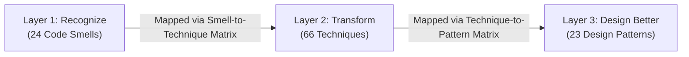

# Refactoring Decision & Connection Matrices 🧭

## Source Reference
* **Core Disciplines:** [Dive Into Refactoring](../index.md), [Dive Into Design Patterns](../../design-patterns/index.md)
* **Author Source:** Alexander Shvets, Martin Fowler, Joshua Kerievsky (*Refactoring to Patterns*)

---

## Overview

The true power of this repository lies in the **connective tissue** between its disciplines. Instead of treating code smells, refactoring techniques, and design patterns as isolated lists, these matrices form a 3-layer decision matrix that answers:

1. **What is wrong with my code?** $\rightarrow$ [Code Smell](../code-smells/index.md)
2. **How do I safely fix it?** $\rightarrow$ [Refactoring Technique](../techniques/index.md)
3. **What architectural pattern prevents it from returning?** $\rightarrow$ [Design Pattern](../../design-patterns/index.md)

---

## The Matrices

| Matrix | Purpose | Key Value |
| :--- | :--- | :--- |
| [**Smell-to-Technique Matrix**](smell-to-technique-matrix.md) | Maps all 24 Code Smells directly to their primary and secondary refactoring treatments | Instant diagnostic lookup during code reviews and PR audits |
| [**Technique-to-Pattern Matrix**](technique-to-pattern-matrix.md) | Connects the 66 Refactoring Techniques directly to the 23 GoF Design Patterns | Explains the architectural destination of each refactoring step |
| [**Refactoring Decision Matrix**](refactoring-decision-matrix.md) | Interactive diagnostic tree and symptom checklist | Step-by-step flowchart from observation to verified refactoring |
