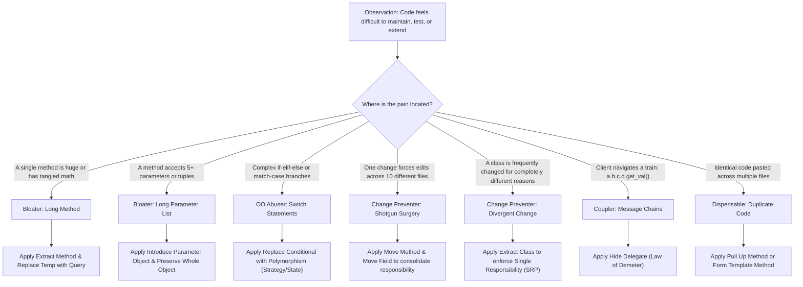

# Refactoring Decision Matrix & Diagnostic Flowchart 🌳

## Source Reference
* **Core Disciplines:** [Dive Into Refactoring](../index.md), *Refactoring: Improving the Design of Existing Code* (Martin Fowler)
* **Target Audience:** Software Engineers, Tech Leads, and Code Reviewers.

---

## 1. The High-Level Diagnostic Flowchart

When reviewing code or facing an intimidating legacy file, use this decision tree to determine which family of smells is present and what refactoring strategy to adopt:

---

## 2. Refactoring Priority Matrix

Not all smells demand immediate remediation. Use this priority matrix to allocate refactoring effort during sprints:

| Priority Level | Symptoms | Business Impact | Recommended Action |
| :--- | :--- | :--- | :--- |
| **P0: Critical** | Tangled global state, untested financial/security math, high regression rate | High risk of production data loss or outages | Write Characterization Tests immediately; isolate into seams; extract pure functions. |
| **P1: High** | Shotgun Surgery, Divergent Change, 500+ line God Classes | High developer friction; constant git merge conflicts | Plan dedicated refactoring stories; apply Extract Class and Move Method. |
| **P2: Medium** | Primitive Obsession, Long Parameter Lists, Feature Envy | Decreased velocity; difficult to onboard new engineers | Refactor incrementally as part of standard "Boy Scout Rule" during feature work. |
| **P3: Low / Harmless** | Minor Comments, Lazy Classes with 1 method, harmless type aliases | Negligible runtime impact; slight visual clutter | Clean up only if you are already touching the file for another reason. |

---

## 3. The 4-Question "Should I Refactor?" Checklist

Before beginning any refactoring, answer these 4 questions:

1. **Do I have an automated test suite with adequate coverage?**
   - *If No:* Stop! Write characterization tests first. Never refactor in the dark.
2. **Am I changing external behavior at the same time?**
   - *If Yes:* Stop! You are violating the Two Hats principle. Commit feature changes first, then refactor in a separate commit (or refactor first, then add the feature).
3. **Will this refactoring simplify the next feature I need to build?**
   - *If Yes:* Proceed! *"Make the change easy, then make the easy change."* — Kent Beck.
4. **Is the code stable legacy code that nobody has touched in 3 years?**
   - *If Yes:* Leave it alone! Code that is ugly but completely stable, rarely modified, and does not hold bugs does not need refactoring.
