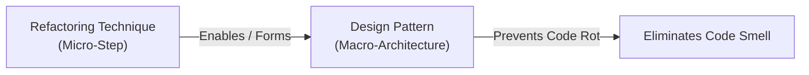

# Technique-to-Pattern Matrix 🌉

## Source Reference
* **Core Disciplines:** [Dive Into Refactoring](../index.md), [Dive Into Design Patterns](../../design-patterns/index.md)
* **Book Bridges:** Joshua Kerievsky (*Refactoring to Patterns*), Alexander Shvets (*Dive Into Refactoring* & *Dive Into Design Patterns*)

---

## Architectural Connection Overview

Refactoring techniques are the incremental steps that transform messy procedural code into clean, modular architectures. Design Patterns are the battle-tested architectural shapes that software naturally grows toward.

This matrix explicitly bridges every major Refactoring Technique with its corresponding Design Pattern destination in `design-patterns/`.

---

## The Master Refactoring-to-Pattern Mapping

| Refactoring Technique | Destination Design Pattern | Architectural Purpose |
| :--- | :--- | :--- |
| [**Replace Conditional with Polymorphism**](../techniques/simplifying-conditionals/replace-conditional-with-polymorphism.md) | [**Strategy Pattern**](../../design-patterns/behavioral/strategy.md) | Replaces procedural branching on types with interchangeable algorithm classes |
| [**Replace Type Code with State/Strategy**](../techniques/organizing-data/replace-type-code-with-state-strategy.md) | [**State Pattern**](../../design-patterns/behavioral/state.md) | Allows an object's behavior to change dynamically as its internal lifecycle state transitions |
| [**Replace Constructor with Factory Method**](../techniques/simplifying-method-calls/replace-constructor-with-factory-method.md) | [**Factory Method Pattern**](../../design-patterns/creational/factory-method.md) | Replaces rigid `__init__` constructor calls with polymorphic creation hooks |
| [**Introduce Parameter Object**](../techniques/simplifying-method-calls/introduce-parameter-object.md) | [**Builder Pattern**](../../design-patterns/creational/builder.md) | Solves [Long Parameter List](../code-smells/bloaters/long-parameter-list.md) by encapsulating complex multi-step assembly |
| [**Form Template Method**](../techniques/generalization/form-template-method.md) | [**Template Method Pattern**](../../design-patterns/behavioral/template-method.md) | Unifies shared algorithmic workflow in base class while delegating primitive steps to subclasses |
| [**Introduce Null Object**](../techniques/simplifying-conditionals/introduce-null-object.md) | [**Null Object Pattern**](../techniques/simplifying-conditionals/introduce-null-object.md) | Eliminates defensive `if obj is None:` checks by providing harmless default implementations |
| [**Replace Inheritance with Delegation**](../techniques/generalization/replace-inheritance-with-delegation.md) | [**Decorator Pattern**](../../design-patterns/structural/decorator.md) | Replaces rigid subclassing with flexible wrapper composition |
| [**Introduce Local Extension**](../techniques/moving-features/introduce-local-extension.md) | [**Adapter Pattern**](../../design-patterns/structural/adapter.md) | Wraps unmodifiable third-party library classes in a domain-friendly interface |
| [**Duplicate Observed Data**](../techniques/organizing-data/duplicate-observed-data.md) | [**Observer Pattern**](../../design-patterns/behavioral/observer.md) | Separates domain business models from UI/presentation components |
| [**Replace Method with Method Object**](../techniques/composing-methods/replace-method-with-method-object.md) | [**Command Pattern**](../../design-patterns/behavioral/command.md) | Encapsulates a long, parameter-heavy calculation into a standalone executable object |
| [**Hide Delegate**](../techniques/moving-features/hide-delegate.md) | [**Facade Pattern**](../../design-patterns/structural/facade.md) | Provides a simplified, high-level interface over a complex subsystem of delegates |
| [**Change Value to Reference**](../techniques/organizing-data/change-value-to-reference.md) | [**Flyweight Pattern**](../../design-patterns/structural/flyweight.md) | Shares common state across thousands of identical lightweight objects via a central factory |
| [**Extract Superclass**](../techniques/generalization/extract-superclass.md) | [**Composite Pattern**](../../design-patterns/structural/composite.md) | Enables treating individual objects and composite collections uniformly |
| [**Move Method**](../techniques/moving-features/move-method.md) & [**Move Field**](../techniques/moving-features/move-field.md) | [**Bridge Pattern**](../../design-patterns/structural/bridge.md) | Decouples an abstraction hierarchy from its implementation hierarchy |

---

## When to Refactor Toward a Pattern (and When to Stop)

1. **Let Patterns Emerge:** Never introduce a design pattern on Day 1. Start with simple functions and classes.
2. **Apply Refactoring First:** When code smells appear (e.g., duplicated code or long parameter lists), apply basic composing and moving refactorings first.
3. **Graduate to Patterns:** If basic refactorings reveal that the code naturally forms a state machine, a family of algorithms, or an object tree, graduate the refactored code to the corresponding Design Pattern.
