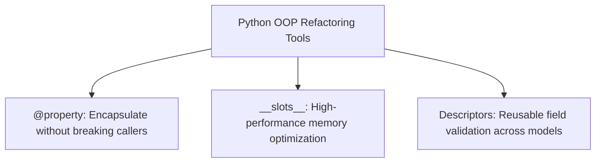

# Classes and Responsibilities in Python 🏛️

## Source Reference
* **Core Philosophy:** *Fluent Python* (Luciano Ramalho), *Dive Into Refactoring* (Alexander Shvets - Python Adaptations)
* **Target Environment:** Modern Python 3 (Python 3.10+) with `pytest`.

---

## 1. When is a Class Genuinely Justified in Python?

A class is justified in Python when **state and behavior are intimately bound together** and the object must protect business invariants throughout a continuous lifecycle.

### The 3 Hallmarks of a Genuine Class:
1. **Multiple methods operate on shared, mutable instance data (`self`).**
2. **The object enforces business rules / invariants** (e.g., `balance` cannot drop below zero; `status` can only transition from `DRAFT` to `SUBMITTED`).
3. **Polymorphic substitution** is needed (e.g., different payment strategies conforming to a shared `Protocol`).

---

## 2. Python-Specific OOP Refactoring Tools



### Tool 1: The `@property` Uniform Access Principle
In languages like Java, developers defensively write getters and setters for every single field:
```java
// Java: Forced boilerplate
public double getBalance() { return this.balance; }
public void setBalance(double b) { this.balance = b; }
```
In Python, start with direct attribute access (`self.balance`). When validation or calculation is later required, convert it to a `@property`. The external caller syntax (`account.balance = 100`) remains **100% identical**, preserving full backward compatibility.

### Tool 2: `__slots__` for Memory Optimization
When instantiating millions of lightweight objects (e.g., geographical coordinates or stock ticks), Python's default instance `__dict__` consumes significant memory overhead. Refactor using `__slots__` to drastically reduce memory usage and prevent accidental dynamic attribute assignment.

```python
class GeoCoordinate:
  __slots__ = ("latitude", "longitude")

  def __init__(self, lat: float, lon: float) -> None:
    self.latitude = lat
    self.longitude = lon
```

### Tool 3: Descriptors for Reusable Field Validation
Instead of copy-pasting the same `@property.setter` validation logic across 10 different classes (e.g., validating positive integers or non-empty strings), refactor the validation into a reusable **Descriptor**.

---

## 3. Concrete Before & After Demonstration: Reusable Descriptors

### A. Smelly / Legacy Code (Duplicated Setter Validation Across Multiple Classes)
```python
# inventory_smelly.py
class Product:

  def __init__(self, name: str, price: float, quantity: int) -> None:
    self.name = name
    self._price = 0.0
    self._quantity = 0
    self.price = price
    self.quantity = quantity

  @property
  def price(self) -> float:
    return self._price

  @price.setter
  def price(self, val: float) -> None:
    if val <= 0:
      raise ValueError("Price must be strictly positive")
    self._price = val

  @property
  def quantity(self) -> int:
    return self._quantity

  @quantity.setter
  def quantity(self, val: int) -> None:
    if val < 0:
      raise ValueError("Quantity cannot be negative")
    self._quantity = val
```

### B. Pytest Baseline Contract
```python
# test_inventory.py
import pytest
from inventory_smelly import Product


def test_product_validation():
  p = Product("Laptop", 999.99, 10)
  assert p.price == 999.99

  with pytest.raises(ValueError):
    Product("Laptop", -50.0, 10)
```

### C. Refactored Clean Code (Reusable Positive Number Descriptor)
```python
# inventory_clean.py
class PositiveNumber:
  """Reusable Descriptor: Encapsulates number validation logic across any class."""

  def __set_name__(self, owner, name: str) -> None:
    self._name = f"_{name}"

  def __get__(self, instance, owner):
    if instance is None:
      return self
    return getattr(instance, self._name, 0.0)

  def __set__(self, instance, value: float) -> None:
    if value <= 0:
      raise ValueError(f"Value must be strictly positive: got {value}")
    setattr(instance, self._name, value)


class Product:
  """Clean class: Field validation handled declaratively via Descriptors."""

  price = PositiveNumber()

  def __init__(self, name: str, price: float, quantity: int) -> None:
    self.name = name
    self.price = price
    self.quantity = quantity
```

---

## 4. Key Takeaways
1. **Never write dummy getters/setters:** If an attribute does not require validation or transformation, leave it as a plain attribute.
2. **Use `@property` strictly for fast operations:** Properties look like attribute lookups. Never perform network I/O, heavy database queries, or long computations inside a property. If it is slow, use a method (`calculate_total()`).
3. **Use Descriptors to eliminate repetitive validation:** When multiple attributes across multiple classes share validation rules, extract a Descriptor.
