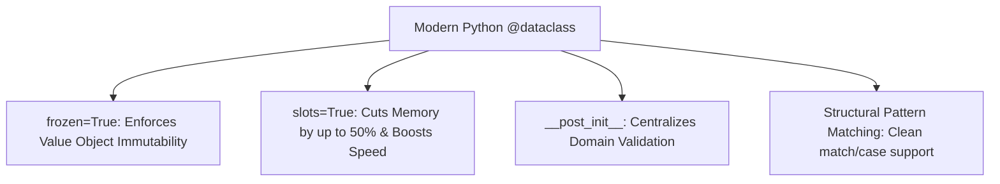

# Dataclasses and Value Objects 💎

## Source Reference
* **Core Philosophy:** PEP 557 (Data Classes), *Domain-Driven Design* (Eric Evans - Value Objects)
* **Target Environment:** Modern Python 3 (Python 3.10+) with `pytest`.

---

## 1. Why Dataclasses Revolutionize Python Refactoring

Prior to Python 3.7, developers facing the [Primitive Obsession](../code-smells/bloaters/primitive-obsession.md) smell had to choose between two bad options:
1. Write a full custom class with boilerplate `__init__`, `__repr__`, `__eq__`, and `__hash__` methods (30+ lines of ceremony).
2. Settle for plain tuples or dictionaries, leaving the code without type safety or validation.

Modern Python `@dataclass` completely eliminates this trade-off. With a single decorator, you can turn raw primitive clumps into rich, immutable, self-validating Value Objects.



---

## 2. Best Practices for Refactoring with Dataclasses

### A. The Gold Standard for Domain Value Objects
Always prefer `frozen=True` and `slots=True` for value objects:
```python
from dataclasses import dataclass


@dataclass(frozen=True, slots=True)
class Money:
  amount: float
  currency: str

  def __post_init__(self) -> None:
    if self.amount < 0:
      raise ValueError("Money amount cannot be negative")
    # For frozen dataclasses, set normalized attributes via object.__setattr__:
    object.__setattr__(self, "currency", self.currency.upper())

  def add(self, other: "Money") -> "Money":
    if self.currency != other.currency:
      raise ValueError(f"Currency mismatch: {self.currency} vs {other.currency}")
    return Money(round(self.amount + other.amount, 2), self.currency)
```

### B. Structural Pattern Matching with Dataclasses (Python 3.10+)
Dataclasses natively support positional pattern matching in `match/case` statements via `__match_args__`:
```python
match payment:
  case Money(amount=0.0):
    print("Zero balance / complimentary")
  case Money(amount, "USD") if amount > 10_000:
    print(f"Large USD transfer requiring compliance review: ${amount}")
  case Money(amount, curr):
    print(f"Standard payment: {amount} {curr}")
```

---

## 3. Concrete Before & After Demonstration

### A. Smelly / Legacy Code (Raw Dictionary Clump with Duplicated Checks)
```python
# coordinate_smelly.py
import math


def calculate_distance_smelly(point_a: dict, point_b: dict) -> float:
  # Smelly: No validation; typos in keys ('x' vs 'X') cause runtime KeyError!
  dx = point_b["x"] - point_a["x"]
  dy = point_b["y"] - point_a["y"]
  return math.sqrt(dx * dx + dy * dy)
```

### B. Pytest Baseline Contract
```python
# test_coordinate.py
import pytest
from coordinate_smelly import calculate_distance_smelly


def test_distance():
  p1 = {"x": 0.0, "y": 0.0}
  p2 = {"x": 3.0, "y": 4.0}
  assert calculate_distance_smelly(p1, p2) == 5.0

  with pytest.raises(KeyError):
    calculate_distance_smelly(p1, {"X": 3.0, "Y": 4.0})  # Typo crash
```

### C. Refactored Clean Code (Immutable `Point2D` Value Object)
```python
# coordinate_clean.py
from dataclasses import dataclass
import math


@dataclass(frozen=True, slots=True)
class Point2D:
  """Clean Value Object: Type-safe, immutable, self-documenting coordinates."""

  x: float
  y: float

  def distance_to(self, other: "Point2D") -> float:
    dx = other.x - self.x
    dy = other.y - self.y
    return math.hypot(dx, dy)


def calculate_distance_clean(p1: Point2D, p2: Point2D) -> float:
  return p1.distance_to(p2)
```

---

## 4. When to Use What in Python 3

| Feature | Mutability | Memory Overhead | Best Use Case |
| :--- | :--- | :--- | :--- |
| **`@dataclass(frozen=True)`** | Immutable | Low (`slots=True`) | **Domain Value Objects**, DTOs, Business Rules |
| **`@dataclass(frozen=False)`** | Mutable | Low (`slots=True`) | Stateful entity records, ORM wrappers |
| **`typing.NamedTuple`** | Immutable | Very Low (C-tuple) | Lightweight numerical records, coordinate tuples |
| **Plain `dict`** | Mutable | Medium-High | Raw unparsed JSON, arbitrary key-value mappings |
