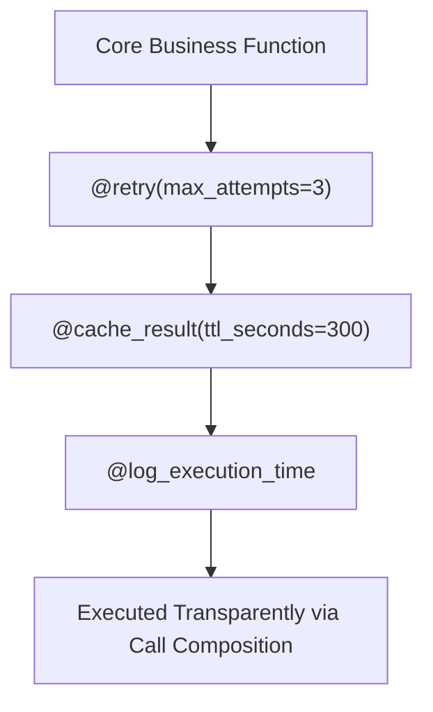

# Decorators and Composition 🎭

## Source Reference
* **Core Philosophy:** *PEP 318 (Decorators for Functions and Methods)*, *Dive Into Design Patterns / Decorator Pattern*
* **Target Environment:** Modern Python 3 (Python 3.10+) with `pytest`.

---

## 1. Intent and Motivation

In object-oriented refactoring, developers frequently encounter **cross-cutting concerns**: logging, performance timing, retries, caching, authentication, or transaction boundaries.

In languages like Java or C++, adding cross-cutting behavior without modifying core logic often requires heavy Aspect-Oriented Programming (AOP), dynamic bytecode proxies, or deep inheritance trees.

In Python, **Decorators** provide first-class syntactic support for the [Decorator Pattern](../../design-patterns/structural/decorator.md). Refactoring cross-cutting code into decorators strips secondary concerns completely out of domain methods.



---

## 2. Step-by-Step Mechanics: Creating a Safe Decorator

A properly refactored Python decorator must **always preserve the original function's metadata** (docstrings, function name, type annotations) using `@functools.wraps`.

```python
import functools
import time
from typing import Any, Callable, TypeVar

F = TypeVar("F", bound=Callable[..., Any])


def measure_latency(func: F) -> F:
  """Decorator that logs execution time without altering function behavior."""

  @functools.wraps(func)
  def wrapper(*args: Any, **kwargs: Any) -> Any:
    start = time.perf_counter()
    result = func(*args, **kwargs)
    duration = time.perf_counter() - start
    print(f"[{func.__name__}] completed in {duration:.4f}s")
    return result

  return wrapper  # type: ignore[return-value]
```

---

## 3. Concrete Before & After Demonstration: Eliminating Retry Boilerplate

### A. Smelly / Legacy Code (Retry Logic Tightly Intertwined with Domain API Call)
```python
# api_smelly.py
import time


class PaymentGateway:

  def charge_card(self, token: str, amount: float) -> dict:
    # Smelly: 15 lines of retry logic obscuring the 2 lines of actual work:
    max_retries = 3
    for attempt in range(1, max_retries + 1):
      try:
        # Actual domain work:
        if token == "FAIL_TRANSIENT" and attempt < 3:
          raise ConnectionError("Transient network blip")
        return {
            "status": "CHARGED",
            "token": token,
            "amount": amount,
        }
      except ConnectionError as err:
        if attempt == max_retries:
          raise err
        time.sleep(0.01 * attempt)
```

### B. Pytest Baseline Contract
```python
# test_api.py
from api_smelly import PaymentGateway


def test_payment_retry_success():
  gw = PaymentGateway()
  res = gw.charge_card("FAIL_TRANSIENT", 100.0)
  assert res["status"] == "CHARGED"
```

### C. Refactored Clean Code (Extracted `@retry_on_exception` Decorator)
```python
# api_clean.py
import functools
import time
from typing import Any, Callable, Type


def retry_on_exception(
    exception_cls: Type[Exception], max_attempts: int = 3, delay: float = 0.01
):
  """Extracted Decorator: Handles retry mechanics for ANY function cleanly."""

  def decorator(func: Callable[..., Any]) -> Callable[..., Any]:
    @functools.wraps(func)
    def wrapper(*args: Any, **kwargs: Any) -> Any:
      for attempt in range(1, max_attempts + 1):
        try:
          return func(*args, **kwargs)
        except exception_cls as err:
          if attempt == max_attempts:
            raise err
          time.sleep(delay * attempt)

    return wrapper

  return decorator


class PaymentGateway:
  """Clean class: Domain logic is 100% focused; retries handled declaratively."""

  @retry_on_exception(ConnectionError, max_attempts=3, delay=0.01)
  def charge_card(self, token: str, amount: float) -> dict:
    if token == "FAIL_TRANSIENT":
      # Simulated transient error:
      if not hasattr(self, "_attempts"):
        self._attempts = 0
      self._attempts += 1
      if self._attempts < 3:
        raise ConnectionError("Transient network blip")

    return {"status": "CHARGED", "token": token, "amount": amount}
```

---

## 4. Key Takeaways
1. **Always use `@functools.wraps`:** Omitting it strips `__name__` and `__doc__`, breaking introspective tools like Sphinx, Pytest, and FastAPI.
2. **Preserve Type Annotations:** Use `ParamSpec` and `TypeVar` (Python 3.10+) so that linters (`mypy`) retain autocomplete on decorated functions.
3. **Decouple Domain from Infrastructure:** Keep decorators in a dedicated `decorators.py` or `cross_cutting.py` utility module so business entities remain pure.
