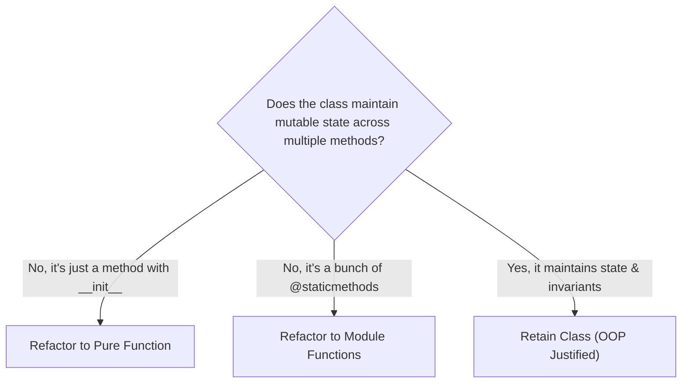

# Functions and Modules vs Class Bloat 📦

## Source Reference
* **Core Philosophy:** Jack Diederich's classic talk *"Stop Writing Classes"*, *Dive Into Refactoring* (Alexander Shvets - Python Adaptations)
* **Target Environment:** Modern Python 3 (Python 3.10+) with `pytest`.

---

## 1. The "Stop Writing Classes" Principle

In Java, every line of executable code must live inside a class. In Python, **modules are natural namespaces, and functions are first-class objects**.

### Classic Smell: The Hollow Utility Class
```python
# Smelly: Class with zero state, serving purely as a namespace:
class StringUtils:

  @staticmethod
  def slugify(text: str) -> str:
    return text.strip().lower().replace(" ", "-")

  @staticmethod
  def truncate(text: str, max_len: int) -> str:
    return text[:max_len] + "..." if len(text) > max_len else text
```
In Python, this should simply be a module named `string_utils.py` containing standalone top-level functions:
```python
# Clean: string_utils.py
def slugify(text: str) -> str:
  return text.strip().lower().replace(" ", "-")


def truncate(text: str, max_len: int) -> str:
  return text[:max_len] + "..." if len(text) > max_len else text
```
Callers import what they need cleanly: `from string_utils import slugify`.

---

## 2. Refactoring Patterns: Class to Functions & Modules



### Pattern 1: Refactoring a 1-Method Class into a Callable or Closure
When a class has only `__init__` and `execute()` (or `run()`), it is usually a function in disguise.

```python
# Smelly 1-method class:
class TaxCalculator:

  def __init__(self, tax_rate: float) -> None:
    self.tax_rate = tax_rate

  def calculate(self, subtotal: float) -> float:
    return round(subtotal * (1.0 + self.tax_rate), 2)


# Clean 1: Standalone function with default/parameter:
def calculate_tax(subtotal: float, tax_rate: float) -> float:
  return round(subtotal * (1.0 + tax_rate), 2)


# Clean 2 (If configuration injection is needed): Higher-order function / Closure:
from typing import Callable


def create_tax_calculator(tax_rate: float) -> Callable[[float], float]:
  return lambda subtotal: round(subtotal * (1.0 + tax_rate), 2)
```

---

## 3. Concrete Before & After Demonstration

### A. Smelly / Legacy Code (Monolithic God Class Smearing Multiple Domains)
```python
# manager_smelly.py
import json


class UserSystemManager:
  """Smelly God Class: Mixes database serialization, password hashing, and email sending."""

  def __init__(self, db_conn, email_client) -> None:
    self.db = db_conn
    self.email_client = email_client

  def hash_password(self, raw_password: str) -> str:
    import hashlib

    return hashlib.sha256(raw_password.encode()).hexdigest()

  def register_user(self, email: str, raw_pwd: str) -> dict:
    hashed = self.hash_password(raw_pwd)
    user_id = self.db.insert("users", {"email": email, "pwd": hashed})
    self.email_client.send(email, "Welcome!")
    return {"id": user_id, "email": email}
```

### B. Pytest Baseline Contract
```python
# test_user_system.py
from unittest.mock import MagicMock
from manager_smelly import UserSystemManager


def test_user_registration():
  mock_db = MagicMock()
  mock_db.insert.return_value = "USR-100"
  mock_email = MagicMock()

  manager = UserSystemManager(mock_db, mock_email)
  res = manager.register_user("alice@example.com", "secret123")

  assert res["id"] == "USR-100"
  mock_email.send.assert_called_once_with("alice@example.com", "Welcome!")
```

### C. Refactored Clean Code (Decomposed into Cohesive Functions & Modules)
```python
# security.py
import hashlib


def hash_password(raw_password: str) -> str:
  """Pure function: zero dependencies, effortlessly testable."""
  return hashlib.sha256(raw_password.encode()).hexdigest()


# user_service.py
from typing import Callable


def register_user(
    email: str,
    raw_pwd: str,
    *,
    save_user_fn: Callable[[str, str], str],
    notify_user_fn: Callable[[str, str], None],
) -> dict:
  """Clean service function: Dependencies injected as simple callables."""
  hashed = hash_password(raw_pwd)
  user_id = save_user_fn(email, hashed)
  notify_user_fn(email, "Welcome!")
  return {"id": user_id, "email": email}
```

---

## 4. Key Benefits of Modular Function Refactoring

| Dimension | Class-Heavy Approach | Functional & Modular Approach |
| :--- | :--- | :--- |
| **Testing Overhead** | Must instantiate classes and mock instance state | Pure functions test with simple inputs and outputs |
| **Cognitive Load** | Deep inheritance trees and `self` references | Clear top-level functions in focused files |
| **Concurrency** | State stored on `self` risks thread race conditions | Pure functions are 100% thread-safe and reentrant |
