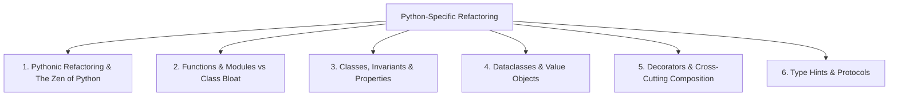

# Python-Specific Refactoring 🐍

## Source Reference
* **Core Philosophy:** *The Zen of Python* (PEP 20), *Dive Into Refactoring* (Alexander Shvets - Python Adaptations)
* **Target Environment:** Modern Python 3 (Python 3.10+) with `pytest`, `mypy`, and `ruff`.

---

## Overview

Alexander Shvets' original *Dive Into Refactoring* and Martin Fowler's foundational refactoring texts were authored primarily around statically-typed, class-heavy languages like Java and C++. 

Python is fundamentally different:
1. **Functions and modules are first-class citizens:** You don't need a `TaxCalculatorFactoryManager` class just to execute a 5-line calculation—a pure function inside a focused module is often far cleaner.
2. **Duck typing & structural protocols:** Python does not require rigid nominal class hierarchies to achieve polymorphism. `typing.Protocol` enables compile-time verified subtyping without explicit inheritance.
3. **Rich built-in primitives:** Tuples, dicts, list/set comprehensions, generators, and `@dataclass` eliminate pages of boilerplate getters, setters, and builder classes.
4. **Properties and Descriptors:** Python allows starting with simple public attributes (`obj.salary`) and encapsulating them later with `@property` without breaking a single caller.

This section bridges classical refactoring patterns into idiomatic, high-performance, modern Python.

---

## The 6 Core Modules

| Module | Core Question Addressed | Key Python Features |
| :--- | :--- | :--- |
| [**Pythonic Refactoring**](pythonic-refactoring.md) | How do we avoid translating Java idioms verbatim into Python? | PEP 20, EAFP vs LBYL, Comprehensions, Context Managers |
| [**Functions and Modules**](functions-and-modules.md) | When should a class be refactored into pure functions and modules? | First-class functions, module namespaces, Lambdas |
| [**Classes and Responsibilities**](classes-and-responsibilities.md) | How do we model clean OOP in Python without boilerplate? | `@property`, `__slots__`, Descriptors, Invariant guards |
| [**Dataclasses and Value Objects**](dataclasses-and-value-objects.md) | How do we build immutable, self-validating data structures? | `@dataclass(frozen=True)`, `__post_init__`, Structural Pattern Matching |
| [**Decorators and Composition**](decorators-and-composition.md) | How do we extract cross-cutting concerns without inheritance? | `@wraps`, Parameterized decorators, Class decorators |
| [**Type Hints and Protocols**](type-hints-and-protocols.md) | How do we use static typing to guarantee safe refactoring? | `typing.Protocol`, `mypy`, Generics (`TypeVar`), `reveal_type` |
