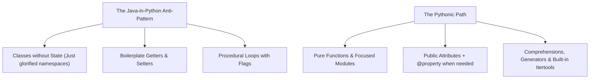

# Pythonic Refactoring 🐍

## Source Reference
* **Core Philosophy:** *The Zen of Python* (PEP 20 - Tim Peters), *Effective Python* (Brett Slatkin)
* **Target Environment:** Modern Python 3 (Python 3.10+) with `pytest`.

---

## 1. The Trap of "Writing Java in Python"

When developers transition from Java or C++ to Python, they frequently drag along boilerplate habits that are actively harmful in Python:
* Creating 1-method classes like `UserStringFormatter.format(str)` instead of a standalone function `format_user_string(s)`.
* Writing explicit getters and setters (`get_name()`, `set_name()`) for every field upfront "just in case".
* Using verbose while-loops and manual index counters instead of list comprehensions, `enumerate()`, or `zip()`.
* Catching generic exceptions (`except Exception:`) or checking types with deep `isinstance` trees instead of relying on duck typing.



---

## 2. Core Pythonic Refactoring Principles

### A. Flat is Better Than Nested (PEP 20)
Deeply nested blocks (`if ... if ... for ... if ...`) should be flattened using guard clauses, early returns, or generator expressions.

### B. EAFP (*Easier to Ask for Forgiveness than Permission*) vs LBYL
In Java/C++, developers *Look Before You Leap* (LBYL):
```python
# LBYL: Smelly if called in a loop
if "key" in my_dict:
  val = my_dict["key"]
else:
  val = "default"
```
In idiomatic Python, prefer direct lookup or dictionary defaults:
```python
# Pythonic:
val = my_dict.get("key", "default")
```

### C. Context Managers (`with` blocks) Eliminate Cleanup Boilerplate
Never write manual `open()` and `close()` or `acquire()` and `release()` try/finally blocks. Refactor them into Python context managers (`with` statement or `@contextlib.contextmanager`).

---

## 3. Concrete Python Refactoring Demonstrations

### Demonstration 1: Eliminating Procedural Loops with Comprehensions
```python
# Smelly (Procedural Java-style loop with flags and accumulators):
def get_high_value_customer_emails_smelly(customers: list[dict]) -> list[str]:
  result = []
  for c in customers:
    if c.get("is_active") and c.get("total_spend", 0) > 1000.0:
      email = c.get("email")
      if email is not None:
        result.append(email.lower())
  return result


# Refactored (Pythonic list comprehension with clean filter):
def get_high_value_customer_emails_clean(customers: list[dict]) -> list[str]:
  return [
      c["email"].lower()
      for c in customers
      if c.get("is_active")
      and c.get("total_spend", 0) > 1000.0
      and c.get("email")
  ]
```

### Demonstration 2: Refactoring Manual Resource Management into a Context Manager
```python
import contextlib
# Smelly: Manual setup and teardown prone to leaks if an error occurs
import time


def query_with_timing_smelly(query_str: str, conn):
  start = time.perf_counter()
  try:
    res = conn.execute(query_str)
    return res
  finally:
    elapsed = time.perf_counter() - start
    print(f"Query executed in {elapsed:.4f}s")


# Refactored: Reusable, composable context manager
@contextlib.contextmanager
def log_duration(label: str):
  start = time.perf_counter()
  try:
    yield
  finally:
    elapsed = time.perf_counter() - start
    print(f"[{label}] finished in {elapsed:.4f}s")


# Usage is now effortless and safe everywhere:
def query_with_timing_clean(query_str: str, conn):
  with log_duration(f"Query: {query_str[:20]}"):
    return conn.execute(query_str)
```

---

## 4. Pytest Contract Verification
```python
# test_pythonic.py
def test_high_value_customer_filtering():
  customers = [
      {
          "email": "Alice@example.com",
          "is_active": True,
          "total_spend": 1500.0,
      },
      {"email": "Bob@example.com", "is_active": False, "total_spend": 2000.0},
      {"email": "Carol@example.com", "is_active": True, "total_spend": 500.0},
  ]
  assert get_high_value_customer_emails_clean(customers) == [
      "alice@example.com"
  ]
```

---

## 5. Summary Checklist for Code Reviews
- [ ] Is there a class with only 1 method (e.g., `__init__` and `execute()`)? $\rightarrow$ Convert to a pure function!
- [ ] Are there manual `get_foo()` and `set_foo()` methods with no custom logic? $\rightarrow$ Replace with direct public attribute access!
- [ ] Are there while-loops tracking array indices manually? $\rightarrow$ Replace with `for i, item in enumerate(items):` or `zip()`.
- [ ] Are dictionary lookups guarded by 3 nested `if key in dict:` blocks? $\rightarrow$ Use `dict.get()` or `collections.defaultdict`.
