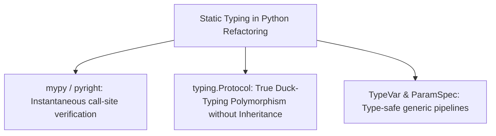

# Type Hints and Protocols for Safe Refactoring 🛡️

## Source Reference
* **Core Philosophy:** PEP 484 (Type Hints), PEP 544 (Protocols & Structural Subtyping)
* **Target Environment:** Modern Python 3 (Python 3.10+) with `mypy` and `pyright`.

---

## 1. The Role of Type Hints in Refactoring

Refactoring dynamically typed code without type annotations is hazardous: renaming a method or changing a parameter type can cause subtle runtime failures that tests miss.

Adding type annotations creates an **executable architectural contract**. Static type checkers (`mypy` or `pyright`) verify every call site in seconds:
* You can rename a field or method and instantly find all 50 broken call sites before running a single test.
* You guarantee that functions receive valid domain types rather than arbitrary dictionaries or primitives.



---

## 2. Structural Subtyping with `typing.Protocol`

The greatest breakthrough for Python OOP refactoring was PEP 544 (`typing.Protocol`). 

### Nominal Typing vs Structural Typing
* **Nominal Typing (Standard ABCs):** A class `B` is only considered a subtype of `A` if it explicitly inherits from `A` (`class B(A):`). This creates rigid coupling.
* **Structural Typing (Protocols):** A class `B` is considered a subtype of Protocol `P` simply because it implements the required methods and properties. No explicit inheritance is needed!

```python
from typing import Protocol


class LogWriter(Protocol):

  def write_log(self, message: str) -> None:
    ...


# This class has never heard of LogWriter, yet it satisfies the protocol 100%!
class CloudLogger:

  def write_log(self, message: str) -> None:
    print(f"[CLOUD]: {message}")


def log_event(logger: LogWriter, text: str) -> None:
  logger.write_log(text)


# Mypy statically verifies this as 100% type-safe!
log_event(CloudLogger(), "System online")
```

---

## 3. Concrete Before & After Demonstration: Decoupling via Protocols

### A. Smelly / Legacy Code (Function Tied to Concrete Database Class)
```python
# service_smelly.py
class PostgresUserRepository:

  def get_user_email(self, user_id: str) -> str:
    # Heavy connection to real Postgres
    return f"user_{user_id}@postgres.internal"


class EmailWelcomeService:

  def __init__(self, repo: PostgresUserRepository) -> None:
    # Rigid nominal coupling! Cannot pass a mock, SQLite, or Redis repository!
    self.repo = repo

  def welcome(self, user_id: str) -> str:
    email = self.repo.get_user_email(user_id)
    return f"Welcome sent to {email}"
```

### B. Pytest Baseline Contract
```python
# test_service.py
from service_smelly import EmailWelcomeService, PostgresUserRepository


def test_welcome():
  repo = PostgresUserRepository()
  service = EmailWelcomeService(repo)
  assert service.welcome("123") == "Welcome sent to user_123@postgres.internal"
```

### C. Refactored Clean Code (Decoupled with `typing.Protocol`)
```python
# service_clean.py
from typing import Protocol


class UserEmailProvider(Protocol):
  """Extracted Protocol: Defines the structural contract required by EmailWelcomeService."""

  def get_user_email(self, user_id: str) -> str:
    ...


class EmailWelcomeService:
  """Clean service: Depends on Protocol, enabling effortless in-memory testing & provider swapping."""

  def __init__(self, provider: UserEmailProvider) -> None:
    self.provider = provider

  def welcome(self, user_id: str) -> str:
    email = self.provider.get_user_email(user_id)
    return f"Welcome sent to {email}"


# Fast, in-memory mock implementation with zero dependencies:
class InMemoryUserProvider:

  def get_user_email(self, user_id: str) -> str:
    return "test@mock.org"


def test_clean_service():
  service = EmailWelcomeService(InMemoryUserProvider())
  assert service.welcome("999") == "Welcome sent to test@mock.org"
```

---

## 4. The 3-Step Typing Refactoring Workflow
1. **Annotate Boundaries First:** Add type hints to public function signatures, parameter lists, and return values.
2. **Run `mypy --strict`:** Let the type checker locate all mismatched attribute accesses, missing None checks, and deprecated parameter signatures.
3. **Extract Protocols:** When two classes share a signature, replace concrete type annotations with a shared `Protocol`.
