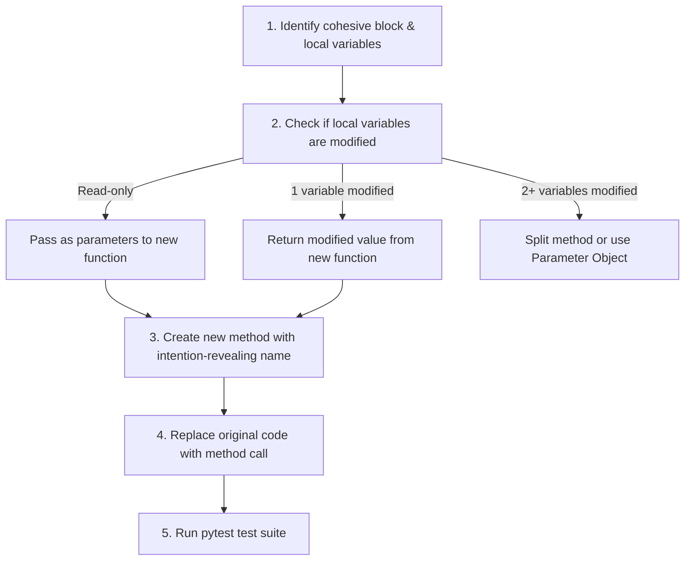

# Extract Method ✂️

## Source Reference
* **Book:** *Dive Into Refactoring* (Alexander Shvets), Chapter: *Refactoring Techniques / Composing Methods / Extract Method*
* **Fixes Code Smells:** [Long Method](../../code-smells/bloaters/long-method.md), [Duplicate Code](../../code-smells/dispensables/duplicate-code.md), [Comments](../../code-smells/dispensables/comments.md), [Feature Envy](../../code-smells/couplers/feature-envy.md)
* **Target Language:** Modern Python 3 (Python 3.10+) with `pytest`.

---

## 1. Intent and Motivation

You have a code fragment that can be grouped together. **Turn the fragment into a method whose name explains the purpose of the method.**

Extract Method is the single most important and frequently used refactoring technique in software development. Long methods obscure intent and invite bugs; short, well-named methods act as executable comments and enable reuse.

---

## 2. Step-by-Step Mechanics



1. **Create a new method** and name it after its *intent* (what it does, not how it does it).
2. **Copy the extracted code** into the new method.
3. **Scan for local variables:**
   - Variables read by the code become **method parameters**.
   - If a variable is modified by the code, **return it** from the method and reassign it at the call site.
   - If multiple variables are modified, split the extracted block first into smaller pieces or extract a class/dataclass.
4. **Replace the original block** with a call to the newly created method.
5. **Run tests** to guarantee no regression.

---

## 3. Python Before & After Demonstration

### A. Smelly / Legacy Code (Monolithic Method with Mixed Abstraction Levels)
```python
# order_printer_smelly.py
class OrderService:

  def print_owing(self, name: str, orders: list[dict]) -> dict:
    # 1. Print Banner
    print("*****************************")
    print("****** Customer Totals ******")
    print("*****************************")

    # 2. Calculate Outstanding
    outstanding = 0.0
    for order in orders:
      outstanding += order["amount"]

    # 3. Print Details
    print(f"Name: {name}")
    print(f"Amount: {outstanding:.2f}")

    return {"name": name, "outstanding": outstanding}
```

### B. Pytest Baseline Contract
```python
# test_order_printer.py
from order_printer_smelly import OrderService


def test_print_owing_contract():
  service = OrderService()
  orders = [{"amount": 100.50}, {"amount": 49.50}]
  res = service.print_owing("Alice", orders)

  assert res["name"] == "Alice"
  assert res["outstanding"] == 150.00
```

### C. Refactored Clean Code (Extracted Methods)
```python
# order_printer_clean.py
class OrderService:
  """Clean service with single-responsibility methods and clean abstraction layers."""

  def print_owing(self, name: str, orders: list[dict]) -> dict:
    self._print_banner()
    outstanding = self._calculate_outstanding(orders)
    self._print_details(name, outstanding)
    return {"name": name, "outstanding": outstanding}

  def _print_banner(self) -> None:
    print("*****************************")
    print("****** Customer Totals ******")
    print("*****************************")

  def _calculate_outstanding(self, orders: list[dict]) -> float:
    return sum(order["amount"] for order in orders)

  def _print_details(self, name: str, outstanding: float) -> None:
    print(f"Name: {name}")
    print(f"Amount: {outstanding:.2f}")
```

---

## 4. Complexity, Trade-offs & Anti-patterns

* **Anti-Pattern: Micro-Extraction Overkill:** Extracting a 1-line expression into a method that is only called once and whose name is longer than the code creates visual noise rather than clarity.
* **Returning Multiple State Changes:** If an extracted method mutates 3 different variables, returning a tuple `(a, b, c)` is a code smell indicating that the method is doing too much or that a class needs to be extracted.

---

## 5. Related Techniques & Design Patterns

* **Opposite:** [Inline Method](inline-method.md) (used when the indirection adds no value).
* **Next Steps:** If extracted methods use only data from another object, use [Move Method](../moving-features/move-method.md) to cure [Feature Envy](../../code-smells/couplers/feature-envy.md).
* **Companion Pattern:** [Template Method Pattern](../../../design-patterns/behavioral/template-method.md).
