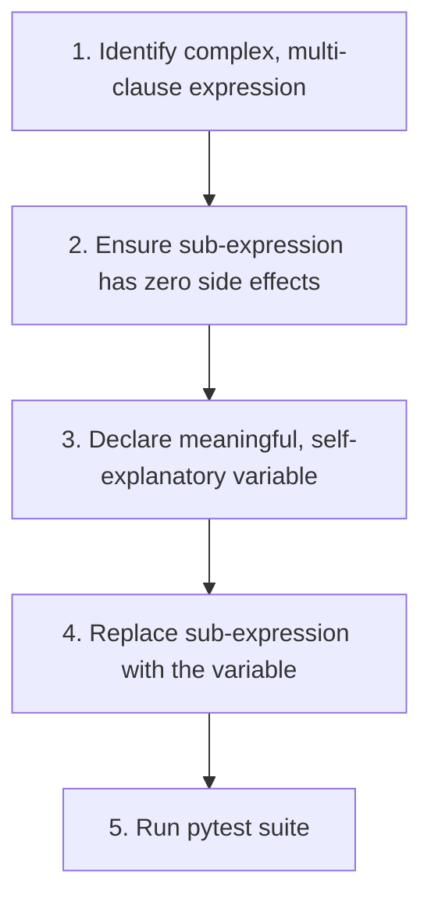

# Extract Variable 🏷️

## Source Reference
* **Book:** *Dive Into Refactoring* (Alexander Shvets), Chapter: *Refactoring Techniques / Composing Methods / Extract Variable*
* **Fixes Code Smells:** [Comments](../../code-smells/dispensables/comments.md), [Long Method](../../code-smells/bloaters/long-method.md)
* **Target Language:** Modern Python 3 (Python 3.10+) with `pytest`.

---

## 1. Intent and Motivation

You have an expression that is hard to understand or spans multiple lines. **Place the result of the expression (or parts of it) into a temporary variable with a name that explains its purpose.**

Extract Variable is especially useful in complex conditionals where multiple boolean clauses (`and`, `or`, `not`) obscure the business intent.

---

## 2. Step-by-Step Mechanics



1. **Verify Side Effects:** Ensure the expression does not produce side effects (e.g., mutating global state or calling non-idempotent I/O) that would change execution order.
2. **Define Variable:** Create a local variable named after the *business concept* of the expression.
3. **Replace:** Swap out the raw expression for the clean variable.
4. **Test:** Run tests to confirm correctness.

---

## 3. Python Before & After Demonstration

### A. Smelly / Legacy Code (Cryptic Multi-Clause Expression)
```python
# discount_smelly.py
def calculate_order_price(
    platform: str, browser: str, resize_count: int, quantity: int, item_price: float
) -> float:
  # Cryptic conditional expression requiring mental gymnastics
  if (
      "MAC" in platform.upper()
      and "SAFARI" in browser.upper()
      and resize_count > 0
      and (quantity * item_price) > 500.0
  ):
    return (quantity * item_price) * 0.90
  return quantity * item_price
```

### B. Pytest Baseline Contract
```python
# test_discount.py
from discount_smelly import calculate_order_price


def test_calculate_order_price():
  # Qualified for 10% discount:
  assert calculate_order_price("macOS", "Safari", 2, 10, 60.0) == 540.0
  # Not qualified (Windows):
  assert calculate_order_price("Windows", "Safari", 2, 10, 60.0) == 600.0
```

### C. Refactored Clean Code (Extracted Explanatory Variables)
```python
# discount_clean.py
def calculate_order_price(
    platform: str, browser: str, resize_count: int, quantity: int, item_price: float
) -> float:
  base_price = quantity * item_price
  is_mac_safari = "MAC" in platform.upper() and "SAFARI" in browser.upper()
  is_qualified_bulk_order = is_mac_safari and resize_count > 0 and base_price > 500.0

  if is_qualified_bulk_order:
    return base_price * 0.90
  return base_price
```

---

## 4. Complexity, Trade-offs & Anti-patterns

* **Variable Proliferation:** Extracting variables for trivial operations (`x = 2; y = 3; total = x + y`) adds noise. Only extract when the expression's business meaning is not immediately obvious.
* **Scope Scope:** If the extracted variable is needed across multiple methods, consider [Replace Temp with Query](replace-temp-with-query.md).

---

## 5. Related Techniques & Design Patterns

* **Opposite:** [Inline Temp](inline-temp.md).
* **Next Level:** [Replace Temp with Query](replace-temp-with-query.md).
