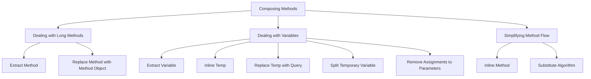

# Composing Methods 🧩

## Source Reference
* **Book:** *Dive Into Refactoring* (Alexander Shvets), Chapter: *Refactoring Techniques / Composing Methods*
* **Target Language:** Modern Python 3 (Python 3.10+) with `pytest`.

---

## Overview

Much of refactoring is devoted to correctly **composing methods**. In most codebases, long and convoluted methods are the root cause of all evil. They conceal business logic, make code impossible to read, and invite copy-paste duplication.

The techniques in this group streamline methods, remove code duplication, eliminate scratchpad variables, and prepare the foundation for higher-level architectural refactorings.

---

## The 9 Techniques in this Group

| Technique | Problem Solved | Core Transformation |
| :--- | :--- | :--- |
| [**Extract Method**](extract-method.md) | Method is too long or contains a cohesive sub-task | Move code fragment to separate method and call it |
| [**Inline Method**](inline-method.md) | Method body is as clear as its name | Replace calls with the method body and delete method |
| [**Extract Variable**](extract-variable.md) | Expression is hard to understand | Put result of expression in self-documenting variable |
| [**Inline Temp**](inline-temp.md) | Temp variable holds result of a simple expression | Replace references with the expression directly |
| [**Replace Temp with Query**](replace-temp-with-query.md) | Temp variable holds result of an expression used across method | Extract expression into a query method |
| [**Split Temporary Variable**](split-temporary-variable.md) | Single variable reused for different purposes | Make separate variable for each responsibility |
| [**Remove Assignments to Parameters**](remove-assignments-to-parameters.md) | Method modifies parameter passed into it | Assign parameter to local variable instead |
| [**Replace Method with Method Object**](replace-method-with-method-object.md) | Long method has local variables that make extraction painful | Turn method into a dedicated class |
| [**Substitute Algorithm**](substitute-algorithm.md) | Existing algorithm is slow, buggy, or overly complex | Replace body with simpler, clearer algorithm |
