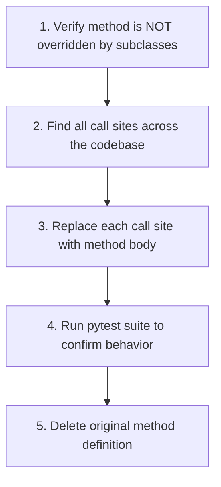

# Inline Method 🔄

## Source Reference
* **Book:** *Dive Into Refactoring* (Alexander Shvets), Chapter: *Refactoring Techniques / Composing Methods / Inline Method*
* **Fixes Code Smells:** [Lazy Class](../../code-smells/dispensables/lazy-class.md), [Speculative Generality](../../code-smells/dispensables/speculative-generality.md)
* **Target Language:** Modern Python 3 (Python 3.10+) with `pytest`.

---

## 1. Intent and Motivation

A method's body is **just as clear as the method's name itself**. Put the method's body into the body of its callers and remove the method.

Use Inline Method when indirection is needless, when a previous refactoring left behind a trivial one-line delegator, or when a group of badly organized small methods needs to be assembled back into one place before re-extracting them cleanly.

---

## 2. Step-by-Step Mechanics



1. **Verify Polymorphism:** Check that the method is not overridden in subclasses. (If it is polymorphic, inlining will break subclass overrides).
2. **Find All Call Sites:** Locate every caller of the method.
3. **Replace with Body:** Replace each call with the actual expression/body of the method.
4. **Test:** Run tests after each replacement.
5. **Delete:** Remove the original method definition.

---

## 3. Python Before & After Demonstration

### A. Smelly / Legacy Code (Pointless Indirection Wrapper)
```python
# rating_smelly.py
class DriverRatingService:

  def __init__(self, late_deliveries: int) -> None:
    self.late_deliveries = late_deliveries

  def get_rating(self) -> int:
    # Pointless indirection to a 1-line helper that says the exact same thing
    return 2 if self._has_too_many_late_deliveries() else 1

  def _has_too_many_late_deliveries(self) -> bool:
    return self.late_deliveries > 5
```

### B. Pytest Baseline Contract
```python
# test_rating.py
from rating_smelly import DriverRatingService


def test_driver_rating_evaluation():
  assert DriverRatingService(6).get_rating() == 2
  assert DriverRatingService(2).get_rating() == 1
```

### C. Refactored Clean Code (Inlined Method)
```python
# rating_clean.py
class DriverRatingService:
  """Clean service with eliminated useless indirection."""

  def __init__(self, late_deliveries: int) -> None:
    self.late_deliveries = late_deliveries

  def get_rating(self) -> int:
    return 2 if self.late_deliveries > 5 else 1
```

---

## 4. Complexity, Trade-offs & Anti-patterns

* **When NOT to Inline:** Never inline a method if doing so causes duplicate code across multiple callers.
* **Complex Inlining:** If the method contains multiple return statements or recursion, inlining can cause syntax gymnastics. Simplify the method first before inlining.

---

## 5. Related Techniques & Design Patterns

* **Opposite:** [Extract Method](extract-method.md).
* **Companion Technique:** [Inline Class](../moving-features/inline-class.md).
