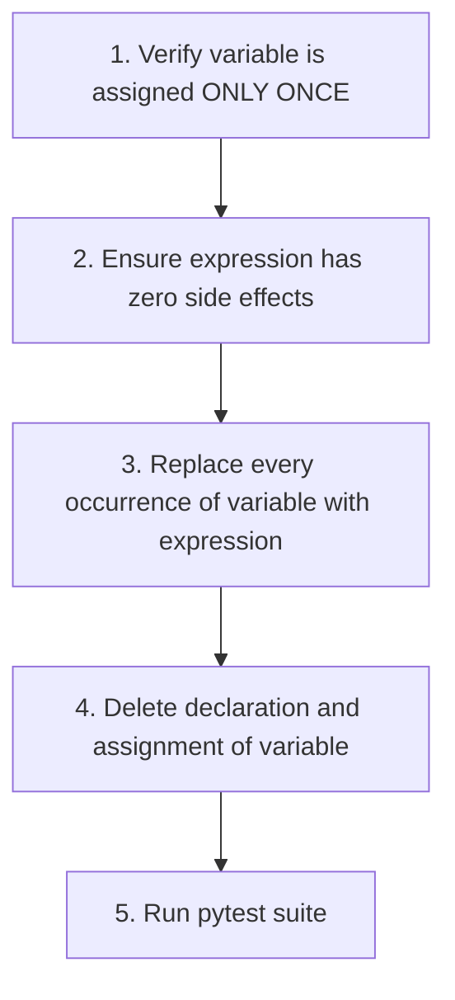

# Inline Temp 💨

## Source Reference
* **Book:** *Dive Into Refactoring* (Alexander Shvets), Chapter: *Refactoring Techniques / Composing Methods / Inline Temp*
* **Target Language:** Modern Python 3 (Python 3.10+) with `pytest`.

---

## 1. Intent and Motivation

You have a temporary variable that is assigned the result of a simple expression and nothing more. **Replace the references to the variable with the expression itself.**

Inline Temp is almost always used as a stepping stone for [Extract Method](extract-method.md) or [Replace Temp with Query](replace-temp-with-query.md). Temporary variables act as roadblocks when extracting methods because they must be passed along as parameters.

---

## 2. Step-by-Step Mechanics



1. **Verify Single Assignment:** Check that the temp variable is assigned only once and never reassigned later.
2. **Verify Idempotency:** Ensure the right-hand side expression has no side effects and returns the exact same value on every evaluation.
3. **Replace & Delete:** Replace all references to the temp variable with the expression, then delete the variable assignment.
4. **Test:** Run tests to verify identical behavior.

---

## 3. Python Before & After Demonstration

### A. Smelly / Legacy Code (Useless Intermediate Temporary Variable)
```python
# pricing_smelly.py
class Order:

  def __init__(self, base_price: float) -> None:
    self.base_price = base_price

  def is_eligible_for_discount(self) -> bool:
    # Pointless temporary variable that simply forwards an attribute
    has_high_base = self.base_price > 1000.0
    return has_high_base
```

### B. Pytest Baseline Contract
```python
# test_pricing.py
from pricing_smelly import Order


def test_discount_eligibility():
  assert Order(1500.0).is_eligible_for_discount() is True
  assert Order(800.0).is_eligible_for_discount() is False
```

### C. Refactored Clean Code (Inlined Temp)
```python
# pricing_clean.py
class Order:

  def __init__(self, base_price: float) -> None:
    self.base_price = base_price

  def is_eligible_for_discount(self) -> bool:
    return self.base_price > 1000.0
```

---

## 4. Complexity, Trade-offs & Anti-patterns

* **Performance Warning:** Never inline a temporary variable if the expression involves an expensive database query, network call, or heavy CPU computation that would now execute repeatedly in a loop. In such cases, keep the temp or use `@functools.cached_property`.

---

## 5. Related Techniques & Design Patterns

* **Opposite:** [Extract Variable](extract-variable.md).
* **Companion Technique:** [Replace Temp with Query](replace-temp-with-query.md).
