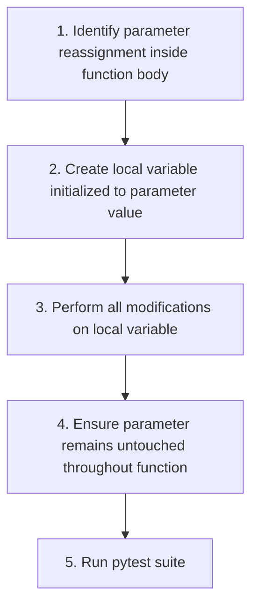

# Remove Assignments to Parameters 🚫

## Source Reference
* **Book:** *Dive Into Refactoring* (Alexander Shvets), Chapter: *Refactoring Techniques / Composing Methods / Remove Assignments to Parameters*
* **Target Language:** Modern Python 3 (Python 3.10+) with `pytest`.

---

## 1. Intent and Motivation

Some code assigns a new value to a parameter passed into a function or method. **Use a local temporary variable instead of reassigning the parameter.**

In Python, arguments are passed by object reference. If you mutate a mutable parameter (like a `list` or `dict`) or reassign the parameter name, you introduce severe mental confusion regarding whether the caller expects pass-by-value or pass-by-reference semantics. Treating parameters as strictly immutable inputs preserves clarity.

---

## 2. Step-by-Step Mechanics



1. **Locate Reassignment:** Find where a parameter name is being overwritten (`discount_rate = ...`, `initial_balance = ...`).
2. **Introduce Local Variable:** Create a new local variable initialized to the parameter's initial value.
3. **Replace Reassignment:** Assign changes to the local variable instead of the parameter.
4. **Test:** Run tests.

---

## 3. Python Before & After Demonstration

### A. Smelly / Legacy Code (Reassigning Parameter Directly)
```python
# discount_smelly.py
def calculate_discount(initial_rate: float, years_active: int) -> float:
  # Smelly: Mutating parameter name directly
  if years_active > 5:
    initial_rate += 0.05
  if years_active > 10:
    initial_rate += 0.05

  return initial_rate
```

### B. Pytest Baseline Contract
```python
# test_discount.py
from discount_smelly import calculate_discount


def test_calculate_discount():
  assert calculate_discount(0.10, 1) == 0.10
  assert calculate_discount(0.10, 6) == 0.15
  assert calculate_discount(0.10, 12) == 0.20
```

### C. Refactored Clean Code (Dedicated Local Variable)
```python
# discount_clean.py
def calculate_discount(initial_rate: float, years_active: int) -> float:
  # Treat parameters as immutable contracts:
  final_rate = initial_rate

  if years_active > 5:
    final_rate += 0.05
  if years_active > 10:
    final_rate += 0.05

  return final_rate
```

---

## 4. Complexity, Trade-offs & Anti-patterns

* **Mutable Parameter In-Place Mutation Trap:** Reassigning a parameter name (`param = "new"`) only affects the local function frame. However, mutating a mutable parameter (`param.append(1)` or `param["key"] = val`) mutates the caller's object in memory, causing unexpected side effects outside the function! If mutation was not intended, copy the collection first: `local_copy = list(incoming_items)`.

---

## 5. Related Techniques & Design Patterns

* **Companion:** [Split Temporary Variable](split-temporary-variable.md).
* **Next Steps:** [Separate Query from Modifier](../simplifying-method-calls/separate-query-from-modifier.md).
