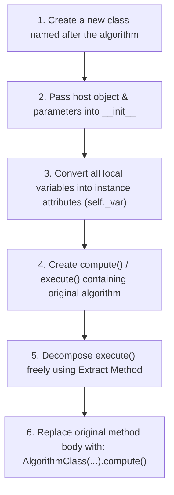

# Replace Method with Method Object 🏗️

## Source Reference
* **Book:** *Dive Into Refactoring* (Alexander Shvets), Chapter: *Refactoring Techniques / Composing Methods / Replace Method with Method Object*
* **Design Pattern Bridge:** [Command Pattern](../../../design-patterns/behavioral/command.md)
* **Fixes Code Smells:** [Long Method](../../code-smells/bloaters/long-method.md), [Temporary Field](../../code-smells/oo-abusers/temporary-field.md)
* **Target Language:** Modern Python 3 (Python 3.10+) with `pytest`.

---

## 1. Intent and Motivation

You have a long, complex method in which the **local variables are so tangled and interdependent that you cannot easily apply [Extract Method](extract-method.md)** without passing 6 parameters between every helper function.

**Transform the method into its own dedicated class.** The local variables become instance fields of this new class. You can then decompose the large method into multiple small, clean methods within this new object without passing any parameters.

---

## 2. Step-by-Step Mechanics



1. **Create New Class:** Name it after the method or algorithm (e.g., `OrderPricingCalculation`).
2. **Setup Constructor:** Pass the original object (if needed) and all method parameters into `__init__`.
3. **Turn Temps into Attributes:** Convert all tangled local variables into instance attributes of the new class.
4. **Define Execution Method:** Create `compute()` or `execute()` containing the original method body.
5. **Decompose Freely:** Now that all state is shared via `self`, freely extract smaller helper methods with zero parameter-passing overhead.
6. **Delegate from Original Method:** Replace the original method body with instantiation and execution of the new method object.

---

## 3. Python Before & After Demonstration

### A. Smelly / Legacy Code (Monolithic Method with Tangled Local State)
```python
# gamma_smelly.py
class Account:

  def gamma(
      self, input_val: int, quantity: int, year_to_date: int
  ) -> int:
    # 5 tangled intermediate variables that prevent clean Extract Method:
    important_value1 = (input_val * quantity) + self._delta()
    important_value2 = (input_val * year_to_date) + 100

    if (year_to_date - important_value1) > 100:
      important_value2 -= 20

    important_value3 = important_value2 * 7
    # and 30 more lines of tangled math...
    return important_value3 - 2 * important_value1

  def _delta(self) -> int:
    return 42
```

### B. Pytest Baseline Contract
```python
# test_gamma.py
from gamma_smelly import Account


def test_gamma_calculation():
  acc = Account()
  assert acc.gamma(input_val=5, quantity=10, year_to_date=200) == 706
```

### C. Refactored Clean Code (Method Object Pattern)
```python
# gamma_clean.py
class GammaCalculation:
  """Method Object: encapsulates complex algorithm state, allowing effortless decomposition."""

  def __init__(
      self,
      account: "Account",
      input_val: int,
      quantity: int,
      year_to_date: int,
  ) -> None:
    self._account = account
    self._input_val = input_val
    self._quantity = quantity
    self._year_to_date = year_to_date
    self._val1 = 0
    self._val2 = 0
    self._val3 = 0

  def compute(self) -> int:
    self._val1 = (self._input_val * self._quantity) + self._account.delta()
    self._val2 = (self._input_val * self._year_to_date) + 100

    self._apply_year_threshold_adjustment()

    self._val3 = self._val2 * 7
    return self._val3 - (2 * self._val1)

  def _apply_year_threshold_adjustment(self) -> None:
    if (self._year_to_date - self._val1) > 100:
      self._val2 -= 20


class Account:

  def delta(self) -> int:
    return 42

  def gamma(
      self, input_val: int, quantity: int, year_to_date: int
  ) -> int:
    return GammaCalculation(
        self, input_val, quantity, year_to_date
    ).compute()
```

---

## 4. Complexity, Trade-offs & Anti-patterns

* **When NOT to Use:** If the method only has 1 or 2 local variables, [Extract Method](extract-method.md) is much simpler and avoids creating a new class.
* **Avoid Retaining Stale Objects:** Method objects should usually be transient: instantiate, execute, and allow Python's garbage collector to reclaim them immediately.

---

## 5. Related Techniques & Design Patterns

* **Companion Pattern:** [Command Pattern](../../../design-patterns/behavioral/command.md), [Strategy Pattern](../../../design-patterns/behavioral/strategy.md).
* **Opposite / Simpler:** [Extract Method](extract-method.md).
