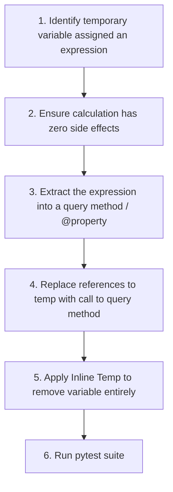

# Replace Temp with Query 🔍

## Source Reference
* **Book:** *Dive Into Refactoring* (Alexander Shvets), Chapter: *Refactoring Techniques / Composing Methods / Replace Temp with Query*
* **Fixes Code Smells:** [Long Method](../../code-smells/bloaters/long-method.md)
* **Target Language:** Modern Python 3 (Python 3.10+) with `pytest`.

---

## 1. Intent and Motivation

You place the result of an expression in a local variable for later use in your code. **Move the entire expression to a separate method and return the result from it. Query the method instead of using a variable.**

Local temporary variables exist only inside the scope of the method that created them. If another method in the class needs the same calculation, the developer is forced to copy-paste the formula. Turning the temp into a query method makes it accessible across the entire class and shortens the calling method.

---

## 2. Step-by-Step Mechanics



1. **Check Immutability:** Ensure the temporary variable is assigned only once and does not change within the method.
2. **Extract Method:** Extract the right-hand side expression into a private helper method (or Python `@property`).
3. **Replace & Inline:** Replace references to the temp variable with calls to the new query method.
4. **Delete Temp:** Delete the temporary variable declaration.
5. **Test:** Run tests.

---

## 3. Python Before & After Demonstration

### A. Smelly / Legacy Code (Temporary Variables Cluttering the Method)
```python
# invoice_smelly.py
class OrderItem:

  def __init__(self, quantity: int, item_price: float) -> None:
    self.quantity = quantity
    self.item_price = item_price

  def calculate_total(self) -> float:
    # Temporary variables trapped inside calculate_total():
    base_price = self.quantity * self.item_price
    discount_factor = 0.95 if base_price > 1000 else 0.98
    return base_price * discount_factor
```

### B. Pytest Baseline Contract
```python
# test_invoice.py
from invoice_smelly import OrderItem


def test_order_item_total():
  item_high = OrderItem(quantity=10, item_price=150.0)  # base = 1500 -> 0.95
  assert item_high.calculate_total() == 1425.0

  item_low = OrderItem(quantity=2, item_price=100.0)  # base = 200 -> 0.98
  assert item_low.calculate_total() == 196.0
```

### C. Refactored Clean Code (Extracted Query Properties)
```python
# invoice_clean.py
class OrderItem:
  """Clean class: Temporary variables converted to reusable domain query properties."""

  def __init__(self, quantity: int, item_price: float) -> None:
    self.quantity = quantity
    self.item_price = item_price

  @property
  def base_price(self) -> float:
    return self.quantity * self.item_price

  @property
  def discount_factor(self) -> float:
    return 0.95 if self.base_price > 1000 else 0.98

  def calculate_total(self) -> float:
    return self.base_price * self.discount_factor
```

---

## 4. Complexity, Trade-offs & Anti-patterns

* **Performance Concern:** If calculating the query property is expensive, calling `self.base_price` twice might appear wasteful. In Python, use `@functools.cached_property` to cache the value after its first invocation when immutability is guaranteed.
* **Separation of Concerns:** Query methods must be **pure functions** (CQS - Command Query Separation). They must never mutate instance state or perform I/O.

---

## 5. Related Techniques & Design Patterns

* **Companion:** [Extract Method](extract-method.md), [Inline Temp](inline-temp.md).
* **Next Steps:** [Separate Query from Modifier](../simplifying-method-calls/separate-query-from-modifier.md).
