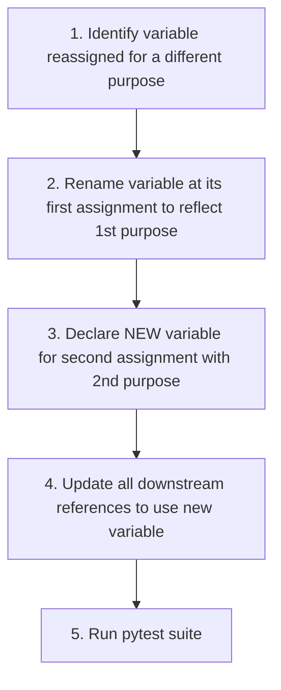

# Split Temporary Variable 🪓

## Source Reference
* **Book:** *Dive Into Refactoring* (Alexander Shvets), Chapter: *Refactoring Techniques / Composing Methods / Split Temporary Variable*
* **Target Language:** Modern Python 3 (Python 3.10+) with `pytest`.

---

## 1. Intent and Motivation

You have a local variable that is **reused to hold different values** across different stages of a method (other than loop counters like `i` or accumulators). **Use a separate temporary variable for each responsibility.**

Reusing a single temporary variable (`temp`, `result`, `val`, `acc`) for multiple unrelated computations confuses readers and creates insidious ordering bugs where a developer accidentally reads an outdated value.

---

## 2. Step-by-Step Mechanics



1. **Find Reassignments:** Locate places where a temporary variable is assigned a new, conceptually distinct value.
2. **Rename First Role:** Rename the variable at its first declaration to describe its specific initial responsibility.
3. **Declare Second Variable:** For the second usage, declare a new variable with a distinct name.
4. **Update References:** Point downstream expressions to the correct variable.
5. **Test:** Run tests.

---

## 3. Python Before & After Demonstration

### A. Smelly / Legacy Code (Reusing `acc` for Both Perimeter and Area)
```python
# geometry_smelly.py
class Rectangle:

  def __init__(self, width: float, height: float) -> None:
    self.width = width
    self.height = height

  def compute_metrics(self) -> dict:
    # 'temp' used first for perimeter calculation:
    temp = 2 * (self.width + self.height)
    print(f"Perimeter: {temp}")

    # 'temp' REUSED for area calculation!
    temp = self.width * self.height
    print(f"Area: {temp}")

    return {"metric": temp}  # Which metric was intended? Confusing!
```

### B. Pytest Baseline Contract
```python
# test_geometry.py
from geometry_smelly import Rectangle


def test_compute_metrics():
  rect = Rectangle(4.0, 5.0)
  res = rect.compute_metrics()
  assert res["metric"] == 20.0
```

### C. Refactored Clean Code (Split Variables)
```python
# geometry_clean.py
class Rectangle:

  def __init__(self, width: float, height: float) -> None:
    self.width = width
    self.height = height

  def compute_metrics(self) -> dict:
    perimeter = 2 * (self.width + self.height)
    print(f"Perimeter: {perimeter}")

    area = self.width * self.height
    print(f"Area: {area}")

    return {"perimeter": perimeter, "area": area}
```

---

## 4. Complexity, Trade-offs & Anti-patterns

* **Loop Accumulators Exempt:** Loop indices (`for i, val in enumerate(items):`) and collection accumulators (`total += item.price`) that update incrementally across an iteration are not considered smelly.

---

## 5. Related Techniques & Design Patterns

* **Companion:** [Extract Variable](extract-variable.md).
* **Next Step:** [Remove Assignments to Parameters](remove-assignments-to-parameters.md).
