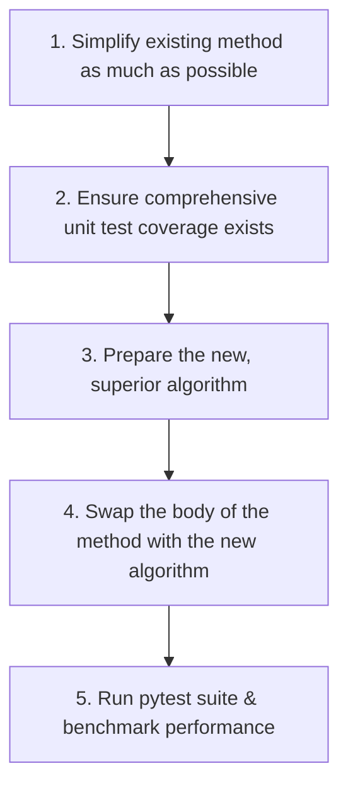

# Substitute Algorithm 🔄

## Source Reference
* **Book:** *Dive Into Refactoring* (Alexander Shvets), Chapter: *Refactoring Techniques / Composing Methods / Substitute Algorithm*
* **Design Pattern Bridge:** [Strategy Pattern](../../../design-patterns/behavioral/strategy.md)
* **Fixes Code Smells:** [Duplicate Code](../../code-smells/dispensables/duplicate-code.md), [Long Method](../../code-smells/bloaters/long-method.md)
* **Target Language:** Modern Python 3 (Python 3.10+) with `pytest`.

---

## 1. Intent and Motivation

You want to replace an existing algorithm with one that is **clearer, more concise, or significantly faster**. **Replace the body of the method with the new algorithm.**

Over time, developers learn better ways to solve problems, or modern language features (such as Python's `set` intersections, dictionary lookups, or comprehensions) make custom loops completely obsolete.

---

## 2. Step-by-Step Mechanics



1. **Verify Baseline Tests:** Ensure you have strong regression tests covering all edge cases, empty inputs, and normal operations.
2. **Decompose First:** Make sure the method has already been simplified by extracting any unrelated side-effects.
3. **Swap Algorithm:** Replace the implementation with the modern, idiomatic algorithm.
4. **Run Tests:** Verify that all test cases pass without deviation.

---

## 3. Python Before & After Demonstration

### A. Smelly / Legacy Code (O(N*M) Nested Loops with Manual String Matching)
```python
# search_smelly.py
def find_matching_candidates(
    candidates: list[str], target_keywords: list[str]
) -> list[str]:
  # Smelly: Procedural nested loop with duplicate handling and flags
  matched = []
  for person in candidates:
    for keyword in target_keywords:
      if keyword.lower() in person.lower():
        found = False
        for m in matched:
          if m == person:
            found = True
            break
        if not found:
          matched.append(person)
  return matched
```

### B. Pytest Baseline Contract
```python
# test_search.py
from search_smelly import find_matching_candidates


def test_find_matching_candidates():
  candidates = ["Alice Smith", "Bob Jones", "Charlie Brown", "Alice Cooper"]
  keywords = ["alice", "brown"]

  result = find_matching_candidates(candidates, keywords)
  assert result == ["Alice Smith", "Charlie Brown", "Alice Cooper"]
```

### C. Refactored Clean Code (Modern Idiomatic Python Algorithm)
```python
# search_clean.py
def find_matching_candidates(
    candidates: list[str], target_keywords: list[str]
) -> list[str]:
  """Clean, declarative algorithm using Python set comprehension logic while preserving order."""
  lower_keywords = tuple(k.lower() for k in target_keywords)

  # Check if person contains any target keyword:
  return [
      person
      for person in candidates
      if any(kw in person.lower() for kw in lower_keywords)
  ]
```

---

## 4. Complexity, Trade-offs & Anti-patterns

* **Algorithmic Equivalence:** Ensure the new algorithm matches the old algorithm's subtleties (e.g., ordering guarantees, casing handling, empty list behavior).
* **Don't Substitute in the Dark:** Never replace an algorithm without a rock-solid `pytest` suite in place first.

---

## 5. Related Techniques & Design Patterns

* **Companion Pattern:** [Strategy Pattern](../../../design-patterns/behavioral/strategy.md).
* **Next Steps:** [Decompose Conditional](../simplifying-conditionals/decompose-conditional.md).
