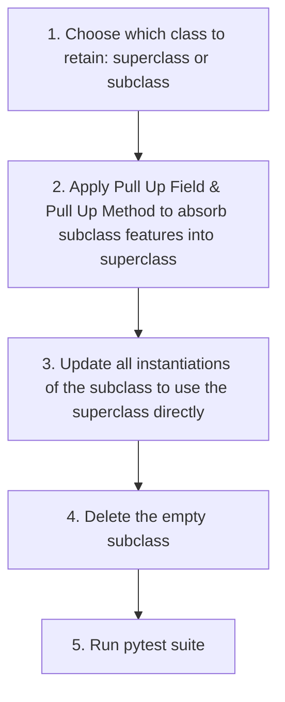

# Collapse Hierarchy 📉

## Source Reference
* **Book:** *Dive Into Refactoring* (Alexander Shvets), Chapter: *Refactoring Techniques / Dealing with Generalization / Collapse Hierarchy*
* **Fixes Code Smells:** [Lazy Class](../../code-smells/dispensables/lazy-class.md), [Speculative Generality](../../code-smells/dispensables/speculative-generality.md)
* **Target Language:** Modern Python 3 (Python 3.10+) with `pytest`.

---

## 1. Intent and Motivation

You have a class hierarchy where a **subclass and superclass are no longer meaningfully distinct** from one another (e.g., refactorings have removed most features from the subclass, leaving behind a hollow freeloader).

**Merge the superclass and subclass together into a single cohesive class, and eliminate the redundant level of inheritance.**

Deep inheritance hierarchies add cognitive strain. If a subclass adds only one trivial method or has become essentially identical to its parent, collapsing the hierarchy removes unnecessary indirection.

---

## 2. Step-by-Step Mechanics



1. **Choose Winner:** Decide whether to keep the superclass name or subclass name (usually keep the superclass).
2. **Move Remaining Features:** Move any remaining unique fields and methods from the subclass into the superclass.
3. **Migrate References:** Replace references to the subclass with the superclass across the codebase.
4. **Delete:** Delete the redundant class definition.
5. **Test:** Run tests.

---

## 3. Python Before & After Demonstration

### A. Smelly / Legacy Code (Hollow Subclass Adding Zero Value)
```python
# employee_smelly.py
class Employee:

  def __init__(self, name: str, salary: float) -> None:
    self.name = name
    self.salary = salary


# Smelly: Salesman used to have 20 methods, but now only has this 1 trivial method:
class Salesman(Employee):

  def get_role(self) -> str:
    return "SALES"
```

### B. Pytest Baseline Contract
```python
# test_employee.py
from employee_smelly import Salesman


def test_salesman():
  sales = Salesman("Alice", 50_000.0)
  assert sales.name == "Alice"
  assert sales.get_role() == "SALES"
```

### C. Refactored Clean Code (Collapsed Hierarchy)
```python
# employee_clean.py
class Employee:
  """Clean consolidated class: Hierarchy collapsed into a single entity."""

  def __init__(
      self, name: str, salary: float, role: str = "GENERAL"
  ) -> None:
    self.name = name
    self.salary = salary
    self.role = role

  def get_role(self) -> str:
    return self.role
```

---

## 4. Complexity, Trade-offs & Anti-patterns

* **Opposite:** [Extract Subclass](extract-subclass.md).
* **When NOT to Collapse:** If future requirements will soon re-introduce divergent behaviors for that subclass in the current milestone, leave the subclass intact.

---

## 5. Related Techniques & Design Patterns

* **Opposite:** [Extract Subclass](extract-subclass.md).
* **Companion:** [Inline Class](../moving-features/inline-class.md).
