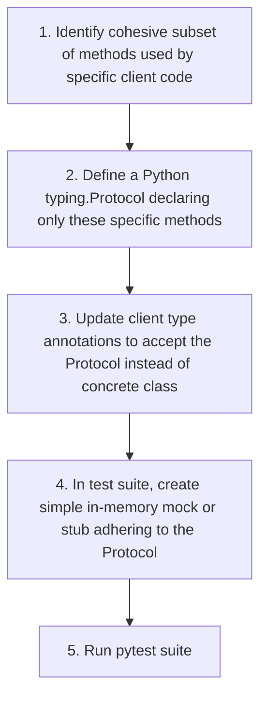

# Extract Interface / Protocol 📜

## Source Reference
* **Book:** *Dive Into Refactoring* (Alexander Shvets), Chapter: *Refactoring Techniques / Dealing with Generalization / Extract Interface*
* **Design Principle Bridge:** *Interface Segregation Principle (ISP)*, *Dependency Inversion Principle (DIP)*
* **Target Language:** Modern Python 3 (Python 3.10+) with `pytest`.

---

## 1. Intent and Motivation

Multiple clients use the **exact same subset of a class's methods**, or two distinct classes implement an identical subset of operations.

**Extract this subset into a formal Python `typing.Protocol` (structural subtyping) or `abc.ABC` (nominal subtyping). Make the calling code depend strictly on the interface rather than the concrete class.**

Depending directly on heavy concrete classes couples client code to database connections, network drivers, or external SDKs. Extracting an interface decouples the caller, satisfies the Interface Segregation Principle, and enables effortless test mocking and dependency injection.

---

## 2. Step-by-Step Mechanics



1. **Define Protocol:** Create a subclass of `typing.Protocol` with method signatures and type hints.
2. **Update Consumer Signatures:** Change client function arguments from `service: ProductionDatabaseService` to `service: DatabaseReaderProtocol`.
3. **Duck Typing / Verification:** Python protocols support structural typing (duck typing): classes don't even need to inherit from the protocol explicitly!
4. **Test:** Verify with `pytest`.

---

## 3. Python Before & After Demonstration

### A. Smelly / Legacy Code (Client Tightly Coupled to Heavy Concrete Class)
```python
# report_smelly.py
class ProductionDatabaseService:
  """Heavy service that connects to real PostgreSQL / Oracle databases."""

  def connect(self) -> None:
    pass

  def fetch_user_record(self, user_id: str) -> dict:
    # Real SQL query...
    return {"id": user_id, "name": "Alice"}

  def execute_bulk_ddl_migration(self) -> None:
    pass


class UserReportGenerator:

  # Smelly: Directly coupled to the heavy production DB class!
  def __init__(self, db: ProductionDatabaseService) -> None:
    self.db = db

  def generate_header(self, user_id: str) -> str:
    # Only calls fetch_user_record(), but depends on the entire heavy DB!
    user = self.db.fetch_user_record(user_id)
    return f"REPORT FOR: {user['name']}"
```

### B. Pytest Baseline Contract
```python
# test_report.py
from report_smelly import ProductionDatabaseService, UserReportGenerator


def test_report_generation():
  db = ProductionDatabaseService()
  report = UserReportGenerator(db)
  assert report.generate_header("U-1") == "REPORT FOR: Alice"
```

### C. Refactored Clean Code (Extracted `typing.Protocol`)
```python
# report_clean.py
from typing import Protocol


class UserRecordReader(Protocol):
  """Extracted Interface: Defines strictly what the report generator actually needs."""

  def fetch_user_record(self, user_id: str) -> dict:
    ...


class UserReportGenerator:
  """Clean class: Depends on the thin abstraction (DIP & ISP)."""

  def __init__(self, reader: UserRecordReader) -> None:
    self.reader = reader

  def generate_header(self, user_id: str) -> str:
    user = self.reader.fetch_user_record(user_id)
    return f"REPORT FOR: {user['name']}"


# Unit testing is now instantaneous without needing a database!
class MockUserReader:

  def fetch_user_record(self, user_id: str) -> dict:
    return {"id": user_id, "name": "Mocked Alice"}


def test_clean_report():
  report = UserReportGenerator(MockUserReader())
  assert report.generate_header("U-1") == "REPORT FOR: Mocked Alice"
```

---

## 4. Complexity, Trade-offs & Anti-patterns

* **Python Protocols vs ABCs:**
  - Prefer `typing.Protocol` for Python: it provides compile-time and mypy type verification through structural subtyping without requiring external classes to inherit from your base class.
  - Use `abc.ABC` when you also need to provide shared default method implementations via `super()`.

---

## 5. Related Techniques & Design Patterns

* **Companion:** [Extract Superclass](extract-superclass.md).
* **Pattern Bridge:** [Adapter Pattern](../../../design-patterns/structural/adapter.md).
