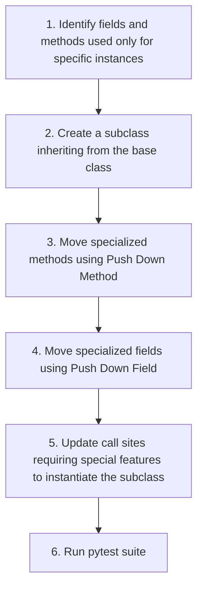

# Extract Subclass 🌿

## Source Reference
* **Book:** *Dive Into Refactoring* (Alexander Shvets), Chapter: *Refactoring Techniques / Dealing with Generalization / Extract Subclass*
* **Fixes Code Smells:** [Large Class](../../code-smells/bloaters/large-class.md)
* **Target Language:** Modern Python 3 (Python 3.10+) with `pytest`.

---

## 1. Intent and Motivation

A class contains **features, attributes, and methods that are used only in certain cases or for a specific subset of its instances**.

**Create a subclass and move the specialized features into it.**

When a class tries to handle both normal cases and complex special-case variants in a single file, it becomes bloated with boolean flags (`is_labor_item`, `is_part_time`) and conditional calculations that only apply 10% of the time. Extracting a subclass isolates the specialized complexity.

---

## 2. Step-by-Step Mechanics



1. **Create Subclass:** Inherit from the parent class.
2. **Push Down Features:** Apply [Push Down Method](push-down-method.md) and [Push Down Field](push-down-field.md) to transfer the special-case features into the new subclass.
3. **Migrate Special Call Sites:** Change code that needs the specialized behavior to instantiate the new subclass (or use a Factory Method).
4. **Test:** Verify with `pytest`.

---

## 3. Python Before & After Demonstration

### A. Smelly / Legacy Code (JobItem Handling Both Parts and Labor via Flags)
```python
# job_smelly.py
class JobItem:

  def __init__(
      self,
      quantity: int,
      unit_price: float,
      is_labor: bool = False,
      employee_hourly_rate: float | None = None,
  ) -> None:
    self.quantity = quantity
    self.unit_price = unit_price
    self.is_labor = is_labor
    self.employee_hourly_rate = employee_hourly_rate

  def get_total_price(self) -> float:
    # Conditional logic branching on labor vs parts item
    base_rate = (
        self.employee_hourly_rate if self.is_labor else self.unit_price
    )
    return self.quantity * base_rate
```

### B. Pytest Baseline Contract
```python
# test_job.py
from job_smelly import JobItem


def test_job_item_calculations():
  part = JobItem(quantity=5, unit_price=10.0, is_labor=False)
  labor = JobItem(
      quantity=4,
      unit_price=0.0,
      is_labor=True,
      employee_hourly_rate=50.0,
  )

  assert part.get_total_price() == 50.0
  assert labor.get_total_price() == 200.0
```

### C. Refactored Clean Code (Extracted `LaborItem` Subclass)
```python
# job_clean.py
class JobItem:
  """Base class: Represents a standard parts/materials line item."""

  def __init__(self, quantity: int, unit_price: float) -> None:
    self.quantity = quantity
    self.unit_price = unit_price

  @property
  def unit_rate(self) -> float:
    return self.unit_price

  def get_total_price(self) -> float:
    return self.quantity * self.unit_rate


class LaborItem(JobItem):
  """Extracted Subclass: Specializes rate calculation for billable labor."""

  def __init__(
      self, quantity: int, employee_hourly_rate: float
  ) -> None:
    super().__init__(quantity, unit_price=0.0)
    self.employee_hourly_rate = employee_hourly_rate

  @property
  def unit_rate(self) -> float:
    return self.employee_hourly_rate
```

---

## 4. Complexity, Trade-offs & Anti-patterns

* **Subclassing vs Strategy:** If an object needs to switch from being a parts item to a labor item dynamically at runtime, do not use subclasses. Instead, use composition via [Replace Type Code with State/Strategy](../organizing-data/replace-type-code-with-state-strategy.md).

---

## 5. Related Techniques & Design Patterns

* **Opposite:** [Collapse Hierarchy](collapse-hierarchy.md).
* **Companion:** [Extract Superclass](extract-superclass.md).
