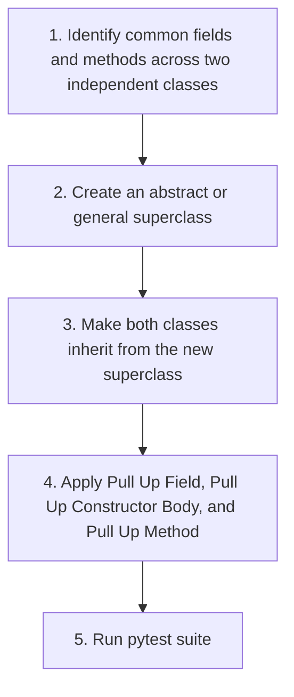

# Extract Superclass 🏛️

## Source Reference
* **Book:** *Dive Into Refactoring* (Alexander Shvets), Chapter: *Refactoring Techniques / Dealing with Generalization / Extract Superclass*
* **Fixes Code Smells:** [Duplicate Code](../../code-smells/dispensables/duplicate-code.md)
* **Target Language:** Modern Python 3 (Python 3.10+) with `pytest`.

---

## 1. Intent and Motivation

You have two or more independent classes that **share similar fields, validation logic, and operations**, but they do not share a common inheritance hierarchy (e.g., `Department` and `Employee` both have a `name`, an `annual_cost`, and a `manager`).

**Create a shared superclass (e.g., `Party`) and move the common fields and methods up into it.**

When two classes independently evolve similar features, developers end up writing duplicate methods and tests. Extracting a superclass unifies the common abstraction, eliminates code duplication, and enables polymorphic handling across both classes.

---

## 2. Step-by-Step Mechanics



1. **Create Superclass:** Define a common base class.
2. **Establish Inheritance:** Make the target classes inherit from the new base class.
3. **Pull Up Common Features:**
   - Use [Pull Up Field](pull-up-field.md) for shared attributes.
   - Use [Pull Up Constructor Body](pull-up-constructor-body.md) for shared initializers.
   - Use [Pull Up Method](pull-up-method.md) for identical behavior.
4. **Test:** Verify with `pytest`.

---

## 3. Python Before & After Demonstration

### A. Smelly / Legacy Code (Independent Classes Sharing Common Cost and Name Logic)
```python
# party_smelly.py
class Employee:

  def __init__(self, name: str, id_code: str, monthly_salary: float) -> None:
    self.name = name
    self.id_code = id_code
    self.monthly_salary = monthly_salary

  def get_annual_cost(self) -> float:
    return self.monthly_salary * 12.0


class Department:

  def __init__(self, name: str, staff: list[Employee]) -> None:
    self.name = name
    self.staff = staff

  def get_annual_cost(self) -> float:
    return sum(emp.get_annual_cost() for emp in self.staff)
```

### B. Pytest Baseline Contract
```python
# test_party.py
from party_smelly import Department, Employee


def test_annual_costs():
  alice = Employee("Alice", "E-1", 5000.0)
  bob = Employee("Bob", "E-2", 4000.0)
  dept = Department("IT", [alice, bob])

  assert alice.get_annual_cost() == 60_000.0
  assert dept.get_annual_cost() == 108_000.0
```

### C. Refactored Clean Code (Extracted `Party` Superclass)
```python
# party_clean.py
from abc import ABC, abstractmethod


class Party(ABC):
  """Extracted Superclass unifying shared organizational identity and cost calculation."""

  def __init__(self, name: str) -> None:
    self.name = name

  @abstractmethod
  def get_annual_cost(self) -> float:
    """Polymorphic contract for all organizational entities."""
    ...


class Employee(Party):

  def __init__(self, name: str, id_code: str, monthly_salary: float) -> None:
    super().__init__(name)
    self.id_code = id_code
    self.monthly_salary = monthly_salary

  def get_annual_cost(self) -> float:
    return self.monthly_salary * 12.0


class Department(Party):

  def __init__(self, name: str, staff: list[Employee]) -> None:
    super().__init__(name)
    self.staff = staff

  def get_annual_cost(self) -> float:
    return sum(emp.get_annual_cost() for emp in self.staff)
```

---

## 4. Complexity, Trade-offs & Anti-patterns

* **Superclass vs Protocol:** If the classes only share a method interface but have completely different internal state, extracting a `typing.Protocol` (via [Extract Interface](extract-interface.md)) is cleaner than creating a rigid inheritance hierarchy.

---

## 5. Related Techniques & Design Patterns

* **Companion:** [Pull Up Method](pull-up-method.md), [Extract Interface / Protocol](extract-interface.md).
* **Pattern Connection:** [Composite Pattern](../../../design-patterns/structural/composite.md).
