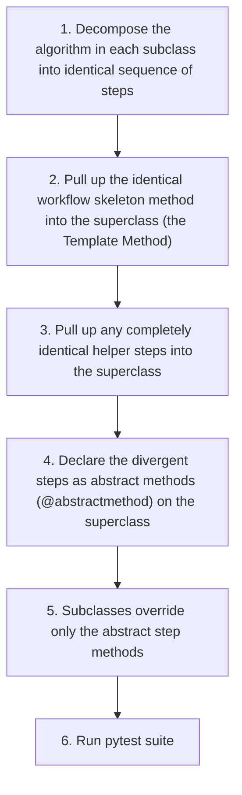

# Form Template Method 📐

## Source Reference
* **Book:** *Dive Into Refactoring* (Alexander Shvets), Chapter: *Refactoring Techniques / Dealing with Generalization / Form Template Method*
* **Design Pattern Bridge:** [Template Method Pattern](../../../design-patterns/behavioral/template-method.md)
* **Fixes Code Smells:** [Duplicate Code](../../code-smells/dispensables/duplicate-code.md)
* **Target Language:** Modern Python 3 (Python 3.10+) with `pytest`.

---

## 1. Intent and Motivation

Your subclasses have **methods that implement the exact same overall algorithm or workflow, but execute slightly different specific steps** (e.g., both generate a report by printing a header, calculating items, and printing a footer, but format the items differently).

**Subdivide the algorithm into discrete steps, pull up the master workflow skeleton into a template method in the superclass, and let each subclass implement only its divergent steps.**

Copying and pasting an entire 40-line algorithmic workflow just to change 2 lines in the middle is a massive violation of the DRY principle. The Template Method pattern centralizes the overarching control flow while preserving subclass customization points.

---

## 2. Step-by-Step Mechanics



1. **Break into Steps:** Apply [Extract Method](../composing-methods/extract-method.md) in each subclass until the algorithms consist of an identical sequence of step calls.
2. **Pull Up Skeleton:** Use [Pull Up Method](pull-up-method.md) to move the master coordinating method into the base class.
3. **Declare Abstract Steps:** For steps that differ, declare `@abstractmethod` in the base class.
4. **Override in Subclasses:** Let subclasses implement only their specialized step methods.
5. **Test:** Run tests.

---

## 3. Python Before & After Demonstration

### A. Smelly / Legacy Code (Duplicated Master Workflow Across Exporters)
```python
# export_smelly.py
class MarkdownExporter:

  def export_statement(self, title: str, items: list[dict]) -> str:
    # Master sequence duplicated:
    lines = [f"# {title}", ""]
    # Divergent step:
    for item in items:
      lines.append(f"- {item['name']}: ${item['price']}")
    # Master sequence duplicated:
    lines.append(f"\nTotal items: {len(items)}")
    return "\n".join(lines)


class HtmlExporter:

  def export_statement(self, title: str, items: list[dict]) -> str:
    # Master sequence duplicated:
    lines = [f"<h1>{title}</h1>", "<ul>"]
    # Divergent step:
    for item in items:
      lines.append(f"<li>{item['name']} - ${item['price']}</li>")
    # Master sequence duplicated:
    lines.append(f"</ul>\n<p>Total items: {len(items)}</p>")
    return "\n".join(lines)
```

### B. Pytest Baseline Contract
```python
# test_export.py
from export_smelly import HtmlExporter, MarkdownExporter


def test_statement_export():
  items = [{"name": "Book", "price": 15}]
  md = MarkdownExporter().export_statement("Order", items)
  html = HtmlExporter().export_statement("Order", items)

  assert "# Order" in md
  assert "- Book: $15" in md
  assert "<h1>Order</h1>" in html
  assert "<li>Book - $15</li>" in html
```

### C. Refactored Clean Code (Template Method Pattern)
```python
# export_clean.py
from abc import ABC, abstractmethod


class BaseStatementExporter(ABC):
  """Template Method Pattern: Coordinates algorithm flow while delegating primitive steps."""

  def export_statement(self, title: str, items: list[dict]) -> str:
    """The Template Method: Defines the unalterable sequence of steps."""
    header = self._format_header(title)
    body = self._format_body(items)
    footer = self._format_footer(len(items))
    return f"{header}\n{body}\n{footer}"

  @abstractmethod
  def _format_header(self, title: str) -> str:
    ...

  @abstractmethod
  def _format_body(self, items: list[dict]) -> str:
    ...

  @abstractmethod
  def _format_footer(self, item_count: int) -> str:
    ...


class MarkdownExporter(BaseStatementExporter):

  def _format_header(self, title: str) -> str:
    return f"# {title}"

  def _format_body(self, items: list[dict]) -> str:
    return "\n".join(
        [f"- {item['name']}: ${item['price']}" for item in items]
    )

  def _format_footer(self, item_count: int) -> str:
    return f"\nTotal items: {item_count}"


class HtmlExporter(BaseStatementExporter):

  def _format_header(self, title: str) -> str:
    return f"<h1>{title}</h1>\n<ul>"

  def _format_body(self, items: list[dict]) -> str:
    return "\n".join(
        [f"<li>{item['name']} - ${item['price']}</li>" for item in items]
    )

  def _format_footer(self, item_count: int) -> str:
    return f"</ul>\n<p>Total items: {item_count}</p>"
```

---

## 4. Complexity, Trade-offs & Anti-patterns

* **Hollywood Principle:** *"Don't call us, we'll call you."* The superclass calls the methods in the subclass, never the reverse.
* **Alternative (Composition):** If the variation steps can be passed as callable functions or lambda strategies, consider the [Strategy Pattern](../../../design-patterns/behavioral/strategy.md) instead of subclassing.

---

## 5. Related Techniques & Design Patterns

* **Design Pattern Connection:** [Template Method Pattern](../../../design-patterns/behavioral/template-method.md).
* **Fixes:** [Duplicate Code](../../code-smells/dispensables/duplicate-code.md).
