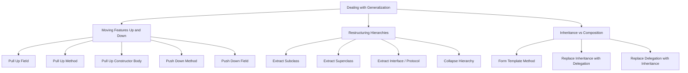

# Dealing with Generalization 🏛️

## Source Reference
* **Book:** *Dive Into Refactoring* (Alexander Shvets), Chapter: *Refactoring Techniques / Dealing with Generalization*
* **Design Pattern Links:** [Template Method Pattern](../../../design-patterns/behavioral/template-method.md), [Bridge Pattern](../../../design-patterns/structural/bridge.md)
* **Target Language:** Modern Python 3 (Python 3.10+) with `pytest`.

---

## Overview

Generalization produces its own cluster of refactoring techniques, mostly tied to **moving functionality along an inheritance hierarchy**, creating new superclasses and interfaces/protocols, and replacing rigid inheritance with flexible composition and delegation.

---

## The 12 Techniques in this Group

| Technique | Problem Solved | Core Transformation |
| :--- | :--- | :--- |
| [**Pull Up Field**](pull-up-field.md) | Two subclasses have the same field | Move field to superclass to eliminate duplication |
| [**Pull Up Method**](pull-up-method.md) | Subclasses have methods that perform identical work | Move method to superclass |
| [**Pull Up Constructor Body**](pull-up-constructor-body.md) | Subclass constructors have mostly identical code | Move common constructor code to `super().__init__()` |
| [**Push Down Method**](push-down-method.md) | Method on superclass is relevant only for one or two subclasses | Move method down into the subclasses that need it |
| [**Push Down Field**](push-down-field.md) | Field on superclass is used only by a few subclasses | Move field down into subclasses |
| [**Extract Subclass**](extract-subclass.md) | A class has features used only in certain cases | Create subclass for the special cases |
| [**Extract Superclass**](extract-superclass.md) | Two classes have common fields and methods | Create superclass and move common features into it |
| [**Extract Interface / Protocol**](extract-interface.md) | Multiple clients use identical subset of a class's interface | Define Python `Protocol` or `ABC` |
| [**Collapse Hierarchy**](collapse-hierarchy.md) | Superclass and subclass are no longer distinct | Merge them into a single class |
| [**Form Template Method**](form-template-method.md) | Subclasses implement similar algorithm with divergent steps | Move skeleton to superclass; let subclasses override steps |
| [**Replace Inheritance with Delegation**](replace-inheritance-with-delegation.md) | Subclass uses only part of parent methods (Refused Bequest) | Replace inheritance with composition field (`self._delegate`) |
| [**Replace Delegation with Inheritance**](replace-delegation-with-inheritance.md) | Class delegates 100% of methods to another class | Inherit from the delegate class directly |
