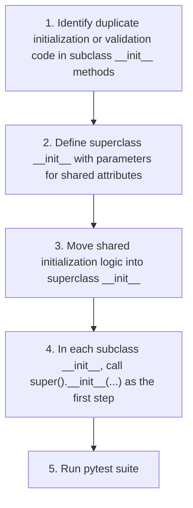

# Pull Up Constructor Body ⬆️

## Source Reference
* **Book:** *Dive Into Refactoring* (Alexander Shvets), Chapter: *Refactoring Techniques / Dealing with Generalization / Pull Up Constructor Body*
* **Fixes Code Smells:** [Duplicate Code](../../code-smells/dispensables/duplicate-code.md)
* **Target Language:** Modern Python 3 (Python 3.10+) with `pytest`.

---

## 1. Intent and Motivation

Your subclasses have **constructors (`__init__`) that contain code that is mostly identical** (e.g., verifying parameters, initializing shared attributes, or setting default timestamps).

**Create a superclass constructor and move the common code into it. Call it from the subclass constructors using `super().__init__(...)`.**

Subclass constructors should only be responsible for initializing attributes unique to that specific subclass. Pulling common initialization up into the superclass ensures that shared invariants and validations are executed consistently.

---

## 2. Step-by-Step Mechanics



1. **Identify Common Initialization:** Compare `__init__` methods of sibling subclasses.
2. **Move to Superclass:** Transfer shared attribute assignments and validation checks into the superclass constructor.
3. **Invoke Super:** In subclass constructors, call `super().__init__(shared_args)` and retain only subclass-specific initialization.
4. **Test:** Run tests.

---

## 3. Python Before & After Demonstration

### A. Smelly / Legacy Code (Duplicated Parameter Validation in Subclasses)
```python
# manager_smelly.py
class Employee:
  pass


class Manager(Employee):

  def __init__(self, name: str, id_code: str, grade: int) -> None:
    # Duplicated initialization and validation:
    if not name.strip():
      raise ValueError("Name cannot be empty")
    self.name = name
    self.id_code = id_code
    self.grade = grade


class Engineer(Employee):

  def __init__(self, name: str, id_code: str, language: str) -> None:
    # Duplicated initialization and validation:
    if not name.strip():
      raise ValueError("Name cannot be empty")
    self.name = name
    self.id_code = id_code
    self.language = language
```

### B. Pytest Baseline Contract
```python
# test_manager.py
import pytest
from manager_smelly import Engineer, Manager


def test_employee_initialization():
  mgr = Manager("Bruce", "M-1", 3)
  eng = Engineer("Clark", "E-2", "Python")

  assert mgr.name == "Bruce"
  assert eng.language == "Python"

  with pytest.raises(ValueError):
    Manager("   ", "M-1", 1)
```

### C. Refactored Clean Code (Pulled Up Constructor Body)
```python
# manager_clean.py
class Employee:
  """Base class encapsulating shared constructor validation and initialization."""

  def __init__(self, name: str, id_code: str) -> None:
    if not name.strip():
      raise ValueError("Name cannot be empty")
    self.name = name
    self.id_code = id_code


class Manager(Employee):

  def __init__(self, name: str, id_code: str, grade: int) -> None:
    super().__init__(name, id_code)
    self.grade = grade


class Engineer(Employee):

  def __init__(self, name: str, id_code: str, language: str) -> None:
    super().__init__(name, id_code)
    self.language = language
```

---

## 4. Complexity, Trade-offs & Anti-patterns

* **Order of Execution:** In Python, call `super().__init__()` at the *beginning* of the subclass constructor to ensure the base state is fully initialized before the subclass attempts to access or configure it.

---

## 5. Related Techniques & Design Patterns

* **Companion:** [Pull Up Field](pull-up-field.md), [Pull Up Method](pull-up-method.md).
