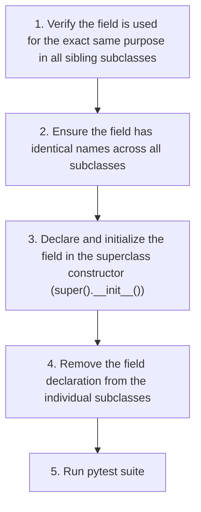

# Pull Up Field ⬆️

## Source Reference
* **Book:** *Dive Into Refactoring* (Alexander Shvets), Chapter: *Refactoring Techniques / Dealing with Generalization / Pull Up Field*
* **Fixes Code Smells:** [Duplicate Code](../../code-smells/dispensables/duplicate-code.md)
* **Target Language:** Modern Python 3 (Python 3.10+) with `pytest`.

---

## 1. Intent and Motivation

Two or more sibling subclasses **define the exact same field (instance variable)** for the exact same purpose.

**Move the field up into their common superclass to eliminate duplication and unify data modeling.**

When sibling subclasses define identical fields independently, they risk drifting apart in naming (e.g., `name` in one class, `full_name` in another) and prevent methods that operate on that field from being pulled up to the superclass.

---

## 2. Step-by-Step Mechanics



1. **Verify Purpose:** Confirm that the fields represent the identical domain concept across subclasses.
2. **Harmonize Names:** If subclasses use slightly different names (`name` vs `full_name`), rename them first.
3. **Move to Superclass:** Add the field initialization to `BaseClass.__init__`.
4. **Remove from Subclasses:** Call `super().__init__(field_val)` and remove redundant assignments.
5. **Test:** Verify with `pytest`.

---

## 3. Python Before & After Demonstration

### A. Smelly / Legacy Code (Duplicated `name` Field in Sibling Subclasses)
```python
# employee_smelly.py
class Employee:
  pass


class Engineer(Employee):

  def __init__(self, name: str, skill_level: int) -> None:
    # Duplicated field:
    self.name = name
    self.skill_level = skill_level


class Salesman(Employee):

  def __init__(self, name: str, quota: float) -> None:
    # Duplicated field:
    self.name = name
    self.quota = quota
```

### B. Pytest Baseline Contract
```python
# test_employee.py
from employee_smelly import Engineer, Salesman


def test_employee_names():
  eng = Engineer("Ada", 5)
  sales = Salesman("Bob", 100_000.0)
  assert eng.name == "Ada"
  assert sales.name == "Bob"
```

### C. Refactored Clean Code (Field Pulled Up to Superclass)
```python
# employee_clean.py
class Employee:
  """Base class unifying common employee fields."""

  def __init__(self, name: str) -> None:
    self.name = name


class Engineer(Employee):

  def __init__(self, name: str, skill_level: int) -> None:
    super().__init__(name)
    self.skill_level = skill_level


class Salesman(Employee):

  def __init__(self, name: str, quota: float) -> None:
    super().__init__(name)
    self.quota = quota
```

---

## 4. Complexity, Trade-offs & Anti-patterns

* **Opposite:** [Push Down Field](push-down-field.md).
* **Next Steps:** Once fields are pulled up, common methods operating on those fields can be pulled up using [Pull Up Method](pull-up-method.md).

---

## 5. Related Techniques & Design Patterns

* **Companion:** [Pull Up Method](pull-up-method.md), [Pull Up Constructor Body](pull-up-constructor-body.md).
* **Opposite:** [Push Down Field](push-down-field.md).
