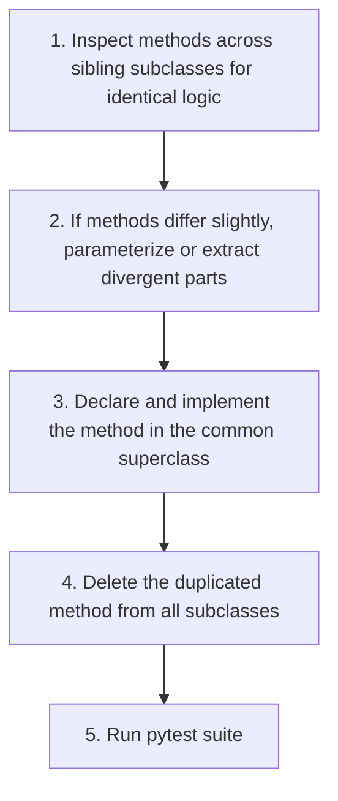

# Pull Up Method ⬆️

## Source Reference
* **Book:** *Dive Into Refactoring* (Alexander Shvets), Chapter: *Refactoring Techniques / Dealing with Generalization / Pull Up Method*
* **Fixes Code Smells:** [Duplicate Code](../../code-smells/dispensables/duplicate-code.md)
* **Target Language:** Modern Python 3 (Python 3.10+) with `pytest`.

---

## 1. Intent and Motivation

Your subclasses have **methods that perform identical (or nearly identical) work**.

**Make the methods identical across subclasses and pull them up into their common superclass.**

Duplicated methods across sibling subclasses are the primary cause of logic drift. A bug fixed in `Salesman.generate_report()` remains unfixed in `Engineer.generate_report()`. Pulling the method up guarantees a single source of truth.

---

## 2. Step-by-Step Mechanics



1. **Compare Implementations:** Ensure the methods perform the identical conceptual task.
2. **Harmonize Signatures & Fields:** Ensure any fields or helper methods called by the method exist on the superclass (or are declared abstract).
3. **Move to Superclass:** Implement the method on the parent class.
4. **Remove from Subclasses:** Delete the method definitions in the subclasses.
5. **Test:** Run tests.

---

## 3. Python Before & After Demonstration

### A. Smelly / Legacy Code (Duplicated Formatting Method in Subclasses)
```python
# report_smelly.py
class Employee:

  def __init__(self, name: str, id_code: str) -> None:
    self.name = name
    self.id_code = id_code


class Engineer(Employee):

  # Duplicated method:
  def get_display_badge(self) -> str:
    return f"[{self.id_code}] {self.name.upper()}"


class Salesman(Employee):

  # Duplicated method:
  def get_display_badge(self) -> str:
    return f"[{self.id_code}] {self.name.upper()}"
```

### B. Pytest Baseline Contract
```python
# test_report.py
from report_smelly import Engineer, Salesman


def test_badges():
  eng = Engineer("Alice", "ENG-01")
  sales = Salesman("Bob", "SLS-02")
  assert eng.get_display_badge() == "[ENG-01] ALICE"
  assert sales.get_display_badge() == "[SLS-02] BOB"
```

### C. Refactored Clean Code (Method Pulled Up to Employee)
```python
# report_clean.py
class Employee:
  """Base class encapsulating shared badge formatting for all employee types."""

  def __init__(self, name: str, id_code: str) -> None:
    self.name = name
    self.id_code = id_code

  def get_display_badge(self) -> str:
    """Pulled up method: Single source of truth."""
    return f"[{self.id_code}] {self.name.upper()}"


class Engineer(Employee):
  pass


class Salesman(Employee):
  pass
```

---

## 4. Complexity, Trade-offs & Anti-patterns

* **Divergent Steps:** If the methods share the same general skeleton but differ in one or two steps, do not pull up the method as a monolith. Instead, use [Form Template Method](form-template-method.md).

---

## 5. Related Techniques & Design Patterns

* **Opposite:** [Push Down Method](push-down-method.md).
* **Next Level:** [Form Template Method](form-template-method.md).
