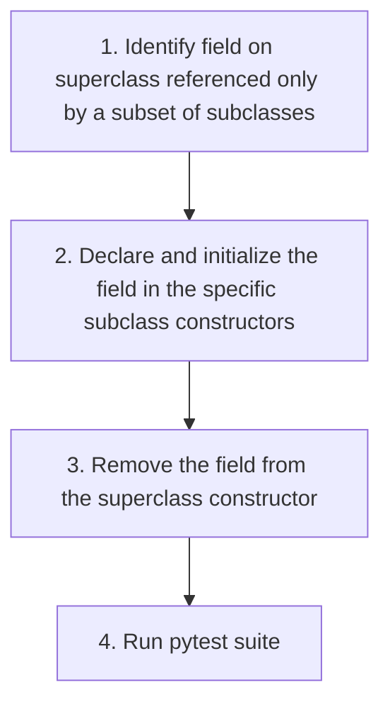

# Push Down Field ⬇️

## Source Reference
* **Book:** *Dive Into Refactoring* (Alexander Shvets), Chapter: *Refactoring Techniques / Dealing with Generalization / Push Down Field*
* **Target Language:** Modern Python 3 (Python 3.10+) with `pytest`.

---

## 1. Intent and Motivation

A field (instance attribute) defined on a superclass is **used only by one or two subclasses, and is completely irrelevant to the remaining subclasses**.

**Move the field down from the superclass into the specific subclasses that actually use it.**

Keeping specialized attributes on a general base class clutters the base class constructor, wastes memory across all instances of unrelated subclasses, and leads to confusion over why an attribute exists on classes that never use it.

---

## 2. Step-by-Step Mechanics



1. **Locate Specialized Field:** Identify an attribute in the parent class that is only accessed by a specific subclass.
2. **Move to Subclass:** Initialize the attribute inside the subclass's `__init__`.
3. **Remove from Superclass:** Delete the attribute from the superclass.
4. **Test:** Verify with `pytest`.

---

## 3. Python Before & After Demonstration

### A. Smelly / Legacy Code (Base Employee Polluted with Sales-Only Quota Field)
```python
# employee_smelly.py
class Employee:

  def __init__(self, name: str, quota: float | None = None) -> None:
    self.name = name
    # Smelly: 'quota' is relevant ONLY to Salesman, but stored on base Employee!
    self.quota = quota


class Engineer(Employee):
  pass


class Salesman(Employee):
  pass
```

### B. Pytest Baseline Contract
```python
# test_employee.py
from employee_smelly import Engineer, Salesman


def test_employee_quota():
  sales = Salesman("Alice", quota=50_000.0)
  eng = Engineer("Bob", quota=None)  # Meaningless None on Engineer

  assert sales.quota == 50_000.0
  assert eng.quota is None
```

### C. Refactored Clean Code (Field Pushed Down to Salesman)
```python
# employee_clean.py
class Employee:
  """Clean base class: Contains strictly universal employee fields."""

  def __init__(self, name: str) -> None:
    self.name = name


class Engineer(Employee):
  """Engineer constructor is clean and uncluttered."""

  pass


class Salesman(Employee):
  """Salesman explicitly declares and owns the quota attribute."""

  def __init__(self, name: str, quota: float) -> None:
    super().__init__(name)
    self.quota = quota
```

---

## 4. Complexity, Trade-offs & Anti-patterns

* **Opposite:** [Pull Up Field](pull-up-field.md).
* **Companion:** [Push Down Method](push-down-method.md).

---

## 5. Related Techniques & Design Patterns

* **Opposite:** [Pull Up Field](pull-up-field.md).
* **Companion:** [Push Down Method](push-down-method.md).
