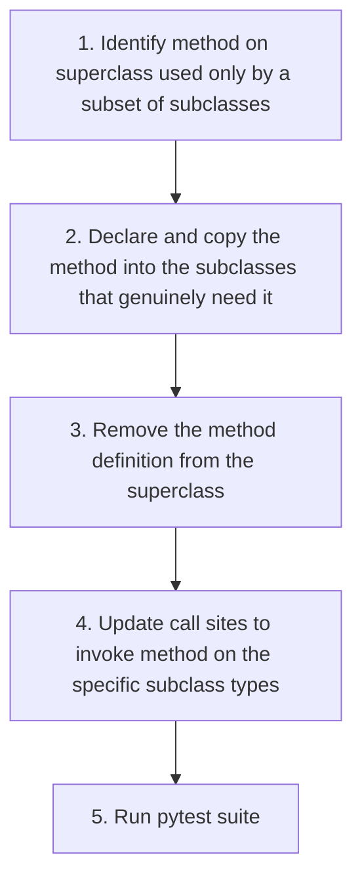

# Push Down Method ⬇️

## Source Reference
* **Book:** *Dive Into Refactoring* (Alexander Shvets), Chapter: *Refactoring Techniques / Dealing with Generalization / Push Down Method*
* **Fixes Code Smells:** [Refused Bequest](../../code-smells/oo-abusers/refused-bequest.md)
* **Target Language:** Modern Python 3 (Python 3.10+) with `pytest`.

---

## 1. Intent and Motivation

A method defined on a superclass is **relevant or implemented for only one or two subclasses, and is meaningless or harmful for the remaining subclasses**.

**Move the method down from the superclass into the specific subclasses that actually need it.**

Defining specialized methods on a general base class causes [Refused Bequest](../../code-smells/oo-abusers/refused-bequest.md). Other subclasses inherit methods they cannot fulfill, forcing them to raise `NotImplementedError` or provide empty dummy implementations.

---

## 2. Step-by-Step Mechanics



1. **Identify Candidates:** Find methods on the superclass that other subclasses override with `pass` or `raise NotImplementedError`.
2. **Move to Relevant Subclasses:** Copy the method implementation directly into the subclasses that need it.
3. **Delete from Base:** Remove the method from the superclass.
4. **Test:** Verify with `pytest`.

---

## 3. Python Before & After Demonstration

### A. Smelly / Legacy Code (Base Class Polluted with Subclass-Specific Behavior)
```python
# vehicle_smelly.py
class Vehicle:

  def __init__(self, name: str) -> None:
    self.name = name

  # Smelly: Only Airplanes can fly! Cars and Boats refuse this bequest:
  def fly(self) -> str:
    return f"{self.name} is taking off into the clouds!"


class Car(Vehicle):

  def fly(self) -> str:
    raise NotImplementedError("Cars cannot fly!")


class Airplane(Vehicle):
  pass
```

### B. Pytest Baseline Contract
```python
# test_vehicle.py
import pytest
from vehicle_smelly import Airplane, Car


def test_vehicles():
  plane = Airplane("Boeing 747")
  car = Car("Tesla")

  assert "taking off" in plane.fly()
  with pytest.raises(NotImplementedError):
    car.fly()
```

### C. Refactored Clean Code (Method Pushed Down to Airplane)
```python
# vehicle_clean.py
class Vehicle:
  """Clean base class with truly universal vehicle features."""

  def __init__(self, name: str) -> None:
    self.name = name


class Car(Vehicle):
  """Car is no longer burdened by flying methods."""

  pass


class Airplane(Vehicle):
  """Airplane explicitly owns the flying capability."""

  def fly(self) -> str:
    return f"{self.name} is taking off into the clouds!"
```

---

## 4. Complexity, Trade-offs & Anti-patterns

* **Polymorphic Calling Caution:** If external client code was polymorphically calling `vehicle.fly()` on a mixed list of vehicles, pushing the method down will cause `AttributeError` on non-flying vehicles. Ensure clients only invoke `fly()` on verified aerial vehicles (or use an explicit `Flyable` Protocol).

---

## 5. Related Techniques & Design Patterns

* **Opposite:** [Pull Up Method](pull-up-method.md).
* **Fixes:** [Refused Bequest](../../code-smells/oo-abusers/refused-bequest.md).
