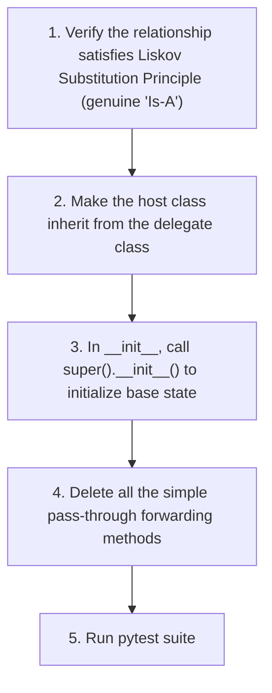

# Replace Delegation with Inheritance 🏛️

## Source Reference
* **Book:** *Dive Into Refactoring* (Alexander Shvets), Chapter: *Refactoring Techniques / Dealing with Generalization / Replace Delegation with Inheritance*
* **Fixes Code Smells:** [Middle Man](../../code-smells/couplers/middle-man.md)
* **Target Language:** Modern Python 3 (Python 3.10+) with `pytest`.

---

## 1. Intent and Motivation

A class contains **numerous simple methods that do nothing except delegate calls to all the methods of another class**. The relationship between the two classes is a genuine "Is-A" relationship, and every method on the delegate is appropriate for the host class.

**Make the host class inherit directly from the delegate class, and eliminate all the pass-through delegating methods.**

While composition is generally preferred over inheritance, blindly avoiding inheritance when a true subtyping relationship exists leads to the [Middle Man](../../code-smells/couplers/middle-man.md) code smell. If Class A genuinely is a specialized variant of Class B and needs all of B's interface, inheritance is simpler and cleaner.

---

## 2. Step-by-Step Mechanics



1. **Verify LSP:** Ensure the subclass can be substituted everywhere the delegate is expected without breaking invariants.
2. **Inherit:** Add `(DelegateClass)` to the class definition.
3. **Call Super:** Update `__init__` to invoke `super().__init__(...)`.
4. **Delete Delegates:** Remove the forwarding methods that simply passed calls along.
5. **Test:** Verify with `pytest`.

---

## 3. Python Before & After Demonstration

### A. Smelly / Legacy Code (Middle Man Forwarding Every Single Method)
```python
# person_smelly.py
class Person:

  def __init__(self, name: str) -> None:
    self.name = name

  def get_name(self) -> str:
    return self.name

  def get_formal_greeting(self) -> str:
    return f"Hello, {self.name}"


class Employee:
  """Smelly: Employee is a Person, but duplicates every Person method with pass-through delegation."""

  def __init__(self, name: str, employee_id: str) -> None:
    self._person = Person(name)
    self.employee_id = employee_id

  # Pass-through boilerplate:
  def get_name(self) -> str:
    return self._person.get_name()

  def get_formal_greeting(self) -> str:
    return self._person.get_formal_greeting()
```

### B. Pytest Baseline Contract
```python
# test_person.py
from person_smelly import Employee


def test_employee_greeting():
  emp = Employee("Alice", "EMP-01")
  assert emp.get_name() == "Alice"
  assert emp.get_formal_greeting() == "Hello, Alice"
```

### C. Refactored Clean Code (Inheritance Eliminates Forwarding Boilerplate)
```python
# person_clean.py
class Person:

  def __init__(self, name: str) -> None:
    self.name = name

  def get_name(self) -> str:
    return self.name

  def get_formal_greeting(self) -> str:
    return f"Hello, {self.name}"


class Employee(Person):
  """Clean class: Inherits genuine Person capabilities directly with zero forwarding boilerplate."""

  def __init__(self, name: str, employee_id: str) -> None:
    super().__init__(name)
    self.employee_id = employee_id
```

---

## 4. Complexity, Trade-offs & Anti-patterns

* **Never Use If Refusing Bequest:** If the class only needs 2 out of 10 methods from the delegate, do *not* inherit. Use [Replace Inheritance with Delegation](replace-inheritance-with-delegation.md).

---

## 5. Related Techniques & Design Patterns

* **Opposite:** [Replace Inheritance with Delegation](replace-inheritance-with-delegation.md).
* **Fixes:** [Middle Man](../../code-smells/couplers/middle-man.md).
