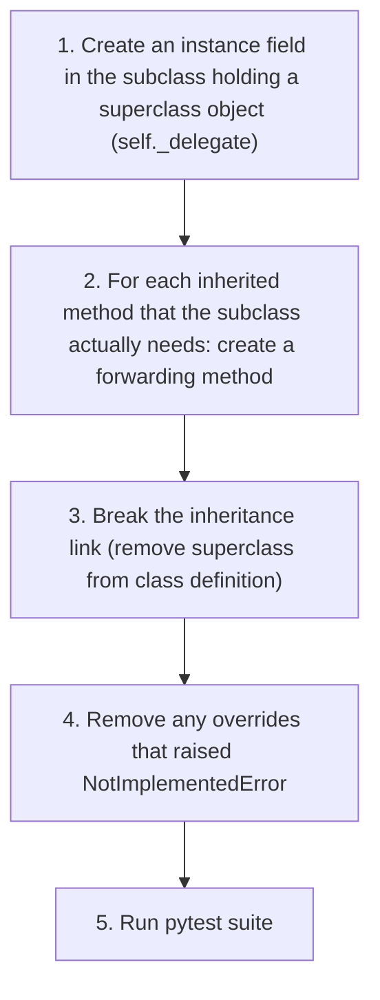

# Replace Inheritance with Delegation 🔄

## Source Reference
* **Book:** *Dive Into Refactoring* (Alexander Shvets), Chapter: *Refactoring Techniques / Dealing with Generalization / Replace Inheritance with Delegation*
* **Design Principle Bridge:** *Favor Object Composition over Class Inheritance (GoF)*
* **Fixes Code Smells:** [Refused Bequest](../../code-smells/oo-abusers/refused-bequest.md)
* **Target Language:** Modern Python 3 (Python 3.10+) with `pytest`.

---

## 1. Intent and Motivation

You have a subclass that **uses only a small fraction of the methods and attributes inherited from its superclass**, or the subclass violates the Liskov Substitution Principle (LSP) by raising errors on inherited methods.

**Create a private field in the subclass holding an instance of the superclass (`self._delegate`), delegate only the required methods to this delegate, and remove the inheritance relationship completely.**

Inheritance creates the tightest possible coupling between two classes in object-oriented programming. Subclassing purely for code reuse (e.g., subclassing `list` to make a `Stack`, or subclassing `dict` to make a `ConfigStore`) leaks unwanted public APIs and breaks invariants. Composition via delegation gives you 100% control over the exposed API.

---

## 2. Step-by-Step Mechanics



1. **Add Delegate Field:** In `__init__`, initialize `self._delegate = Superclass(...)`.
2. **Implement Forwarding Methods:** For each method the class legitimately needs, write an explicit forwarding method calling `self._delegate.method(...)`.
3. **Break Inheritance:** Remove `(Superclass)` from the class header.
4. **Delete Refused Overrides:** Remove dummy `raise NotImplementedError` methods.
5. **Test:** Run tests.

---

## 3. Python Before & After Demonstration

### A. Smelly / Legacy Code (Stack Subclassing List - Refused Bequest)
```python
# stack_smelly.py
class CustomStack(list):
  """Smelly: Inherits from list, exposing insert(), sort(), and reverse()."""

  def push(self, item: object) -> None:
    self.append(item)

  # Refusing inherited methods:
  def insert(self, index: int, item: object) -> None:
    raise NotImplementedError("Arbitrary insertion illegal in LIFO stack")
```

### B. Pytest Baseline Contract
```python
# test_stack.py
import pytest
from stack_smelly import CustomStack


def test_stack_operations():
  stack = CustomStack()
  stack.push("Alpha")
  stack.push("Beta")
  assert stack.pop() == "Beta"

  with pytest.raises(NotImplementedError):
    stack.insert(0, "Illegal")
```

### C. Refactored Clean Code (Composition & Delegation)
```python
# stack_clean.py
from typing import Generic, TypeVar

T = TypeVar("T")


class SafeStack(Generic[T]):
  """Clean class: Uses delegation. Only genuine Stack methods are exposed."""

  def __init__(self) -> None:
    # Delegate object held via private composition:
    self._storage: list[T] = []

  def push(self, item: T) -> None:
    self._storage.append(item)

  def pop(self) -> T:
    if not self._storage:
      raise IndexError("pop from empty stack")
    return self._storage.pop()

  def peek(self) -> T:
    if not self._storage:
      raise IndexError("peek at empty stack")
    return self._storage[-1]

  @property
  def size(self) -> int:
    return len(self._storage)
```

---

## 4. Complexity, Trade-offs & Anti-patterns

* **Middle Man Warning:** If you find yourself forwarding 40+ methods without adding any logic or filtering, the relationship might genuinely be an "Is-A" subtyping relationship after all. In that case, use [Replace Delegation with Inheritance](replace-delegation-with-inheritance.md).

---

## 5. Related Techniques & Design Patterns

* **Opposite:** [Replace Delegation with Inheritance](replace-delegation-with-inheritance.md).
* **Fixes:** [Refused Bequest](../../code-smells/oo-abusers/refused-bequest.md).
* **Companion Pattern:** [Adapter Pattern](../../../design-patterns/structural/adapter.md), [Decorator Pattern](../../../design-patterns/structural/decorator.md).
