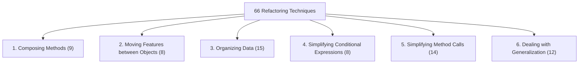

# The 66 Refactoring Techniques 🛠️

## Source Reference
* **Book:** *Dive Into Refactoring* (Alexander Shvets), Part 2: *Refactoring Techniques*
* **Companion Discipline:** [Dive Into Design Patterns](../../design-patterns/index.md)
* **Target Language:** Modern Python 3 (Python 3.10+) with `pytest` verification contracts.

---

## Overview

Refactoring techniques are the concrete, step-by-step transformations used to cure [Code Smells](../code-smells/index.md). Each technique prescribes a safe, incremental micro-procedure that modifies internal code structure without altering external observable behavior.

---

## The 6 Technique Groups

### [1. Composing Methods](composing-methods/index.md) (9 Techniques)
Much of refactoring is devoted to correctly composing methods to eliminate long methods and code duplication.
* [Extract Method](composing-methods/extract-method.md)
* [Inline Method](composing-methods/inline-method.md)
* [Extract Variable](composing-methods/extract-variable.md)
* [Inline Temp](composing-methods/inline-temp.md)
* [Replace Temp with Query](composing-methods/replace-temp-with-query.md)
* [Split Temporary Variable](composing-methods/split-temporary-variable.md)
* [Remove Assignments to Parameters](composing-methods/remove-assignments-to-parameters.md)
* [Replace Method with Method Object](composing-methods/replace-method-with-method-object.md)
* [Substitute Algorithm](composing-methods/substitute-algorithm.md)

### [2. Moving Features between Objects](moving-features/index.md) (8 Techniques)
Safely shifting responsibilities between classes to fix feature envy, inappropriate intimacy, and bloated containers.
* [Move Method](moving-features/move-method.md)
* [Move Field](moving-features/move-field.md)
* [Extract Class](moving-features/extract-class.md)
* [Inline Class](moving-features/inline-class.md)
* [Hide Delegate](moving-features/hide-delegate.md)
* [Remove Middle Man](moving-features/remove-middle-man.md)
* [Introduce Foreign Method](moving-features/introduce-foreign-method.md)
* [Introduce Local Extension](moving-features/introduce-local-extension.md)

### [3. Organizing Data](organizing-data/index.md) (15 Techniques)
Replacing primitive values and raw collections with rich domain classes and value objects.
* [Self Encapsulate Field](organizing-data/self-encapsulate-field.md)
* [Replace Data Value with Object](organizing-data/replace-data-value-with-object.md)
* [Change Value to Reference](organizing-data/change-value-to-reference.md)
* [Change Reference to Value](organizing-data/change-reference-to-value.md)
* [Replace Array/Dict with Object](organizing-data/replace-array-with-object.md)
* [Duplicate Observed Data](organizing-data/duplicate-observed-data.md)
* [Change Unidirectional Association to Bidirectional](organizing-data/change-unidirectional-to-bidirectional.md)
* [Change Bidirectional Association to Unidirectional](organizing-data/change-bidirectional-to-unidirectional.md)
* [Replace Magic Number with Symbolic Constant](organizing-data/replace-magic-number.md)
* [Encapsulate Field](organizing-data/encapsulate-field.md)
* [Encapsulate Collection](organizing-data/encapsulate-collection.md)
* [Replace Type Code with Class](organizing-data/replace-type-code-with-class.md)
* [Replace Type Code with Subclasses](organizing-data/replace-type-code-with-subclasses.md)
* [Replace Type Code with State/Strategy](organizing-data/replace-type-code-with-state-strategy.md)
* [Replace Subclass with Fields](organizing-data/replace-subclass-with-fields.md)

### [4. Simplifying Conditional Expressions](simplifying-conditionals/index.md) (8 Techniques)
Transforming tangled boolean branching into clean, readable guard clauses and polymorphic strategies.
* [Decompose Conditional](simplifying-conditionals/decompose-conditional.md)
* [Consolidate Conditional Expression](simplifying-conditionals/consolidate-conditional-expression.md)
* [Consolidate Duplicate Conditional Fragments](simplifying-conditionals/consolidate-duplicate-conditional-fragments.md)
* [Remove Control Flag](simplifying-conditionals/remove-control-flag.md)
* [Replace Nested Conditional with Guard Clauses](simplifying-conditionals/replace-nested-conditional-with-guard-clauses.md)
* [Replace Conditional with Polymorphism](simplifying-conditionals/replace-conditional-with-polymorphism.md)
* [Introduce Null Object](simplifying-conditionals/introduce-null-object.md)
* [Introduce Assertion](simplifying-conditionals/introduce-assertion.md)

### [5. Simplifying Method Calls](simplifying-method-calls/index.md) (14 Techniques)
Refining interfaces, parameter lists, and invocation mechanics to make method calls self-documenting.
* [Rename Method](simplifying-method-calls/rename-method.md)
* [Add Parameter](simplifying-method-calls/add-parameter.md)
* [Remove Parameter](simplifying-method-calls/remove-parameter.md)
* [Separate Query from Modifier (CQS)](simplifying-method-calls/separate-query-from-modifier.md)
* [Parameterize Method](simplifying-method-calls/parameterize-method.md)
* [Replace Parameter with Explicit Methods](simplifying-method-calls/replace-parameter-with-explicit-methods.md)
* [Preserve Whole Object](simplifying-method-calls/preserve-whole-object.md)
* [Replace Parameter with Method Call](simplifying-method-calls/replace-parameter-with-method-call.md)
* [Introduce Parameter Object](simplifying-method-calls/introduce-parameter-object.md)
* [Remove Setting Method (Immutability)](simplifying-method-calls/remove-setting-method.md)
* [Hide Method](simplifying-method-calls/hide-method.md)
* [Replace Constructor with Factory Method](simplifying-method-calls/replace-constructor-with-factory-method.md)
* [Replace Error Code with Exception](simplifying-method-calls/replace-error-code-with-exception.md)
* [Replace Exception with Test](simplifying-method-calls/replace-exception-with-test.md)

### [6. Dealing with Generalization](generalization/index.md) (12 Techniques)
Managing class hierarchies, abstracting common functionality, and replacing rigid inheritance with flexible composition.
* [Pull Up Field](generalization/pull-up-field.md)
* [Pull Up Method](generalization/pull-up-method.md)
* [Pull Up Constructor Body](generalization/pull-up-constructor-body.md)
* [Push Down Method](generalization/push-down-method.md)
* [Push Down Field](generalization/push-down-field.md)
* [Extract Subclass](generalization/extract-subclass.md)
* [Extract Superclass](generalization/extract-superclass.md)
* [Extract Interface / Protocol](generalization/extract-interface.md)
* [Collapse Hierarchy](generalization/collapse-hierarchy.md)
* [Form Template Method](generalization/form-template-method.md)
* [Replace Inheritance with Delegation](generalization/replace-inheritance-with-delegation.md)
* [Replace Delegation with Inheritance](generalization/replace-delegation-with-inheritance.md)
