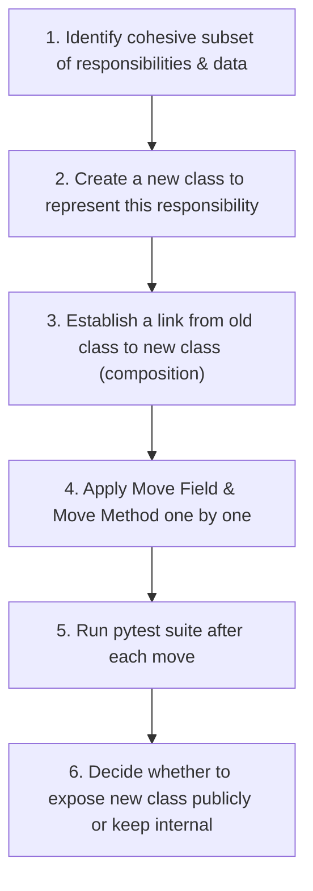

# Extract Class 🏛️

## Source Reference
* **Book:** *Dive Into Refactoring* (Alexander Shvets), Chapter: *Refactoring Techniques / Moving Features between Objects / Extract Class*
* **Fixes Code Smells:** [Large Class](../../code-smells/bloaters/large-class.md), [Divergent Change](../../code-smells/change-preventers/divergent-change.md), [Data Clumps](../../code-smells/bloaters/data-clumps.md)
* **Target Language:** Modern Python 3 (Python 3.10+) with `pytest`.

---

## 1. Intent and Motivation

When one class **does the work of two**, the class has grown bloated and violates the Single Responsibility Principle (SRP). **Create a new class and move the relevant fields and methods from the old class into the new class.**

Extract Class is the primary tool for splitting up "God Classes". Signs that a class should be split include subsets of data that always change together, or prefixes on attributes (e.g., `office_area_code`, `office_phone_number`).

---

## 2. Step-by-Step Mechanics



1. **Define Responsibility:** Give the new class a crisp, focused name representing the extracted concept.
2. **Establish Composition Link:** In the old class's `__init__`, instantiate or inject an instance of the new class.
3. **Move Fields:** Use [Move Field](move-field.md) to transfer instance variables to the new class.
4. **Move Methods:** Use [Move Method](move-method.md) to transfer behavior to the new class.
5. **Run Tests:** Verify each small step with `pytest`.

---

## 3. Python Before & After Demonstration

### A. Smelly / Legacy Code (Person Class Absorbing Telephone Responsibilities)
```python
# person_smelly.py
class Person:

  def __init__(
      self, name: str, office_area_code: str, office_number: str
  ) -> None:
    self.name = name
    # Telephone data clumped directly on Person:
    self.office_area_code = office_area_code
    self.office_number = office_number

  def get_telephone_number(self) -> str:
    return f"({self.office_area_code}) {self.office_number}"
```

### B. Pytest Baseline Contract
```python
# test_person.py
from person_smelly import Person


def test_telephone_formatting():
  person = Person("Alice", "415", "555-1234")
  assert person.get_telephone_number() == "(415) 555-1234"
```

### C. Refactored Clean Code (Extracted TelephoneNumber Class)
```python
# person_clean.py
from dataclasses import dataclass


@dataclass(frozen=True)
class TelephoneNumber:
  """Extracted cohesive class managing telephone state and formatting."""

  area_code: str
  number: str

  @property
  def formatted(self) -> str:
    return f"({self.area_code}) {self.number}"


class Person:
  """Clean class composed with TelephoneNumber."""

  def __init__(
      self, name: str, office_area_code: str, office_number: str
  ) -> None:
    self.name = name
    self._office_telephone = TelephoneNumber(
        office_area_code, office_number
    )

  @property
  def office_telephone(self) -> TelephoneNumber:
    return self._office_telephone

  def get_telephone_number(self) -> str:
    return self._office_telephone.formatted
```

---

## 4. Complexity, Trade-offs & Anti-patterns

* **Anti-Pattern: Excessive Granularity:** Splitting a class into 10 one-field classes increases navigation complexity without delivering domain clarity. Only extract when the extracted subset has a distinct lifecycle, independent identity, or can be reused.

---

## 5. Related Techniques & Design Patterns

* **Opposite:** [Inline Class](inline-class.md).
* **Companion:** [Move Method](move-method.md), [Move Field](move-field.md).
