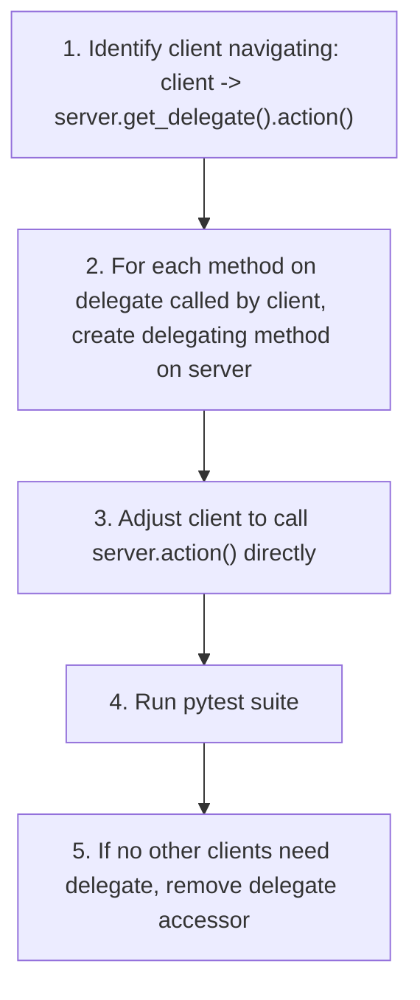

# Hide Delegate 🙈

## Source Reference
* **Book:** *Dive Into Refactoring* (Alexander Shvets), Chapter: *Refactoring Techniques / Moving Features between Objects / Hide Delegate*
* **Design Principle Bridge:** *Law of Demeter* ("Principle of Least Knowledge")
* **Fixes Code Smells:** [Message Chains](../../code-smells/couplers/message-chains.md), [Inappropriate Intimacy](../../code-smells/couplers/inappropriate-intimacy.md)
* **Target Language:** Modern Python 3 (Python 3.10+) with `pytest`.

---

## 1. Intent and Motivation

A client gets object B from a field or method of object A, and then calls a method on object B: `a.get_b().do_something()`. **Create a new method in class A that delegates the call to object B. Now the client does not know about or depend on class B.**

Hide Delegate enforces the **Law of Demeter** ("Only talk to your immediate friends"). When internal relationships change, clients remain completely insulated.

---

## 2. Step-by-Step Mechanics



1. **Create Delegating Method:** In the server class, define a method that forwards the call to the delegate.
2. **Update Client:** Change the client to call this new server method.
3. **Test:** Run tests after updating each client.
4. **Encapsulate Delegate:** If no external clients need access to the delegate object directly, make the delegate private (`_delegate`).

---

## 3. Python Before & After Demonstration

### A. Smelly / Legacy Code (Client Violating Demeter on Person and Department)
```python
# demeter_smelly.py
class Department:

  def __init__(self, charge_code: str, manager: str) -> None:
    self.charge_code = charge_code
    self.manager = manager


class Person:

  def __init__(self, name: str, department: Department) -> None:
    self.name = name
    self.department = department


class PayrollReport:

  def print_person_manager(self, person: Person) -> str:
    # Smelly: Client navigates through Person to reach Department.manager
    return f"Manager: {person.department.manager}"
```

### B. Pytest Baseline Contract
```python
# test_demeter.py
from demeter_smelly import Department, PayrollReport, Person


def test_manager_reporting():
  dept = Department("FIN-101", "Sandra Bullock")
  person = Person("Keanu Reeves", dept)
  report = PayrollReport()

  assert report.print_person_manager(person) == "Manager: Sandra Bullock"
```

### C. Refactored Clean Code (Hide Delegate)
```python
# demeter_clean.py
class Department:

  def __init__(self, charge_code: str, manager: str) -> None:
    self.charge_code = charge_code
    self.manager = manager


class Person:
  """Clean class: Hides the Department delegate from external consumers."""

  def __init__(self, name: str, department: Department) -> None:
    self.name = name
    self._department = department

  @property
  def manager(self) -> str:
    """Delegating method hides Department object entirely."""
    return self._department.manager


class PayrollReport:
  """Clean client: Talks only to its immediate friend (Person)."""

  def print_person_manager(self, person: Person) -> str:
    return f"Manager: {person.manager}"
```

---

## 4. Complexity, Trade-offs & Anti-patterns

* **Middle Man Trap:** If you hide delegates too aggressively for dozens of methods, the server class turns into an empty [Middle Man](../../code-smells/couplers/middle-man.md). When that happens, apply [Remove Middle Man](remove-middle-man.md).

---

## 5. Related Techniques & Design Patterns

* **Opposite:** [Remove Middle Man](remove-middle-man.md).
* **Companion Pattern:** [Facade Pattern](../../../design-patterns/structural/facade.md).
